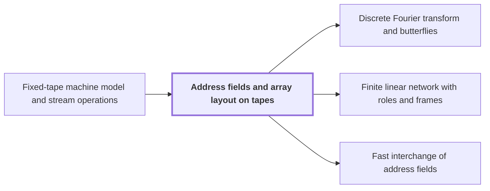

# Address fields and array layout on tapes

!!! info "Before this page"

    Address fields and array layout on tapes *is measured in* [Fixed-tape machine model and stream operations](fixed-tape-model.md "A layout's cost is measured in the Fixed-tape machine model and stream operations, where each step touches one cell per tape, so moving data is the cost to minimize.").

!!! abstract "Where this fits"

    - Relied on to show: Each procedure comes from a fixed linear network that exchanges two banks of values with prescribed signs and restores every auxiliary value; rows are distributed among $W$ roles and frames cancel along routes. ([Finite linear network with roles and frames](linear-network-roles.md "Fixed linear network exchanging two banks of values with prescribed signs and restoring auxiliary values; wires have roles, rows are distributed cyclically among roles, and invertible frame operators cancel along routes leaving an endpoint operator."))
    - Relied on to show: Two disjoint contiguous $u$-bit address fields can be interchanged in $O(Vu^\tau)$ for a fixed $\tau<1$, although the intermediate steps are XOR combinations. ([Fast interchange of address fields](fast-address-interchange.md "Interchange two disjoint contiguous u-bit address fields in an array in O(V u^τ) for fixed τ<1, via XOR combinations that end as an exact permutation."))
    - Relied on to show: The radix-digit coefficient list is placed on a product of distinct prime cyclic axes by a convolution-preserving Chinese-remainder map. ([Chinese-remainder map to prime cyclic axes](crt-address-map.md "Places the coefficient list on a product of distinct prime cyclic axes by a map preserving convolution, implemented via triangular controlled shifts and axis moves."))

??? note "Symbols from earlier pages"

    - $n$ — list length: The number of entries in each input and output coefficient list. (on [Convolution](convolution.md "Product of polynomials / combination of coefficient lists where entries sum by index (cyclic if indices wrap)."))

An address field is a contiguous block of address bits, and the choice of fields fixes how an array is laid out on a tape. The transform levels of the multiplication algorithm rearrange these fields, so the layout sets what each level costs.

An array is stored in tape order. Write $m$ for an item's position in tape order. The item at position $m$ sits in the $m$-th cell, and its address is $m$ written in binary. Write $u$ for the number of bits in one address field. Splitting the address bits into contiguous blocks of $u$ bits gives the address fields. An address is then a tuple of field values, and the set of all addresses is the Cartesian product of the fields' value sets.

Example. A 4-item array has two one-bit fields, the high bit and the low bit. Interchanging them sends the item at address $01$ to address $10$, the item at $10$ to $01$, and leaves the items at $00$ and $11$ in place. The items are unchanged; only their cells move.

Why levels rearrange fields. The transform is the discrete Fourier transform, which evaluates a coefficient list at roots of unity. It is computed in levels, each a layer of two-point butterflies that replace a pair of entries by their sum and difference, up to a scale factor. A level pairs entries whose addresses differ in one bit, and successive levels pair different bits. A fixed-tape machine combines two entries only when both are scanned together, so a level may first need an interchange of two disjoint address fields that brings its pair into the scanned position.

Rearranging is not free. A layout's cost is measured in the [Fixed-tape machine model and stream operations](fixed-tape-model.md "Machine with one fixed finite alphabet and a fixed number of one-dimensional tapes; each step touches one cell per tape, so data movement (scans, shifts, permutations) is the cost to minimize."), where each step touches one cell per tape, so moving data is the cost to minimize. Write $V$ for the stored bit volume, the total number of bits the array holds. Each entry is a fixed-width coefficient of $\Theta(\log n)$ bits, and the padded array holds $\Theta(n/\log n)$ entries, so $V=\Theta(n)$. Scanning all $\Theta(n)$ stored bits at each of the $\Theta(\log n)$ levels costs $\Theta(n\log n)$<cite class="exegenius-ref" data-source="paper" data-locator="§1.1 The two tape operations" data-quote="$\Theta(\log n)$ transform levels already costs $\Theta(n\log n)$" title="$\Theta(\log n)$ transform levels already costs $\Theta(n\log n)$"> (see §1.1 The two tape operations)</cite>.

## Connections

Used by:

- [Discrete Fourier transform and butterflies](dft-fft.md "On tapes, the transform is built from butterflies and the address rearrangements of Address fields and array layout on tapes.") *is built from* Address fields and array layout on tapes
- [Finite linear network with roles and frames](linear-network-roles.md "These rows are the suffixes of Address fields and array layout on tapes, so the network acts on rows indexed by those fields.") *acts on rows indexed by* Address fields and array layout on tapes
- [Fast interchange of address fields](fast-address-interchange.md "The procedure acts on arrays laid out as in Address fields and array layout on tapes, so each field is a block of $u$ contiguous bits.") *acts on arrays laid out* Address fields and array layout on tapes

??? quote "From the sources"

    > address rearrangements
    >
    > — [Integer multiplication below n log n (OpenAI, 2026)](https://github.com/openai/math/tree/fd4aeeb2ee4fc729c18d98444fed42fd0529eeeb/preprints/Integer-multiplication-below-n-log-n-September-23-2026)
