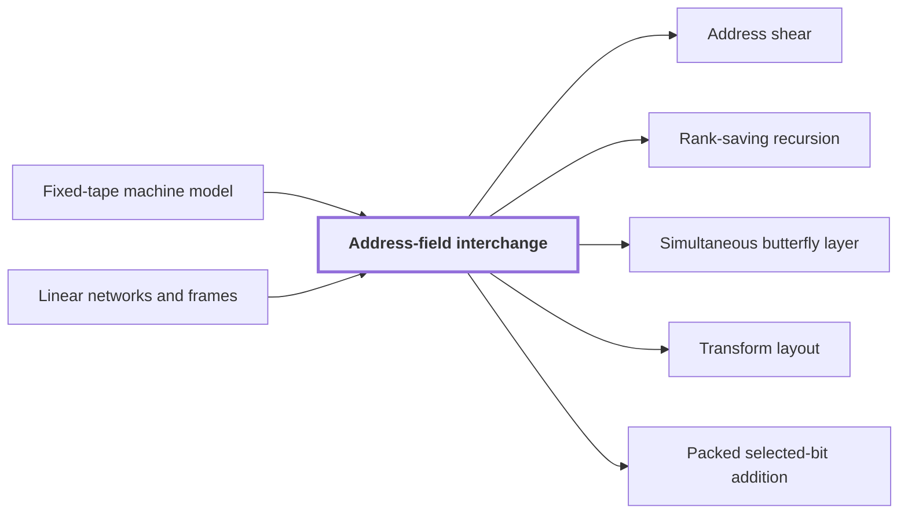

# Address-field interchange

!!! info "Before this page"

    Address-field interchange *runs on* [Fixed-tape machine model](fixed-tape-model.md "The procedure runs on a Fixed-tape machine model.") and *is built from* [Linear networks and frames](linear-network-frames.md "The procedure is built from a fixed Linear networks and frames network that exchanges two banks of values.").

!!! abstract "Where this fits"

    1. A deterministic fixed-tape machine multiplies two $n$-bit integers exactly in $O(n(\lg n)^{1-\kappa})$ time, with $\kappa=2^{-182}$, below the $n\lg n$ conjecture in this model. — how: bound the cost of an exact multiplication whose transform layers are made cheap by two tape procedures, then fix parameters so every cost term fits ([Integer multiplication below n log n](main-theorem.md "A deterministic fixed-tape machine that multiplies two n-bit integers exactly in O(n (lg n)^(1−κ)) time with κ = 2^−182, which disproves the n log n optimality conjecture in this model."))
    2. **This page:** Two disjoint equal address fields of $u$ bits in an array of stored volume $V$ can be interchanged in $O(V u^{\tau})$ time.

Address-field interchange is a tape procedure, a procedure carried out on the tapes of a Turing machine, that swaps two disjoint, contiguous address fields of an array<cite class="exegenius-ref" data-source="paper" data-locator="§11 A consequence for matrix transposition, p. 3" data-quote="The first procedure interchanges two disjoint contiguous address fields of u bits in an array" title="The first procedure interchanges two disjoint contiguous address fields of u bits in an array"> (see §11 A consequence for matrix transposition, p. 3)</cite>. The main result uses it to make the transform layers cheap, where a transform layer is one of the levels of the transform, each of which rearranges and combines the whole array. The cost of the procedure therefore matters.

An address field is a block of consecutive address bits. Let the array have stored volume $V$, the number of bits it stores. Each address field has $u$ bits, the width of the field. The procedure runs on a [Fixed-tape machine model](fixed-tape-model.md "A Turing machine with one fixed finite alphabet and one fixed finite number of one-dimensional tapes, whose size does not grow with the input.").

The exponent $\tau$ is a fixed constant with $\tau<1$, so $u^{\tau}$ grows more slowly than $u$ itself. The procedure runs in $O(V u^{\tau})$ time<cite class="exegenius-ref" data-source="paper" data-locator="§11 A consequence for matrix transposition, p. 3" data-quote="Its cost is O(V uτ ) for a fixed τ &lt; 1" title="Its cost is O(V uτ ) for a fixed τ &lt; 1"> (see §11 A consequence for matrix transposition, p. 3)</cite>.

The procedure is built from a fixed [Linear networks and frames](linear-network-frames.md "A fixed linear network that exchanges two banks of values while restoring scratch values, in which each vertex carries an invertible operator called its frame.") network that exchanges two banks of values. The network has scratch wires for temporary values and restores them, and the final permutation is exact for any initial scratch values<cite class="exegenius-ref" data-source="paper" data-locator="§11 A consequence for matrix transposition, p. 3" data-quote="The final permutation is exact for arbitrary initial auxiliary values" title="The final permutation is exact for arbitrary initial auxiliary values"> (see §11 A consequence for matrix transposition, p. 3)</cite>.

The network is applied recursively to streams. A stream is a block of stored values handled as one unit, here a fraction of the volume $V$. Each recursive level costs a strictly smaller power of $u$, because the network's edge ranks sum to less than its number of wires<cite class="exegenius-ref" data-source="paper" data-locator="§11 A consequence for matrix transposition, p. 20" data-quote="Because the sum of these ranks is less than the number of wires" title="Because the sum of these ranks is less than the number of wires"> (see §11 A consequence for matrix transposition, p. 20)</cite>.

For example, with $u=2$ and addresses written as pairs of 2-bit fields, the entry at address $(01,10)$ moves to address $(10,01)$, and every other entry moves by the same swap.

## Connections

Used by:

- [Address shear](address-shear.md "Address shear is the first of three address updates in an Address-field interchange.") *is the first of three* Address-field interchange
- [Rank-saving recursion](rank-saving-recursion.md "Rank-saving recursion is instantiated by address-field interchange, where the parameter $f$ counts field digits.") *is instantiated by* Address-field interchange
- [Simultaneous butterfly layer](simultaneous-butterfly-layer.md "The layer moves its address chunks by address-field interchange, which realizes these changes of basis.") *moves its address chunks by* Address-field interchange
- [Transform layout](transform-layout.md "Transform layout is reached by swapping contiguous chunks, as in Address-field interchange.") *is reached by swapping* Address-field interchange
- [Packed selected-bit addition](packed-bit-addition.md "Packed selected-bit addition is built from three streaming operations, fixed multitape procedures whose time grows with the volume they process: an address-field interchange of equal-width chunks, cyclic shifts of chunk ranges, and a fixed permutation of two-bit values.") *is built from* Address-field interchange

??? quote "From the sources"

    > The first procedure interchanges two disjoint contiguous address fields of u bits in an array
    >
    > — Integer multiplication below n log n (OpenAI, 2026)
