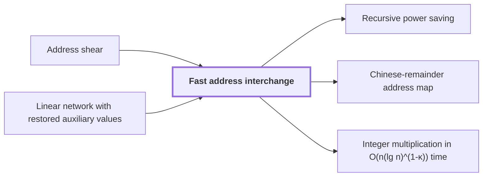

# Fast address interchange

!!! info "Before this page"

    Fast address interchange *is applied to each* [Address shear](address-shear.md "The procedure is applied to each Address shear that a layer (one stage of the transform) produces.") and *is realized by running* [Linear network with restored auxiliary values](linear-network-exchange.md "The shear is realized by running the Linear network with restored auxiliary values, whose gates act pointwise on the array."). Assumed known: Multitape Turing machine.

!!! abstract "Where this fits"

    1. Two $n$-bit integers can be multiplied exactly in $O(n(\lg n)^{1-\kappa})$ worst-case time on a deterministic multitape Turing machine, for a fixed $\kappa=2^{-182}$. — how: reduce the product to a digit convolution, compute that convolution through transform layers whose tape cost saves a power, and recover the exact product by rounding ([Integer multiplication in O(n(lg n)^(1-κ)) time](integer-multiplication-target.md "A deterministic multitape Turing machine that multiplies two n-bit integers exactly in O(n(lg n)^(1-κ)) worst-case time for a fixed κ = 2^(-182) > 0, beating the n log n conjecture in this model."))
    2. Both tape procedures cost $O(V)$ times a power of their parameter whose exponent is strictly below one. — how: give each procedure a fixed linear network with fewer smaller calls than roles, and iterate the resulting recursion ([Recursive power saving](recursive-power-saving.md "The mechanism in which a network with s smaller calls on W roles and parameter m gives a recursion with cost ratio s/W < m, so that repeated recursion saves a power of the parameter."))
    3. **This page:** The address interchange of $u$-bit fields costs $O(Vu^\tau)$ for a fixed $\tau<1$.

??? note "Symbols from earlier pages"

    - $H$ — first address group: The first group of address fields, a vector over a common residue ring with one entry for each row of A. (on [Address shear](address-shear.md "The permutation (H, D) ↦ (H + AD, D) on two ordered groups of address fields, which is performed with as many pairwise interchanges as the rank of A."))
    - $D$ — second address group: The second group of address fields, with one entry for each column of A. (on [Address shear](address-shear.md "The permutation (H, D) ↦ (H + AD, D) on two ordered groups of address fields, which is performed with as many pairwise interchanges as the rank of A."))
    - $A$ — rational matrix: The rational $m\times m$ matrix being factorized. (on [Lower-triangular factorization](lower-triangular-factorization.md "The factorization A = E₁ΠE₂ of a rational matrix into invertible lower-triangular factors and a partial permutation matrix with one 1 per pivot."))
    - $E_1$ — left factor: The invertible lower-triangular matrix on the left of the factorization. (on [Lower-triangular factorization](lower-triangular-factorization.md "The factorization A = E₁ΠE₂ of a rational matrix into invertible lower-triangular factors and a partial permutation matrix with one 1 per pivot."))
    - $E_2$ — right factor: The invertible lower-triangular matrix on the right of the factorization. (on [Lower-triangular factorization](lower-triangular-factorization.md "The factorization A = E₁ΠE₂ of a rational matrix into invertible lower-triangular factors and a partial permutation matrix with one 1 per pivot."))
    - $\Pi$ — partial permutation matrix: The middle factor, a matrix with at most one $1$ in each row and column and zeros elsewhere. (on [Lower-triangular factorization](lower-triangular-factorization.md "The factorization A = E₁ΠE₂ of a rational matrix into invertible lower-triangular factors and a partial permutation matrix with one 1 per pivot."))

Fast address interchange is a tape procedure that swaps two disjoint contiguous address fields of an array, and its cost bound lets [Recursive power saving](recursive-power-saving.md "The mechanism in which a network with s smaller calls on W roles and parameter m gives a recursion with cost ratio s/W < m, so that repeated recursion saves a power of the parameter.") save a power. An address field is a block of consecutive address bits.

$V$ is the stored bit volume, the number of data bits the array holds. $u$ is the width of each field, the number of address bits in one field; the letter $u$ changes meaning here. $\tau$ is a fixed exponent with $0<\tau<1$. The cost is $O(Vu^\tau)$ time<cite class="exegenius-ref" data-source="paper" data-locator="§1.1 The two tape operations" data-quote="Its cost is $O(Vu^\tau)$ for a fixed $\tau&lt;1$." title="Its cost is $O(Vu^\tau)$ for a fixed $\tau&lt;1$."> (see §1.1 The two tape operations)</cite>

Swapping fields $H$ and $D$ takes three updates, $D\leftarrow D-H$, $H\leftarrow H+D$, $D\leftarrow H-D$, which send $(H,D)$ to $(D,H)$. The outer two are lower-triangular changes of $D$, each costing $O(V)$<cite class="exegenius-ref" data-source="paper" data-locator="§4.1 A matrix decomposition adapted to tape order" data-quote="A lower triangular transformation of $H$, or of $D$, costs $O(V)$" title="A lower triangular transformation of $H$, or of $D$, costs $O(V)$"> (see §4.1 A matrix decomposition adapted to tape order)</cite>. The middle one is a shear $(H,D)\mapsto(H+D,D)$.

The procedure is applied to each [Address shear](address-shear.md "The permutation (H, D) ↦ (H + AD, D) on two ordered groups of address fields, which is performed with as many pairwise interchanges as the rank of A.") that a layer (one stage of the transform) produces. Write $A=E_1\Pi E_2$ with $E_1,E_2$ invertible lower-triangular and $\Pi$ a partial permutation matrix. So $\Pi$ has $\operatorname{rank}A$ ones. Each one is one swap, so the shear takes $\operatorname{rank}A$ interchanges.

The shear is realized by running the [Linear network with restored auxiliary values](linear-network-exchange.md "A fixed linear network that exchanges banks of values with prescribed signs and restores every auxiliary value, with each gate acting on the stored array through a frame operator that cancels between edges."), whose gates act pointwise on the array. Its $W$ wires, scratch wires included, each carry rows of volume $V/W$. Gates commute with a common shear, so they run on sheared streams. Each edge $e$ changes that shear by $G_e$, the difference of its end-vertex matrices, by the interchanges above.<cite class="exegenius-ref" data-source="paper" data-locator="§1.1 The two tape operations" data-quote="The final permutation is exact for arbitrary initial auxiliary values." title="The final permutation is exact for arbitrary initial auxiliary values."> (see §1.1 The two tape operations)</cite>

Let $d\ge2$ be the size of the network's matrices; a field splits into $d$ pieces of width $u/d$. Each edge needs $\operatorname{rank}G_e$ of these interchanges<cite class="exegenius-ref" data-source="paper" data-locator="§4 Faster interchange of address chunks" data-quote="An edge matrix of rank $a$ will require $a$ smaller interchanges." title="An edge matrix of rank $a$ will require $a$ smaller interchanges."> (see §4 Faster interchange of address chunks)</cite>

Summing over edges, one level makes $R=\sum_e\operatorname{rank}G_e$ calls, each on volume $V/W$ and width $u/d$.

Let $\varphi(u)$ be the time per stored bit at width $u$. Each level's own work is $CV$ for a constant $C$, so dividing by $V$ gives $\varphi(u)\le\gamma\varphi(u/d)+C$, with $\gamma=R/W$. The condition $R<dW$ gives $\gamma<d$, so a fixed $\tau\in(0,1)$ with $\gamma<d^\tau$ exists.

Let $\ell=\log_d u$ be the number of levels; $\ell$ levels reach width 1, where a single-digit swap gives $\varphi(1)=O(1)$. Unrolling gives $\varphi(u)\le\gamma^\ell\varphi(1)+C\,(\gamma^0+\gamma^1+\dots+\gamma^{\ell-1})$. Here $\gamma^\ell<d^{\ell\tau}=u^\tau$; the sum is geometric if $\gamma>1$, and at most $\ell=O(u^\tau)$ otherwise. So $\varphi(u)=O(u^\tau)$.

## Connections

Used by:

- [Recursive power saving](recursive-power-saving.md "Applied to the Fast address interchange with field width $u$ as the parameter, this recursion bounds the cost of the interchange by $O(Vu^\tau)$ for a fixed $\tau$ with $e\le\tau<1$. The top parameter is $m^\ell=u$, and since $u\ge 1$, $u^e\le u^\tau$ whenever $e\le\tau$, so the bound $O\big(V(m^\ell)^e\big)$ gives the claim.") *bounds the cost of* Fast address interchange
- [Chinese-remainder address map](chinese-remainder-address-map.md "It is implemented by fast address interchange steps.") *is implemented by* Fast address interchange
- [Integer multiplication in O(n(lg n)^(1-κ)) time](integer-multiplication-target.md "The algorithm performs its address permutations by Fast address interchange, whose cost is $O(V u^\tau)$ for $\tau<1$.") *performs its address permutations by* Fast address interchange

??? quote "From the sources"

    > The first procedure interchanges two disjoint contiguous address fields
    >
    > — [Integer multiplication below n log n (OpenAI, 2026)](https://github.com/openai/math/tree/fd4aeeb2ee4fc729c18d98444fed42fd0529eeeb/preprints/Integer-multiplication-below-n-log-n-September-23-2026)
