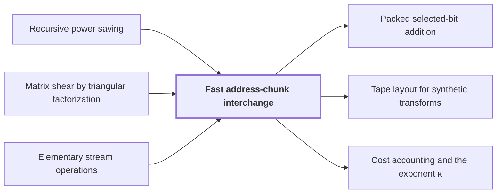

# Fast address-chunk interchange

!!! info "Before this page"

    Fast address-chunk interchange *takes its power saving from* [Recursive power saving](rank-recurrence.md "The interchange takes its power saving from the recurrence of Recursive power saving."), *performs each edge shear by* [Matrix shear by triangular factorization](matrix-shear.md "The interchange performs each edge shear by Matrix shear by triangular factorization") and *splits rows using the scans of* [Elementary stream operations](stream-ops.md "Whole rows are split cyclically into $W$ role streams within each prefix, and row $Wx+w-1$ goes to stream $w$ as row $x$, using the scans of Elementary stream operations.").

!!! abstract "Where this fits"

    1. A single deterministic Turing machine with a fixed finite alphabet and a fixed finite number of one-dimensional tapes multiplies two $n$-bit integers exactly in $O(n(\lg n)^{1-\kappa})$ worst-case time with $\kappa=2^{-182}$, disproving the $n\log n$ optimality conjecture of Sch\"onhage and Strassen in this model. — how: Build two power-saving tape procedures (chunk interchange and simultaneous butterfly layer) from fixed finite linear networks; use them to accelerate the synthetic polynomial transforms and ring convolution; use Gaussian resampling with retained permutations and chirps to reduce the prime-length cyclic convolution of the radix-digit coefficients to those power-of-two transforms; assemble the exact product with a proof that the error is below $1/2$; and total the cost to show a power of $\log n$ is saved. ([Power-saving integer multiplication](main-result.md "A deterministic fixed-tape Turing machine multiplying two n-bit integers exactly in O(n(lg n)^{1−κ}) time with κ = 2^{−182}, disproving the n log n optimality conjecture in this model."))
    2. Both tape primitives (the interchange of two address chunks of $u$ digits and the simultaneous butterfly layer on up to $d$ axes) cost the volume times a power below one of their width, because a call at parameter $mf$ makes $s$ calls at parameter $f$ on streams of volume $V/W$ with $s<Wm$, so the cost per unit volume grows by $s/W<m$ per factor $m$ of the parameter. — how: Build a fixed finite linear network of $W$ wires that exchanges two banks and restores all scratch values, make the representation of each wire's array vary along the network through frames so that an edge costs one smaller call per unit of rank, show the total rank $s$ is below $Wm$, fix an exponent, and solve the recurrence in the bit variant (interchange) and the complex variant (butterfly layer). ([Recursive power saving](rank-recurrence.md "Each call at parameter m·f makes s calls at parameter f on streams of 1/W the volume, so cost per unit volume grows by s/W < m per factor m, giving a power saving."))
    3. **This page:** Bit variant: two disjoint address chunks of $u$ bits can be interchanged on a fixed number of tapes in $O(Vu^\tau)$ time, $\tau=1-2^{-50}$, although the intermediate steps form XOR combinations of data.

Fast address-chunk interchange swaps two address fields of an array stored on tape, and it is the first of the two power-saving tape procedures on which the main result rests. An address is $(p,h,g,d,z)$: a prefix $p$, a chunk $h$, a gap $g$, a second chunk $d$ and a suffix $z$, the chunks being $u$ bits wide ($u$ is the chunk width). These letters change meaning from earlier pages, as do several others below. The goal is the permutation $(p,h,g,d,z)\mapsto(p,d,g,h,z)$ on $V$ stored digits, in time $O(Vu^\tau)$ on a fixed number of tapes<cite class="exegenius-ref" data-source="paper" data-locator="§1.1 The two tape operations" data-quote="Its cost is $O(Vu^\tau)$ for a fixed $\tau&lt;1$." title="Its cost is $O(Vu^\tau)$ for a fixed $\tau&lt;1$."> (see §1.1 The two tape operations)</cite>, with the interchange exponent $\tau=1-2^{-50}$. The intermediate steps add data together (XOR, for bits), yet the final permutation is exact.

Digits have a fixed prime radix $q$. Take chunks of $e=m^k$ digits, where $m$ is the number of fields in a chunk and $k$ is the number of recursion levels. Write each chunk as $m$ consecutive $b=e/m$ digit fields, giving vectors $H,D$ over $\mathbb Z/q^b\mathbb Z$. The interchange of the two full chunks is $D\gets D-H$, then $H\gets H+D$, then $D\gets H-D$, componentwise; only the middle shear uses the circuit. The outer updates are linear scans.

The circuit is the [Linear exchange network with restored scratch wires](exchange-network.md "A fixed network of linear gates on wires holding values that swaps two banks with a prescribed sign while undoing the effect of arbitrary initial scratch values, built from three-element subsets.") with $W$ wires. Each vertex carries a rational $m\times m$ matrix $M$, and edge $i$ carries $A_i=M_{\mathrm{head}(i)}-M_{\mathrm{tail}(i)}$. Input wire $w$ is routed to an output role $\rho(w)$ with $M_{\mathrm{out}(\rho(w))}-M_{\mathrm{in}(w)}=I_m$, the $m\times m$ identity. By [Nested subspace labels and rank deficit](subspace-labels.md "Assigning nondegenerate subspaces of an m-dimensional space to gates so adjacent labels are nested; the total dimension change over edges, the number s of smaller calls, is strictly less than W·m."), $s=\sum_i\operatorname{rank}A_i$ is less than $Wm$.

Let $\Phi_M$ move the entry at address $(H,D)$ to $(H+MD,D)$, spectators unchanged; then $\Phi_{M'}\Phi_M=\Phi_{M'+M}$. By [Frames on wire arrays](array-frames.md "Replacing each wire scalar by an array and assigning an invertible operator D_v (a frame) at each gate so the pointwise gate commutes with the frame and only the endpoint frames matter."), the frame at a vertex with matrix $M$ is the address permutation $\Phi_M$ and every edge changes it by $\Phi_{M'-M}$; a common address permutation commutes with every pointwise bit gate. So only the frame change $\Phi_{A_i}$ of an edge is paid for on tape. That change is a shear by $A_i$, which is why an edge costs its rank.

The interchange performs each edge shear by [Matrix shear by triangular factorization](matrix-shear.md "Factoring a rational matrix as A = E₁ΠE₂ with lower triangular E₁, E₂ and partial permutation Π lets the shear (H,D)→(H+AD,D) be done with exactly rank(A) field interchanges."): a shear by an edge matrix costs as many interchanges of pairs of $b$-digit fields as its rank, plus $O(V)$ further work. The number of recursive calls is the sum of the edge ranks, exactly $s$.

Suppose a row field, an address field ahead of both chunks, has length divisible by $W^k$. Whole rows are split cyclically into $W$ role streams within each prefix, and row $Wx+w-1$ goes to stream $w$ as row $x$, using the scans of [Elementary stream operations](stream-ops.md "Linear-time scans on arrays stored in lexicographic order: swapping two digits, moving a digit, splitting into streams, applying a pointwise map and merging back."). Each role stream has logical volume $V/W$ and its row count is divisible by $W^{k-1}$, so the same argument applies one level down. On every circuit edge apply $\Phi_{A_i}$ to that role stream, implemented by the matrix-shear lemma, recursively interchanging each pivot pair of $b$-digit fields.

Read the physical input $f_w$ as the logical array $\Phi_{-M_{\mathrm{in}(w)}}f_w$, with no tape operation. By the endpoint contract the physical output is $f'_{\rho(w)}=\Phi_{M_{\mathrm{out}(\rho(w))}}\Phi_{-M_{\mathrm{in}(w)}}f_w=\Phi_{I_m}f_w$. Merging row $x$ of role $\rho(w)$ back to the original row undoes $\rho$, and the result is $H\gets H+D$ on every original row, including rows assigned to scratch roles whose initial values were arbitrary.

Let $F_k$ be the time per unit volume at width $m^k$. Splitting, merging, gates, triangular operations and the scheduling of the $s$ calls on fixed tapes cost $O(V)$ at the node, a fixed number of operations on the node's own volume. Therefore $F_0=O(1)$ from the single-digit operation, and $F_k\le cF_{k-1}+O(1)$, where $c=s/W$ is the number of calls $s$ times the volume fraction $1/W$ of each. The interchange takes its power saving from the recurrence of [Recursive power saving](rank-recurrence.md "Each call at parameter m·f makes s calls at parameter f on streams of 1/W the volume, so cost per unit volume grows by s/W < m per factor m, giving a power saving.").

Unrolling $F_k\le cF_{k-1}+O(1)$ gives $F_k=O(\sum_{j=0}^k c^j)$, summed over the recursion levels $j$, with $c=s/W<m^\tau$. If $c\le1$, every term is at most $1$, so $\sum_{j=0}^k c^j\le k+1=O(m^{k\tau})$. If $c>1$, the geometric series gives $\sum_{j=0}^k c^j=(c^{k+1}-1)/(c-1)=O(c^k)$, and $c^k<m^{k\tau}$. Hence, since $e=m^k$, $F_k=O(e^\tau)$.

Each of the $k=\log_m e$ levels multiplies the cost by at most $c$, since an edge matrix costs as many smaller interchanges as its rank<cite class="exegenius-ref" data-source="paper" data-locator="§4 Faster interchange of address chunks" data-quote="An edge matrix of rank $a$ will require $a$ smaller interchanges." title="An edge matrix of rank $a$ will require $a$ smaller interchanges."> (see §4 Faster interchange of address chunks)</cite>, giving $c^k=e^{\log_m c}$. With $s=Wm$ calls the cost would be $e$, no saving; strictness of $s<Wm$ puts the exponent $\log_m c$ below $1$.

The value $\tau=1-2^{-50}$ is chosen, not derived as the best exponent: the argument needs only a fixed $\tau<1$ with $c<m^\tau$. Let $\eta=(Wm-s)/(Wm)$ be the relative rank deficit, so $c=m(1-\eta)$. For the actual network $\eta$ exceeds $20\cdot2^{-50}$<cite class="exegenius-ref" data-source="paper" data-locator="§3.6 Explicit rational bounds for the two recurrences" data-quote="Both exact deficits displayed above are greater than $20\cdot2^{-50}$." title="Both exact deficits displayed above are greater than $20\cdot2^{-50}$."> (see §3.6 Explicit rational bounds for the two recurrences)</cite>, and $m<2^{20}$ gives $\log m<20$, so $m^{1-2^{-50}}>m(1-20\cdot2^{-50})>m(1-\eta)=c$.

For chunks of range $[q^e]$ put $k=\lceil\log_me\rceil$. Put $\nu=\lceil k\log W/(2\log q)\rceil$ so that $q^{2\nu}\ge W^k$; for large $e$, $1\le\nu<e$ and $\nu=O(\log 2e)$. The row field comes from the chunks' own top $\nu$ digits: write each chunk as top digits and rest, $h^+,h^-$ and $d^+,d^-$. Interchange the top $\nu$ digits of the two chunks one pair at a time and join them, so the two middle field orders have a row field of the two high parts before both remaining chunks:
$$(h^+,h^-,g,d^+,d^-)\to(d^+,h^+,h^-,g,d^-)\to(d^+,h^+,d^-,g,h^-)\to(d^+,d^-,g,h^+,h^-).$$
This row field has range $\Lambda=q^{2\nu}\ge W^k$. Pad with zero rows, separately within each prefix, to $\Lambda'=W^k\lceil\Lambda/W^k\rceil<2\Lambda$ rows, so the padded volume is below $2V$ and the row count is divisible by each needed $W^j$.

Write the remaining width in base $m$: $e-\nu=\sum_{j=0}^ka_jm^j$ with $0\le a_j<m$, and interchange corresponding pieces ($a_j$ pieces of width $m^j$) by the power-width case, all using the same row field. The total cost is $O(V)\sum_ja_jm^{j\tau}=O(Ve^\tau)$. The bound $a_j<m$ and $m^k<me$ make this a geometric sum of order $e^\tau$: it is below $m\sum_{j\le k}m^{j\tau}=O(m^{k\tau})$ and $m^{k\tau}<(me)^\tau$.

For binary chunks of width $u$, pad each range from $[2^u]$ to $[q^e]$ with the least $e$ such that $q^e\ge2^u$, putting zero where either chunk coordinate is invalid. The volume grows by a fixed factor, so the cost is $O(Vu^\tau)$ since $e=O(u)$. Altogether one fixed finite-alphabet multitape procedure performs $(p,h,g,d,z)\mapsto(p,d,g,h,z)$ on arbitrary bit arrays in $O(Vu^\tau)$ steps, including one-bit payloads $z$<cite class="exegenius-ref" data-source="paper" data-locator="§4.3 Removing width and row restrictions" data-quote="Since $e=O(u)$ for fixed $q$, the bound is $O(Vu^\tau)$." title="Since $e=O(u)$ for fixed $q$, the bound is $O(Vu^\tau)$."> (see §4.3 Removing width and row restrictions)</cite>.

## Connections

Used by:

- [Packed selected-bit addition](packed-bit-addition.md "It rotates chunks by Controlled shifts and rational scalings in $O(V)$ time and swaps by Fast address-chunk interchange in $O(VL^\tau)$, for $\tau<1$.") *swaps chunks by* Fast address-chunk interchange
- [Tape layout for synthetic transforms](transform-layout.md "This is at most $Dq-1$ exchanges, each done by the fast address-chunk interchange in $O(TpK^\tau)$ even for nonadjacent chunks") *exchanges chunks by* Fast address-chunk interchange
- [Cost accounting and the exponent κ](cost-accounting.md "Each chunk exchange costs $O(VK^\tau)$ by Fast address-chunk interchange, and the normalized total is $O(p/K)K^\tau=O(pK^{\tau-1})$.") *costs each chunk exchange by* Fast address-chunk interchange

??? quote "From the sources"

    > The first procedure interchanges two disjoint contiguous address
    >
    > — [Integer multiplication below n log n (OpenAI, 2026)](https://github.com/openai/math/tree/fd4aeeb2ee4fc729c18d98444fed42fd0529eeeb/preprints/Integer-multiplication-below-n-log-n-September-23-2026)

    > Arbitrary-width interchange
    >
    > — [Integer multiplication below n log n (OpenAI, 2026)](https://github.com/openai/math/tree/fd4aeeb2ee4fc729c18d98444fed42fd0529eeeb/preprints/Integer-multiplication-below-n-log-n-September-23-2026)
