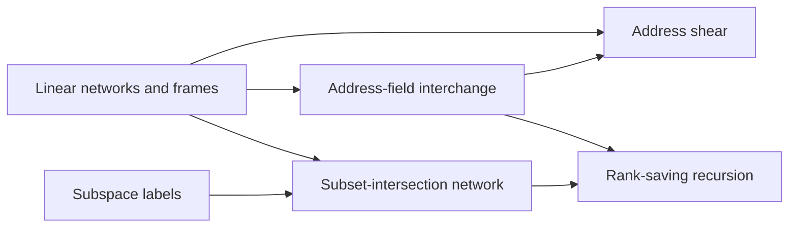

# Address moves on the tape

This part explains how a fixed-tape machine can exchange two address fields of an array at a cost that grows sublinearly in the field width. The [Linear networks and frames](../linear-network-frames.md "A fixed linear network that exchanges two banks of values while restoring scratch values, in which each vertex carries an invertible operator called its frame.") and [Subspace labels](../subspace-labels.md "Nondegenerate subspaces of a fixed bilinear space attached to each wire of a network, whose inclusions control how much work a change of representation costs.") supply the algebra, and the [Subset-intersection network](../subset-intersection-network.md "A linear network on the three-element subsets of a ground set, whose wires carry scalars and whose gates combine them by intersection size, so that it swaps two banks while cancelling arbitrary scratch values.") realises the exchange. The [Address-field interchange](../address-interchange.md "A tape procedure that swaps two disjoint contiguous address fields of an array in time that grows like a power of the field width, rather than linearly.") and [Rank-saving recursion](../rank-saving-recursion.md "The recursion in which each call splits into s smaller calls on streams of 1/W of the volume, where s < W m, so that the cost grows by the strictly smaller factor s/W per level.") give its cost, which later parts rely on.

## Pages

1. [Linear networks and frames](../linear-network-frames.md "A fixed linear network that exchanges two banks of values while restoring scratch values, in which each vertex carries an invertible operator called its frame.") — A fixed linear network that exchanges two banks of values while restoring scratch values, in which each vertex carries an invertible operator called its frame.
2. [Address-field interchange](../address-interchange.md "A tape procedure that swaps two disjoint contiguous address fields of an array in time that grows like a power of the field width, rather than linearly.") — A tape procedure that swaps two disjoint contiguous address fields of an array in time that grows like a power of the field width, rather than linearly.
3. [Address shear](../address-shear.md "The map that updates two address fields H, D to H + D, D, which is implemented by a small number of field interchanges.") — The map that updates two address fields H, D to H + D, D, which is implemented by a small number of field interchanges.
4. [Subspace labels](../subspace-labels.md "Nondegenerate subspaces of a fixed bilinear space attached to each wire of a network, whose inclusions control how much work a change of representation costs.") — Nondegenerate subspaces of a fixed bilinear space attached to each wire of a network, whose inclusions control how much work a change of representation costs.
5. [Subset-intersection network](../subset-intersection-network.md "A linear network on the three-element subsets of a ground set, whose wires carry scalars and whose gates combine them by intersection size, so that it swaps two banks while cancelling arbitrary scratch values.") — A linear network on the three-element subsets of a ground set, whose wires carry scalars and whose gates combine them by intersection size, so that it swaps two banks while cancelling arbitrary scratch values.
6. [Rank-saving recursion](../rank-saving-recursion.md "The recursion in which each call splits into s smaller calls on streams of 1/W of the volume, where s < W m, so that the cost grows by the strictly smaller factor s/W per level.") — The recursion in which each call splits into s smaller calls on streams of 1/W of the volume, where s < W m, so that the cost grows by the strictly smaller factor s/W per level.

## Map

Arrows point from a page to the pages that build on it.

