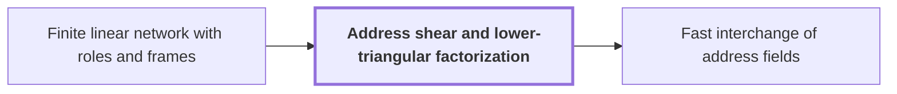

# Address shear and lower-triangular factorization

!!! info "Before this page"

    Address shear and lower-triangular factorization *is the endpoint operator of* [Finite linear network with roles and frames](linear-network-roles.md "The address shear is the endpoint operator of the bit network, a Finite linear network with roles and frames.").

!!! abstract "Where this fits"

    1. An $n$-bit integer product is computed by a fixed-tape machine in $O(n(\lg n)^{1-\kappa})$ time, $\kappa=2^{-182}$. — how: reduce multiplication to ring convolution and speed up its address moves and butterfly layers ([Integer multiplication in O(n(lg n)^{1-κ}) time](main-theorem.md "Deterministic fixed-tape Turing machine multiplying n-bit integers in O(n(lg n)^{1-κ}), κ=2^{-182}, by reducing to ring convolution with fast address interchanges and simultaneous butterfly layers, disproving the n log n conjecture in this model."))
    2. Two fixed-tape procedures, an address interchange and a simultaneous butterfly layer, cost $O(Vu^\tau)$ and $O(Vd^{\lambda'})$ for fixed exponents below 1, where $V$ is the stored bit volume. — how: build both procedures from one finite linear network and a recursion that saves a power
    3. Two disjoint contiguous $u$-bit address fields can be interchanged in $O(Vu^\tau)$ for a fixed $\tau<1$, although the intermediate steps are XOR combinations. — how: take the network's endpoint operator to be an address shear and finish with two linear-cost updates ([Fast interchange of address fields](fast-address-interchange.md "Interchange two disjoint contiguous u-bit address fields in an array in O(V u^τ) for fixed τ<1, via XOR combinations that end as an exact permutation."))
    4. **This page:** The endpoint operator of the bit network is the address shear $(H,D)\mapsto(H+D,D)$ over a residue ring, with rank reduced by a lower-triangular factorization.

??? note "Symbols from earlier pages"

    - $I$ — identity operator: The identity operator, which leaves every array unchanged. (on [Finite linear network with roles and frames](linear-network-roles.md "Fixed linear network exchanging two banks of values with prescribed signs and restoring auxiliary values; wires have roles, rows are distributed cyclically among roles, and invertible frame operators cancel along routes leaving an endpoint operator."))
    - $V$ — stored bit volume: The total number of bits the array holds. (on [Address fields and array layout on tapes](address-fields.md "Arrays stored in tape order with addresses forming a Cartesian product of digit fields; rearranging fields costs time."))

An address shear is a linear update of two vectors of address fields, and a lower-triangular factorization reduces it to interchanges and linear-cost updates. The address shear is the endpoint operator of the bit network, a [Finite linear network with roles and frames](linear-network-roles.md "Fixed linear network exchanging two banks of values with prescribed signs and restoring auxiliary values; wires have roles, rows are distributed cyclically among roles, and invertible frame operators cancel along routes leaving an endpoint operator.").

Let $R$ be the number of fields in each vector, and let $H=(H_1,\ldots,H_R)$ and $D=(D_1,\ldots,D_R)$ be two vectors of address fields. Here $q$ is a fixed odd prime, the radix of the digits, and $b$ is the number of radix-$q$ digits in each field, so a field holds a residue in $\mathbb Z/q^b\mathbb Z$. Several letters here change meaning from earlier pages.

For a rational $R\times R$ matrix $M$, the shear by $M$ is $(H,D)\mapsto(H+MD,D)$. A rational entry is written $\mu/\xi$, where $\mu$ is its integer numerator and $\xi$ its integer denominator, and $q$ must not divide $\xi$. It acts on fields as $\mu\,\xi^{-1}$ modulo $q^b$. So $q$ divides no numerator or denominator of the finitely many matrices used. Let $\operatorname{rank}_{\mathbb Q}M$ be the number of linearly independent rows of $M$.

A matrix is lower triangular when all its entries above the diagonal are zero. A partial permutation matrix $\Pi$ is a 0-1 matrix with at most one 1 in each row and column, and it has $\operatorname{rank}_{\mathbb Q}M$ ones. Every rational $M$ factors as $M=F_1\Pi F_2$, where $F_1$ and $F_2$ are invertible lower-triangular rational matrices. Elimination proves this: pivot on the topmost nonzero row's rightmost entry, clear its left and lower entries by lower-triangular operations, and repeat on what remains.

For example, take $R=2$ and $M=\begin{pmatrix}1&1\\0&0\end{pmatrix}$. Then $\operatorname{rank}_{\mathbb Q}M=1$, and $F_1=I$, $\Pi=\begin{pmatrix}0&1\\0&0\end{pmatrix}$, $F_2=\begin{pmatrix}1&0\\1&1\end{pmatrix}$ satisfy $M=F_1\Pi F_2$.

To apply the shear, replace $D$ by $F_2D$ and $H$ by $F_1^{-1}H$. For each 1 in $\Pi$, at row $\sigma$ and column $\tau$, update $H_\sigma\leftarrow H_\sigma+D_\tau$, using the transformed $D$. Finally replace $H$ by $F_1H$ and $D$ by $F_2^{-1}D$. The result is $H+F_1\Pi F_2D=H+MD$, and $D$ is unchanged.

Each update $H_\sigma\leftarrow H_\sigma+D_\tau$ takes one interchange of two equal fields and two additions: set $D_\tau\leftarrow D_\tau+H_\sigma$, swap the contents of $H_\sigma$ and $D_\tau$, then set $D_\tau\leftarrow H_\sigma-D_\tau$. Let $\eta$ be the content of $H_\sigma$ and $\zeta$ that of $D_\tau$. Then the pair $(\eta,\zeta)$ becomes $(\eta+\zeta,\zeta)$. So the shear needs $\operatorname{rank}_{\mathbb Q}M$ interchanges plus $O(V)$ further work.

A lower-triangular transformation costs $O(V)$<cite class="exegenius-ref" data-source="paper" data-locator="§4.1 A matrix decomposition adapted to tape order" data-quote="A lower triangular transformation of $H$, or of $D$, costs $O(V)$" title="A lower triangular transformation of $H$, or of $D$, costs $O(V)$"> (see §4.1 A matrix decomposition adapted to tape order)</cite>, where $V$ is the stored bit volume. Update coordinates from last to first, so each becomes a fixed combination of earlier, still unchanged, coordinates. The coefficients come from the finitely many matrices, not from $V$, and $R$ is fixed, so each pass is linear.

Each edge of the bit network carries such a matrix. The interchange count of the network is $s_{\rm b}$, the sum of their ranks. The network's rank budget, which counts dimension changes along its edges, gives $s_{\rm b}=W_{\rm b}R-N+2L_{\rm b}$, where $W_{\rm b}$ is the number of wires, $N$ the number of negative source projections, and $L_{\rm b}$ the total dimension lost on decreasing edges. The paper shows $N>2L_{\rm b}$, so $s_{\rm b}<W_{\rm b}R$.<cite class="exegenius-ref" data-source="paper" data-locator="§3.4 The rational matrix interface" data-quote="Its deficit from $W_{\rm b}m$ is $N-2L_{\rm b}&gt;0$." title="Its deficit from $W_{\rm b}m$ is $N-2L_{\rm b}&gt;0$."> (see §3.4 The rational matrix interface)</cite> Per wire, the interchanges are fewer than $R$, which the recurrence turns into a saving of a power of the chunk width (the chunk length).

## Connections

Used by:

- [Fast interchange of address fields](fast-address-interchange.md "The procedure is built from the Address shear and lower-triangular factorization: the network's endpoint operator is the shear $(H,D)\mapsto(H+D,D)$ over $\mathbb F_2$, with rank reduced by a lower-triangular factorization.") *is built from* Address shear and lower-triangular factorization

??? quote "From the sources"

    > that endpoint operator is an address shear
    >
    > — [Integer multiplication below n log n (OpenAI, 2026)](https://github.com/openai/math/tree/fd4aeeb2ee4fc729c18d98444fed42fd0529eeeb/preprints/Integer-multiplication-below-n-log-n-September-23-2026)
