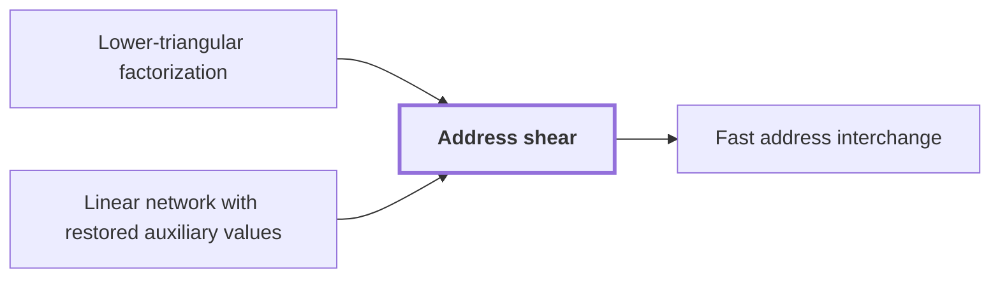

# Address shear

!!! info "Before this page"

    Address shear *is based on* [Lower-triangular factorization](lower-triangular-factorization.md "The shear is based on Lower-triangular factorization, which writes $A = E_1\Pi E_2$ with $E_1$ and $E_2$ invertible lower-triangular and $\Pi$ a partial permutation matrix with one 1 per pivot.") and *is realized in* [Linear network with restored auxiliary values](linear-network-exchange.md "The shear is realized in a Linear network with restored auxiliary values, which restores every auxiliary value it uses, so the array holds only the updated fields when the shear ends.").

!!! abstract "Where this fits"

    - Relied on to show: Both tape procedures cost $O(V)$ times a power of their parameter whose exponent is strictly below one. ([Recursive power saving](recursive-power-saving.md "The mechanism in which a network with s smaller calls on W roles and parameter m gives a recursion with cost ratio s/W < m, so that repeated recursion saves a power of the parameter."))

??? note "Symbols from earlier pages"

    - $A$ — rational matrix: The rational $m\times m$ matrix being factorized. (on [Lower-triangular factorization](lower-triangular-factorization.md "The factorization A = E₁ΠE₂ of a rational matrix into invertible lower-triangular factors and a partial permutation matrix with one 1 per pivot."))
    - $E_1$ — left factor: The invertible lower-triangular matrix on the left of the factorization. (on [Lower-triangular factorization](lower-triangular-factorization.md "The factorization A = E₁ΠE₂ of a rational matrix into invertible lower-triangular factors and a partial permutation matrix with one 1 per pivot."))
    - $E_2$ — right factor: The invertible lower-triangular matrix on the right of the factorization. (on [Lower-triangular factorization](lower-triangular-factorization.md "The factorization A = E₁ΠE₂ of a rational matrix into invertible lower-triangular factors and a partial permutation matrix with one 1 per pivot."))
    - $\Pi$ — partial permutation matrix: The middle factor, a matrix with at most one $1$ in each row and column and zeros elsewhere. (on [Lower-triangular factorization](lower-triangular-factorization.md "The factorization A = E₁ΠE₂ of a rational matrix into invertible lower-triangular factors and a partial permutation matrix with one 1 per pivot."))

An address shear is a rearrangement of two ordered groups of address fields in which one group is changed by a matrix applied to the other. It is the endpoint operator of a tape procedure in the target bound. Here $H$ is the first group, a vector over a common residue ring (the integers with arithmetic taken modulo a fixed number), with one entry for each row of $A$. $D$ is the second group, with one entry for each column of $A$. The shear is $(H,D)\mapsto(H+AD,D)$, which replaces $H$ by $H+AD$ and leaves $D$ unchanged.

The shear is based on [Lower-triangular factorization](lower-triangular-factorization.md "The factorization A = E₁ΠE₂ of a rational matrix into invertible lower-triangular factors and a partial permutation matrix with one 1 per pivot."), which writes $A = E_1\Pi E_2$ with $E_1$ and $E_2$ invertible lower-triangular and $\Pi$ a partial permutation matrix with one 1 per pivot. Invertible factors do not change rank, so $\Pi$ has exactly as many 1s as $A$ has rank.

The shear runs in four steps. First transform $D$ by $E_2$ and $H$ by $E_1^{-1}$. Then add $\Pi D$, computed from the transformed $D$, to $H$. Finally transform $H$ by $E_1$ and $D$ by $E_2^{-1}$. The result is $H+E_1\Pi E_2D=H+AD$, and $D$ is restored. Only the addition moves values between the two groups, so only it needs interchanges.

On this page $s$ and $t$ take new meanings: $s$ indexes the fields of $H$ and $t$ the fields of $D$, and a 1 in row $s$ and column $t$ of $\Pi$ calls for $H_s\leftarrow H_s+D_t$. Three updates achieve this with one swap:

$$D_t\leftarrow D_t+H_s,\qquad (H_s,D_t)\leftarrow(D_t,H_s),\qquad D_t\leftarrow H_s-D_t.$$

The first update puts $H_s+D_t$ into $D_t$. The swap moves that sum into $H_s$ and puts the old $H_s$ into $D_t$. The last update subtracts the old $H_s$ from $D_t$, which restores $D_t$. Only the swap moves fields, so each 1 of $\Pi$ costs exactly one interchange. The shear therefore uses as many interchanges as the rank of $A$, not one for each entry of $A$.

The shear is realized in a [Linear network with restored auxiliary values](linear-network-exchange.md "A fixed linear network that exchanges banks of values with prescribed signs and restores every auxiliary value, with each gate acting on the stored array through a frame operator that cancels between edges."), which restores every auxiliary value it uses, so the array holds only the updated fields when the shear ends.

The bit procedure, which interchanges two equal address chunks on tape using a fixed bit network, has an endpoint operator that is a shear of this form.<cite class="exegenius-ref" data-source="paper" data-locator="§1.2 Linear networks and the recursive saving" data-quote="two fields, written as vectors $H,D$ over a common residue ring, are updated by $(H,D)\mapsto(H+D,D)$" title="two fields, written as vectors $H,D$ over a common residue ring, are updated by $(H,D)\mapsto(H+D,D)$"> (see §1.2 Linear networks and the recursive saving)</cite>.

## Connections

Used by:

- [Fast address interchange](address-interchange.md "The procedure is applied to each Address shear that a layer (one stage of the transform) produces.") *is applied to each* Address shear

??? quote "From the sources"

    > two fields, written as vectors $H,D$ over a common residue ring, are
    >
    > — [Integer multiplication below n log n (OpenAI, 2026)](https://github.com/openai/math/tree/fd4aeeb2ee4fc729c18d98444fed42fd0529eeeb/preprints/Integer-multiplication-below-n-log-n-September-23-2026)
