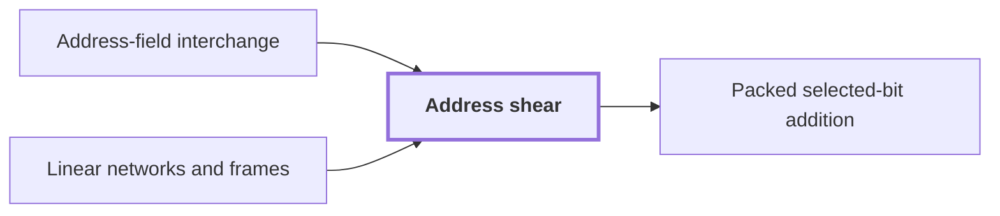

# Address shear

!!! info "Before this page"

    Address shear *is the first of three* [Address-field interchange](address-interchange.md "Address shear is the first of three address updates in an Address-field interchange.") and *is the endpoint operator of* [Linear networks and frames](linear-network-frames.md "For the bit procedure, the address shear is the endpoint operator of a route through a Linear networks and frames.").

!!! abstract "Where this fits"

    - Relied on to show: A fixed linear network on three-element subsets exchanges two banks of scalars and restores every scratch wire. ([Subset-intersection network](subset-intersection-network.md "A linear network on the three-element subsets of a ground set, whose wires carry scalars and whose gates combine them by intersection size, so that it swaps two banks while cancelling arbitrary scratch values."))

Address shear is the map that sends two address fields $H$ and $D$, which are vectors of residues, to $H + D$ and $D$. It is the endpoint update of the bit procedure, the paper's version of the construction for binary integers rather than complex numbers.

Entries are residues modulo a common integer, so $H + D$ is computed entry by entry modulo that integer. For example, with modulus 5, $H = (1, 2)$ and $D = (3, 4)$ give $H + D = (4, 1)$, while $D$ is unchanged.

The map is invertible: subtracting $D$ from its first field recovers $H$, so the inverse is the same kind of update with a minus sign.

An endpoint operator relates the stored array at the start of a route through a network to the stored array at its end. For the bit procedure, the address shear is the endpoint operator of a route through a [Linear networks and frames](linear-network-frames.md "A fixed linear network that exchanges two banks of values while restoring scratch values, in which each vertex carries an invertible operator called its frame.").<cite class="exegenius-ref" data-source="paper" data-locator="§11 A consequence for matrix transposition, p. 4" data-quote="For the bit procedure, that endpoint operator is an address shear: two fields, written as vectors H, D over a common residue ring, are updated by (H, D) 7→ (H + D, D)." title="For the bit procedure, that endpoint operator is an address shear: two fields, written as vectors H, D over a common residue ring, are updated by (H, D) 7→ (H + D, D)."> (see §11 A consequence for matrix transposition, p. 4)</cite>

Address shear is the first of three address updates in an [Address-field interchange](address-interchange.md "A tape procedure that swaps two disjoint contiguous address fields of an array in time that grows like a power of the field width, rather than linearly.").<cite class="exegenius-ref" data-source="paper" data-locator="§11 A consequence for matrix transposition, p. 4" data-quote="Two further linear-cost address updates complete their interchange." title="Two further linear-cost address updates complete their interchange."> (see §11 A consequence for matrix transposition, p. 4)</cite> The shear alone does not swap $H$ and $D$.

## Connections

Used by:

- [Packed selected-bit addition](packed-bit-addition.md "Packed selected-bit addition is a restricted form of the address shear that changes only the selected positions.") *is a restricted form of* Address shear

??? quote "From the sources"

    > that endpoint operator is an address shear
    >
    > — Integer multiplication below n log n (OpenAI, 2026)
