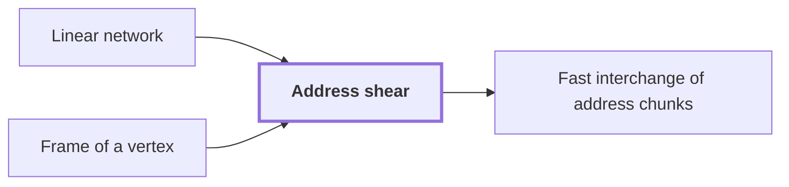

# Address shear

!!! info "Before this page"

    Address shear *is applied in* [Linear network](linear-network.md "The shear is applied in the linear network of the bit procedure, at its endpoint.") and *acts on fields stored in* [Frame of a vertex](frame.md "It acts on fields stored in the frame of a vertex at that terminal, so the $H$ and $D$ it updates are the address fields as they are stored there.").

!!! abstract "Where this fits"

    - Relied on to show: Interchanging two equal address fields of width $u$ costs less than linear in $u$ per unit volume. ([Fast interchange of address chunks](tape-interchange.md "A fixed-tape procedure that swaps two disjoint equal-width address fields of an array in time O(V u^τ) for a fixed τ < 1, where V is the stored volume and u the field width, using XOR combinations of intermediate data."))

The address shear is the permutation of array entries that replaces one address field by its sum with a second field and leaves the second field unchanged. It is the endpoint operator of the bit procedure, the version of the construction that works on single bits through XOR gates, and it is one of the linear-cost address updates that interchange two address fields.

Write $H$ for the first address field and $D$ for the second, each a vector whose entries lie in a common residue ring $\mathbb{Z}/q\mathbb{Z}$, the integers modulo a fixed modulus $q$. The shear is

$$(H,D)\mapsto(H+D,\,D),$$

which adds $D$ entrywise to $H$ and leaves $D$ fixed. It is linear and invertible: $(H,D)\mapsto(H-D,\,D)$ undoes it.

Worked example, with $q=10$: take $H=(3,7)$ and $D=(5,5)$. Then $H+D=(8,2)$, since $7+5=12\equiv 2$, so the pair becomes $((8,2),(5,5))$. Applying the inverse recovers $(3,7)$.

A single shear does not swap $H$ and $D$. The swap uses three updates in order: $D\leftarrow D-H$, then the shear $H\leftarrow H+D$, then $D\leftarrow H-D$. Starting from $(H,D)$ these give $(H,\,D-H)$, then $(D,\,D-H)$, then $(D,\,H)$.

Only the middle shear moves entries between addresses. The network performs it by splitting rows into role streams, applying its gates pointwise at matching addresses, and merging the rows back. The two outer updates only change $D$ by a subtraction, and they cost linear time per unit volume.<cite class="exegenius-ref" data-source="paper" data-locator="§4.2 Transferring a finite circuit to address permutations" data-quote="The other two updates target the later group and have linear cost." title="The other two updates target the later group and have linear cost."> (see §4.2 Transferring a finite circuit to address permutations)</cite>

The shear is applied in the [linear network](linear-network.md "A fixed network of wires with gates that apply fixed linear maps to the values on their wires, used here to exchange two banks of values while restoring all auxiliary values.") of the bit procedure, at its endpoint. It acts on fields stored in the [frame of a vertex](frame.md "An invertible linear operator attached to a gate or terminal that sets how the array on each wire there is stored; changing frames along an edge cancels between the two ends of a route.") at that terminal, so the $H$ and $D$ it updates are the address fields as they are stored there.

## Connections

Used by:

- [Fast interchange of address chunks](tape-interchange.md "The interchange reduces to three updates, and the middle one is the Address shear, which replaces $H$ by $H+D$ and leaves $D$ fixed.") *reduces to* Address shear

??? quote "From the sources"

    > For the bit procedure, that endpoint operator is an address shear:
    >
    > — [Integer multiplication below n log n (OpenAI, 2026)](https://github.com/openai/math/tree/fd4aeeb2ee4fc729c18d98444fed42fd0529eeeb/preprints/Integer-multiplication-below-n-log-n-September-23-2026)
