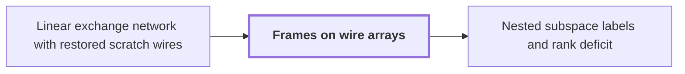

# Frames on wire arrays

!!! info "Before this page"

    Frames on wire arrays *extend* [Linear exchange network with restored scratch wires](exchange-network.md "They extend the linear exchange network with restored scratch wires from scalars to arrays.").

!!! abstract "Where this fits"

    1. A single deterministic Turing machine with a fixed finite alphabet and a fixed finite number of one-dimensional tapes multiplies two $n$-bit integers exactly in $O(n(\lg n)^{1-\kappa})$ worst-case time with $\kappa=2^{-182}$, disproving the $n\log n$ optimality conjecture of Sch\"onhage and Strassen in this model. — how: Build two power-saving tape procedures (chunk interchange and simultaneous butterfly layer) from fixed finite linear networks; use them to accelerate the synthetic polynomial transforms and ring convolution; use Gaussian resampling with retained permutations and chirps to reduce the prime-length cyclic convolution of the radix-digit coefficients to those power-of-two transforms; assemble the exact product with a proof that the error is below $1/2$; and total the cost to show a power of $\log n$ is saved. ([Power-saving integer multiplication](main-result.md "A deterministic fixed-tape Turing machine multiplying two n-bit integers exactly in O(n(lg n)^{1−κ}) time with κ = 2^{−182}, disproving the n log n optimality conjecture in this model."))
    2. Both tape primitives (the interchange of two address chunks of $u$ digits and the simultaneous butterfly layer on up to $d$ axes) cost the volume times a power below one of their width, because a call at parameter $mf$ makes $s$ calls at parameter $f$ on streams of volume $V/W$ with $s<Wm$, so the cost per unit volume grows by $s/W<m$ per factor $m$ of the parameter. — how: Build a fixed finite linear network of $W$ wires that exchanges two banks and restores all scratch values, make the representation of each wire's array vary along the network through frames so that an edge costs one smaller call per unit of rank, show the total rank $s$ is below $Wm$, fix an exponent, and solve the recurrence in the bit variant (interchange) and the complex variant (butterfly layer). ([Recursive power saving](rank-recurrence.md "Each call at parameter m·f makes s calls at parameter f on streams of 1/W the volume, so cost per unit volume grows by s/W < m per factor m, giving a power saving."))
    3. **This page:** If every scalar wire value is replaced by an array over a finite address set $\Omega$ and every gate acts pointwise, then assigning an invertible operator $D_v$ (a frame) to each source, gate and sink, with the same $D_v$ on all incidences of a gate, makes the network apply $D_{\rm out}\mathsf S_\Omega D_{\rm in}^{-1}$: a route from input role $w$ to output role $\rho(w)$ applies only the endpoint frames $D_{\mathrm{sink}(\rho(w))}D_{\mathrm{source}(w)}^{-1}$ and its scalar sign.

Frames let a network of scalar gates act on whole arrays stored differently on different wires, so that only the representations at the two ends of a route matter. They extend the [linear exchange network with restored scratch wires](exchange-network.md "A fixed network of linear gates on wires holding values that swaps two banks with a prescribed sign while undoing the effect of arbitrary initial scratch values, built from three-element subsets.") from scalars to arrays.

Let $R$ be the ring of scalars carried by the wires, and let $\Omega$ be a finite set of addresses indexing every array. Replace each scalar wire value by an array in $R^\Omega$ and apply every gate pointwise, at each address separately. Write $\mathsf S_\Omega$ for the resulting network on all the wire arrays together. Here $u$, $v$, $a$, $b$ are vertices, not their earlier meanings.

At each source, gate and sink $v$, assign an invertible $R$-linear operator $D_v$ on $R^\Omega$, called its frame. A frame may mix entries of one array across addresses, whereas a gate combines different wires at one fixed address. All incidences of a gate use the same $D_v$, and an edge from $u$ to $v$ applies $D_vD_u^{-1}$ to the array it carries.

The invariant is that the stored array at $v$ equals $D_v$ applied to the logical array. It holds at the sources by definition: with $D_{\rm in}=\bigoplus_w D_{\mathrm{source}(w)}$ stacking the source frames over the input roles $w$, a physical input $f$ is interpreted as the logical input $g=D_{\rm in}^{-1}f$, which needs no preprocessing. It continues along an edge: if the logical array is $\varphi$, the stored array $D_u\varphi$ becomes $D_vD_u^{-1}D_u\varphi=D_v\varphi$.

At a gate $G$ with $t$ input arrays, every incoming array has the common frame $D_v$, and a gate output combines the logical inputs $\varphi_1,\dots,\varphi_t$ with coefficients $c_j\in R$. Because $D_v$ is $R$-linear, $\sum_j c_jD_v\varphi_j=D_v\bigl(\sum_j c_j\varphi_j\bigr)$. So $G(D_vg_1,\dots,D_vg_t)=D_vG(g_1,\dots,g_t)$ for any arrays $g_1,\dots,g_t$: the gate applied to stored arrays gives the stored form of the logical output, so the invariant continues to the sinks<cite class="exegenius-ref" data-source="paper" data-locator="§3.2 From scalar values to arrays" data-quote="the common frame commutes with the pointwise gate" title="the common frame commutes with the pointwise gate"> (see §3.2 From scalar values to arrays)</cite>.

With $D_{\rm out}=\bigoplus_w D_{\mathrm{sink}(w)}$, the implemented operator is therefore
$$D_{\rm out}\,\mathsf S_\Omega\,D_{\rm in}^{-1}.$$

On a route from a source $u$ through gates $a$ and $b$ to a sink $v$, the edges apply $D_aD_u^{-1}$, $D_bD_a^{-1}$ and $D_vD_b^{-1}$, whose product is $D_vD_u^{-1}$: the intermediate frames telescope away. So if the scalar network is a signed role permutation sending input role $w$ to output role $\rho(w)$ with scalar sign $\varepsilon_w$, that route applies $\varepsilon_wD_{\mathrm{sink}(\rho(w))}D_{\mathrm{source}(w)}^{-1}$ to its input array. This holds for every role, scratch roles included.

## What the free frames are for

Once the scalar routing is fixed, the endpoint frames determine the array operator on each route<cite class="exegenius-ref" data-source="paper" data-locator="§3.2 From scalar values to arrays" data-quote="the endpoint frames determine the array operator on each route" title="the endpoint frames determine the array operator on each route"> (see §3.2 From scalar values to arrays)</cite>. Interior frames do not change that operator, but each sets what the edges beside it must compute, and an edge costs whatever applying $D_vD_u^{-1}$ costs. So the intermediate frames can be chosen to make each edge change inexpensive<cite class="exegenius-ref" data-source="paper" data-locator="§3.2 From scalar values to arrays" data-quote="intermediate frames can then be chosen to make each edge change inexpensive." title="intermediate frames can then be chosen to make each edge change inexpensive."> (see §3.2 From scalar values to arrays)</cite>

The later page [Nested subspace labels and rank deficit](subspace-labels.md "Assigning nondegenerate subspaces of an m-dimensional space to gates so adjacent labels are nested; the total dimension change over edges, the number s of smaller calls, is strictly less than W·m.") makes this choice: it uses nested subspaces as frames, so that an edge costs one smaller call per unit of rank change. The number of such calls over the network is what the [Recursive power saving](rank-recurrence.md "Each call at parameter m·f makes s calls at parameter f on streams of 1/W the volume, so cost per unit volume grows by s/W < m per factor m, giving a power saving.") recurrence counts.

## Connections

Used by:

- [Nested subspace labels and rank deficit](subspace-labels.md "The labelling chooses the frames of Frames on wire arrays so that a network of $W\in\{W_{\rm b},W_{\rm c}\}$ wires costs $s<Wm$ smaller calls, the saving the recursion needs.") *chooses the frames of* Frames on wire arrays

??? quote "From the sources"

    > We call $D_v$ its frame: the stored
    >
    > — [Integer multiplication below n log n (OpenAI, 2026)](https://github.com/openai/math/tree/fd4aeeb2ee4fc729c18d98444fed42fd0529eeeb/preprints/Integer-multiplication-below-n-log-n-September-23-2026)

    > Thus the common frame commutes with the pointwise gate
    >
    > — [Integer multiplication below n log n (OpenAI, 2026)](https://github.com/openai/math/tree/fd4aeeb2ee4fc729c18d98444fed42fd0529eeeb/preprints/Integer-multiplication-below-n-log-n-September-23-2026)
