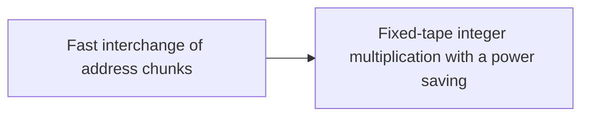

# Assembling the multiplier

The procedure must permute stored addresses cheaply, which the [fast interchange of address chunks](../tape-interchange.md "A fixed-tape procedure that swaps two disjoint equal-width address fields of an array in time O(V u^τ) for a fixed τ < 1, where V is the stored volume and u the field width, using XOR combinations of intermediate data.") does in time $O(V u^{\tau})$ for a fixed $\tau<1$. The [fixed-tape multiplier](../fixed-tape-multiplication.md "A deterministic fixed-tape Turing machine that multiplies two n-bit integers exactly in O(n(lg n)^(1−κ)) worst-case time, for a fixed κ = 2^(−182), disproving the n log n optimality conjecture in this model.") combines the earlier parts into the main theorem, with $\kappa=2^{-182}$ and worst-case time $O(n(\lg n)^{1-\kappa})$.

## Pages

1. [Fast interchange of address chunks](../tape-interchange.md "A fixed-tape procedure that swaps two disjoint equal-width address fields of an array in time O(V u^τ) for a fixed τ < 1, where V is the stored volume and u the field width, using XOR combinations of intermediate data.") — A fixed-tape procedure that swaps two disjoint equal-width address fields of an array in time O(V u^τ) for a fixed τ < 1, where V is the stored volume and u the field width, using XOR combinations of intermediate data.
2. [Fixed-tape integer multiplication with a power saving](../fixed-tape-multiplication.md "A deterministic fixed-tape Turing machine that multiplies two n-bit integers exactly in O(n(lg n)^(1−κ)) worst-case time, for a fixed κ = 2^(−182), disproving the n log n optimality conjecture in this model.") — A deterministic fixed-tape Turing machine that multiplies two n-bit integers exactly in O(n(lg n)^(1−κ)) worst-case time, for a fixed κ = 2^(−182), disproving the n log n optimality conjecture in this model.

## Map

Arrows point from a page to the pages that build on it.

