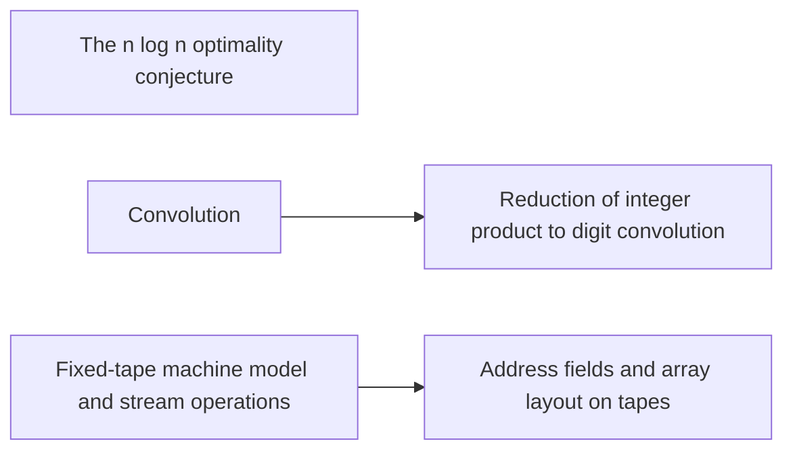

# Background and the conjecture

This part fixes the conjectured bound, the machine model, and the reduction of integer products to convolution. The reader needs these to see what the main theorem beats and how the cost is measured. Radix digit reduction and [address fields](../address-fields.md "Arrays stored in tape order with addresses forming a Cartesian product of digit fields; rearranging fields costs time.") prepare the data layout used later.

## Pages

1. [The n log n optimality conjecture](../nlogn-conjecture.md "Schönhage–Strassen's proposal that n log n is the optimal order of cost for multiplying n-bit integers.") — Schönhage–Strassen's proposal that n log n is the optimal order of cost for multiplying n-bit integers.
2. [Convolution](../convolution.md "Product of polynomials / combination of coefficient lists where entries sum by index (cyclic if indices wrap).") — Product of polynomials / combination of coefficient lists where entries sum by index (cyclic if indices wrap).
3. [Reduction of integer product to digit convolution](../radix-digit-reduction.md "Splitting the inputs into radix digits turns the integer product into a convolution of short integer coefficients, followed by carry propagation.") — Splitting the inputs into radix digits turns the integer product into a convolution of short integer coefficients, followed by carry propagation.
4. [Fixed-tape machine model and stream operations](../fixed-tape-model.md "Machine with one fixed finite alphabet and a fixed number of one-dimensional tapes; each step touches one cell per tape, so data movement (scans, shifts, permutations) is the cost to minimize.") — Machine with one fixed finite alphabet and a fixed number of one-dimensional tapes; each step touches one cell per tape, so data movement (scans, shifts, permutations) is the cost to minimize.
5. [Address fields and array layout on tapes](../address-fields.md "Arrays stored in tape order with addresses forming a Cartesian product of digit fields; rearranging fields costs time.") — Arrays stored in tape order with addresses forming a Cartesian product of digit fields; rearranging fields costs time.

## Map

Arrows point from a page to the pages that build on it.

