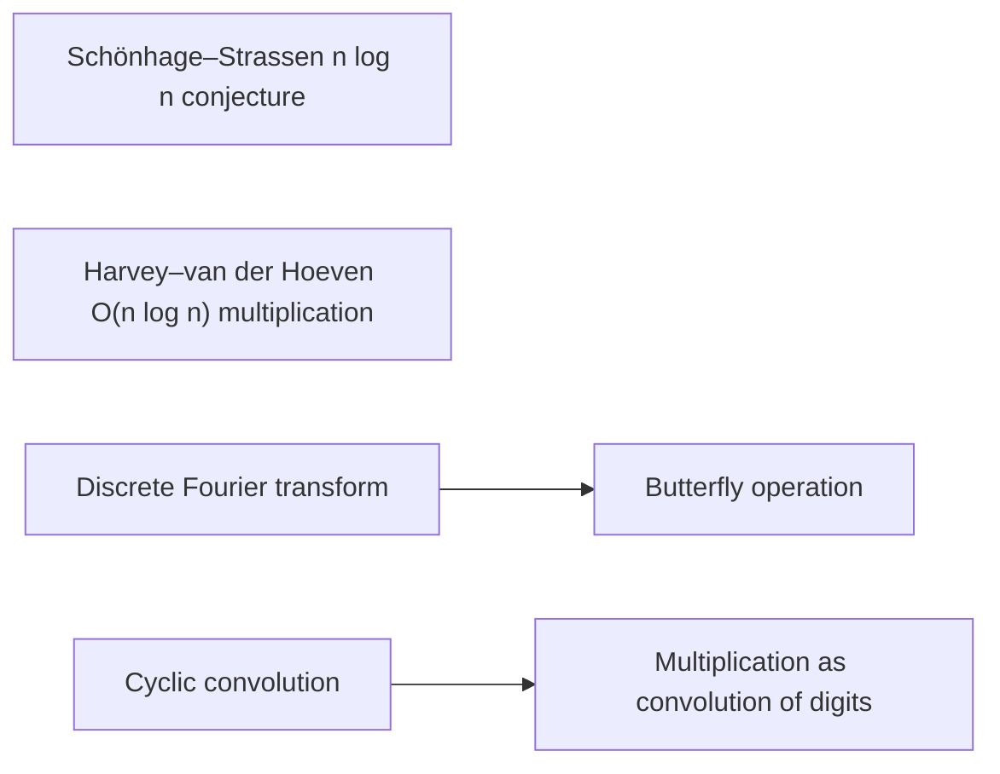

# Background: transforms and convolution

The reader needs the conjecture that the target beats, the $O(n\log n)$ multiplier used as a black box, and the transform vocabulary. [The discrete Fourier transform](../fourier-transform.md "The map sending a length-n sequence to its values at the n-th roots of unity, i.e. the sums of the sequence weighted by powers of a root of unity.") and [the butterfly operation](../butterfly-operation.md "The two-point map (u, v) ↦ ((u + v)/2, (u − v)/2) applied to a pair of values, the basic step of a fast transform.") give the basic fast-transform step, and [cyclic convolution](../cyclic-convolution.md "The product of two sequences in which indices are taken modulo a fixed length, so each coefficient of the result is a sum of products over residues.") is the operation the whole argument reduces to. [Multiplication as convolution of digits](../convolution-reduction.md "Writing each integer in radix 2^b digits so that the integer product becomes a convolution of the digit sequences, which is then carried back to binary.") shows that the integer product is a carried convolution, which is the first main step.

## Pages

1. [Schönhage–Strassen n log n conjecture](../nlogn-conjecture.md "The conjecture of Schönhage and Strassen that n log n is the optimal order of growth of the time to multiply two n-bit integers on a multitape Turing machine.") — The conjecture of Schönhage and Strassen that n log n is the optimal order of growth of the time to multiply two n-bit integers on a multitape Turing machine.
2. [Harvey–van der Hoeven O(n log n) multiplication](../harvey-hoeven-multiplier.md "The unconditional O(n log n) multiplication algorithm on a multitape Turing machine, used in this result as an ordinary subroutine.") — The unconditional O(n log n) multiplication algorithm on a multitape Turing machine, used in this result as an ordinary subroutine.
3. [Discrete Fourier transform](../fourier-transform.md "The map sending a length-n sequence to its values at the n-th roots of unity, i.e. the sums of the sequence weighted by powers of a root of unity.") — The map sending a length-n sequence to its values at the n-th roots of unity, i.e. the sums of the sequence weighted by powers of a root of unity.
4. [Butterfly operation](../butterfly-operation.md "The two-point map (u, v) ↦ ((u + v)/2, (u − v)/2) applied to a pair of values, the basic step of a fast transform.") — The two-point map (u, v) ↦ ((u + v)/2, (u − v)/2) applied to a pair of values, the basic step of a fast transform.
5. [Cyclic convolution](../cyclic-convolution.md "The product of two sequences in which indices are taken modulo a fixed length, so each coefficient of the result is a sum of products over residues.") — The product of two sequences in which indices are taken modulo a fixed length, so each coefficient of the result is a sum of products over residues.
6. [Multiplication as convolution of digits](../convolution-reduction.md "Writing each integer in radix 2^b digits so that the integer product becomes a convolution of the digit sequences, which is then carried back to binary.") — Writing each integer in radix 2^b digits so that the integer product becomes a convolution of the digit sequences, which is then carried back to binary.

## Map

Arrows point from a page to the pages that build on it.

