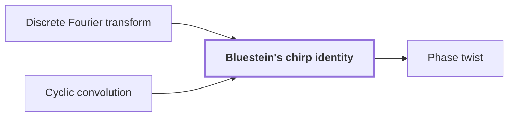

# Bluestein's chirp identity

!!! info "Before this page"

    Bluestein's chirp identity *rewrites* [Discrete Fourier transform](discrete-fourier-transform.md "Bluestein's chirp identity rewrites a Discrete Fourier transform so that the transform can be computed with convolution, which the multiplication reduction needs.") and *computes its transforms by* [Cyclic convolution](glossary.md#cyclic-convolution "It computes its transforms by a Cyclic convolution multiplied by chirp factors.").

!!! abstract "Where this fits"

    1. A deterministic fixed-tape machine multiplies two $n$-bit integers exactly in $O(n(\lg n)^{1-\kappa})$ time, with $\kappa=2^{-182}$, below the $n\lg n$ conjecture in this model. — how: bound the cost of an exact multiplication whose transform layers are made cheap by two tape procedures, then fix parameters so every cost term fits ([Integer multiplication below n log n](main-theorem.md "A deterministic fixed-tape machine that multiplies two n-bit integers exactly in O(n (lg n)^(1−κ)) time with κ = 2^−182, which disproves the n log n optimality conjecture in this model."))
    2. The exact product of two $n$-bit integers is obtained from the convolution of their radix-digit coefficients, computed by transforms on a fixed tape layout and then recovered and carried. — how: reduce the convolution by a Chinese-remainder map, Gaussian resampling, Bluestein's identity and a phase twist to a convolution over a polynomial ring, then recover coefficients and propagate carries ([Radix-digit convolution](radix-digit-convolution.md "Writing both integers as polynomials in a power of two whose coefficients are their digits, so that their product is a polynomial convolution of short coefficients."))
    3. **This page:** Bluestein's chirp identity converts the middle transform, including its target permutation, into normalized cyclic convolution.

??? note "Symbols from earlier pages"

    - $j$ — input index: The index of an input entry, ranging over 0 to q-1. (on [Discrete Fourier transform](discrete-fourier-transform.md "The map sending a vector of q values to its q values weighted by powers of a q-th root of unity, normalized by 1/q."))
    - $k$ — output index: The index of an output entry, ranging over 0 to q-1. (on [Discrete Fourier transform](discrete-fourier-transform.md "The map sending a vector of q values to its q values weighted by powers of a q-th root of unity, normalized by 1/q."))
    - $X$ — transform vector: The transform of x, the vector of q outputs computed from x. (on [Discrete Fourier transform](discrete-fourier-transform.md "The map sending a vector of q values to its q values weighted by powers of a q-th root of unity, normalized by 1/q."))
    - $x$ — input vector: The input vector of q complex numbers, indexed from 0 to q-1. (on [Discrete Fourier transform](discrete-fourier-transform.md "The map sending a vector of q values to its q values weighted by powers of a q-th root of unity, normalized by 1/q."))
    - $a$ — first input sequence: The first sequence of t complex numbers, indexed from 0 to t-1. (on [Cyclic convolution](glossary.md#cyclic-convolution "The product of two sequences in which indices wrap around modulo the sequence length."))
    - $b$ — second input sequence: The second sequence of t complex numbers, indexed from 0 to t-1. (on [Cyclic convolution](glossary.md#cyclic-convolution "The product of two sequences in which indices wrap around modulo the sequence length."))

Bluestein's chirp identity rewrites a [Discrete Fourier transform](discrete-fourier-transform.md "The map sending a vector of q values to its q values weighted by powers of a q-th root of unity, normalized by 1/q.") so that the transform can be computed with convolution, which the multiplication reduction needs. It computes its transforms by a [Cyclic convolution](glossary.md#cyclic-convolution "The product of two sequences in which indices wrap around modulo the sequence length.") multiplied by chirp factors.

Let $q$ be the length of the transform, and let $\omega = e^{2\pi i/q}$ be the primitive $q$-th root of unity it uses. Let $w = e^{\pi i/q}$ be the number whose square is $\omega$, so that $w^2 = \omega$. The indices $j$ and $k$ run over $\{0,\ldots,q-1\}$, and $q$ is even.

The identity is
$$\omega^{jk} = w^{j^2}\, w^{k^2}\, w^{-(k-j)^2}.$$

The factors $w^{j^2}$, $w^{k^2}$ and $w^{-(k-j)^2}$ are called chirps: their phases are quadratic in the index. The identity holds because $j^2 + k^2 - (k-j)^2 = 2jk$, so the right side is $w^{2jk} = \omega^{jk}$. Substituting into the normalized transform $X_k = \frac{1}{q}\sum_j x_j\,\omega^{jk}$ gives
$$X_k = \frac{w^{k^2}}{q}\sum_{j} a_j\, w^{-(k-j)^2}, \qquad a_j = x_j\, w^{j^2}.$$

The sum is a cyclic convolution. For any integer $p$, $w^{-(p+q)^2} = w^{-p^2}$, because $w^{-2pq} = \omega^{-pq} = 1$ and $w^{-q^2} = (-1)^q = 1$. So the chirp depends only on $(k-j) \bmod q$. Define $b_\ell = w^{-\ell^2}$ for $\ell \in \{0,\ldots,q-1\}$, where $\ell$ is the reduced index $(k-j) \bmod q$, an integer from 0 to $q-1$. Then the sum is $\sum_j a_j b_\ell$ over the pairs with $j+\ell \equiv k \pmod q$, which is the $k$-th entry of the cyclic convolution $a \ast b$, so
$$X_k = \frac{w^{k^2}}{q}\,(a \ast b)_k.$$

For example, take $q=2$, $\omega=-1$ and $w=i$. For $j=k=1$, $w^{j^2}w^{k^2}w^{-(k-j)^2} = i\cdot i\cdot 1 = -1 = \omega^{1}$, as the identity requires.

The paper applies this identity to the middle transform of its reduction.<cite class="exegenius-ref" data-source="paper" data-locator="§11 A consequence for matrix transposition, p. 5" data-quote="converts the middle transform, including its target permutation, into normalized cyclic convolution" title="converts the middle transform, including its target permutation, into normalized cyclic convolution"> (see §11 A consequence for matrix transposition, p. 5)</cite> The target permutation stays inside the transform identity, so it is not executed as a separate sort.

## Connections

Used by:

- [Phase twist](phase-twist.md "The phase twist follows Bluestein's chirp identity, which has already turned the middle transform into a normalized cyclic convolution.") *follows* Bluestein's chirp identity

??? quote "From the sources"

    > Bluestein’s chirp identity converts the middle transform
    >
    > — Integer multiplication below n log n (OpenAI, 2026)
