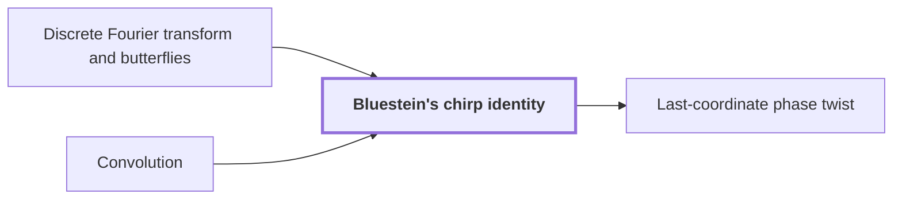

# Bluestein's chirp identity

!!! info "Before this page"

    Bluestein's chirp identity *rewrites* [Discrete Fourier transform and butterflies](dft-fft.md "Bluestein's chirp identity rewrites a discrete Fourier transform as a cyclic Convolution, so that later convolution machinery can compute it.") and *computes its transform by* [Convolution](convolution.md "So the identity computes its transform by a cyclic Convolution, with the phase $\zeta^{j^2-j}$ applied to each output.").

!!! abstract "Where this fits"

    1. An $n$-bit integer product is computed by a fixed-tape machine in $O(n(\lg n)^{1-\kappa})$ time, $\kappa=2^{-182}$. — how: reduce multiplication to ring convolution and speed up its address moves and butterfly layers ([Integer multiplication in O(n(lg n)^{1-κ}) time](main-theorem.md "Deterministic fixed-tape Turing machine multiplying n-bit integers in O(n(lg n)^{1-κ}), κ=2^{-182}, by reducing to ring convolution with fast address interchanges and simultaneous butterfly layers, disproving the n log n conjecture in this model."))
    2. **This page:** Bluestein's chirp identity converts the middle transform into normalized cyclic convolution.

??? note "Symbols from earlier pages"

    - $\omega$ — primitive root of unity: A primitive $n$-th root of unity, whose powers are the frequencies of the transform. (on [Discrete Fourier transform and butterflies](dft-fft.md "Evaluation of a coefficient list at roots of unity, computed in log-many levels of two-point butterfly operations; turns convolution into pointwise product."))
    - $n$ — list length: The number of entries in each input and output coefficient list. (on [Convolution](convolution.md "Product of polynomials / combination of coefficient lists where entries sum by index (cyclic if indices wrap)."))
    - $a$ — input list a: The first input coefficient list, with entries $a_0,\dots,a_{n-1}$. (on [Convolution](convolution.md "Product of polynomials / combination of coefficient lists where entries sum by index (cyclic if indices wrap)."))
    - $A$ — transform of a: The list of $n$ entries $A_0,\dots,A_{n-1}$ obtained by transforming $a$. (on [Discrete Fourier transform and butterflies](dft-fft.md "Evaluation of a coefficient list at roots of unity, computed in log-many levels of two-point butterfly operations; turns convolution into pointwise product."))

Bluestein's chirp identity rewrites a [discrete Fourier transform](dft-fft.md "Evaluation of a coefficient list at roots of unity, computed in log-many levels of two-point butterfly operations; turns convolution into pointwise product.") as a cyclic [Convolution](convolution.md "Product of polynomials / combination of coefficient lists where entries sum by index (cyclic if indices wrap)."), so that later convolution machinery can compute it.

Let $\zeta$ be a primitive $2n$th root of unity with $\zeta^2=\omega$. Here $j$ indexes outputs and $k$ indexes inputs, both in $\{0,\dots,n-1\}$; these letters mean something else on the convolution page, where $j$ indexes its second list and $k$ its output. The transform of $a_0,\dots,a_{n-1}$ is
$$A_j=\sum_{k=0}^{n-1}a_k\,\omega^{jk}.$$

Since $2jk=j^2+k^2-(j-k)^2$, the power splits:
$$\omega^{jk}=\zeta^{j^2}\,\zeta^{k^2}\,\zeta^{-(j-k)^2}.$$
Define $g_k=a_k\zeta^{k^2}$ and $z_e=\zeta^{-e^2}$, the chirp at integer index $e$. Then
$$A_j=\zeta^{j^2}\sum_{k=0}^{n-1}g_k\,z_{j-k}.$$

Reading $z$ at $j-k$ modulo $n$ makes the sum cyclic, but the wrap carries a sign. Since $\zeta^n$ squares to $\omega^n=1$ and is not $1$, $\zeta^n=-1$. Expanding $(e+n)^2=e^2+2en+n^2$ gives $z_{e+n}=(-1)^n z_e$, using $\omega^{en}=1$. For odd $n$, $z_{e+n}=-z_e$, and the phase twist below turns this wrap into the original cyclic wrap; the source's polynomial version of the twist has this property<cite class="exegenius-ref" data-source="paper" data-locator="§1.3 From transforms to the exact product" data-quote="its negative wrap gives precisely the original cyclic wrap" title="its negative wrap gives precisely the original cyclic wrap"> (see §1.3 From transforms to the exact product)</cite>.

Multiply each $g_k$ by $\zeta^k$ and each $z_l$ by $\zeta^l$, for $k,l\in\{0,\dots,n-1\}$. Let $w_j$ be the cyclic convolution of these twisted lists at output $j$, for $j\in\{0,\dots,n-1\}$:
$$w_j=\sum_{k+l\equiv j \pmod n}\left(\zeta^k g_k\right)\left(\zeta^l z_l\right).$$

Since $k$, $l$ and $j$ lie in $\{0,\dots,n-1\}$, $k+l-j$ lies between $-(n-1)$ and $2n-2$, whose only multiples of $n$ are $0$ and $n$, so $k+l=j+cn$ with $c\in\{0,1\}$, where $c$ counts the wraps (on the convolution page $c$ names the output list). Then $\zeta^{k+l}=\zeta^j(-1)^c$. If $c=1$, then $l=(j-k)+n$ and $z_l=-z_{j-k}$, so $(-1)^c z_l=z_{j-k}$. If $c=0$, then $l=j-k$. Either way it contributes $\zeta^j g_k z_{j-k}$. Each $k$ gives one pair, so $w_j=\zeta^j\sum_k g_k z_{j-k}$ and $A_j=\zeta^{j^2-j}w_j$.

So the identity computes its transform by a cyclic [Convolution](convolution.md "Product of polynomials / combination of coefficient lists where entries sum by index (cyclic if indices wrap)."), with the phase $\zeta^{j^2-j}$ applied to each output.

For $n=2$ take $\zeta=i$, so $\omega=-1$. Then $A_1=i\,(-i\,a_0+i\,a_1)=a_0-a_1$. For even $n$, $z_{e+n}=z_e$ and no twist is needed.

## Connections

Used by:

- [Last-coordinate phase twist](phase-twist-convolution.md "It is applied after Bluestein's chirp identity has turned the middle transform into a cyclic convolution.") *is applied after* Bluestein's chirp identity

??? quote "From the sources"

    > Bluestein's chirp identity converts the middle transform,
    >
    > — [Integer multiplication below n log n (OpenAI, 2026)](https://github.com/openai/math/tree/fd4aeeb2ee4fc729c18d98444fed42fd0529eeeb/preprints/Integer-multiplication-below-n-log-n-September-23-2026)
