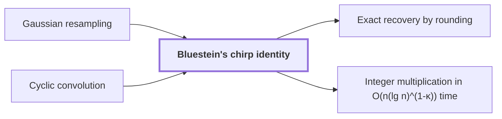

# Bluestein's chirp identity

!!! info "Before this page"

    Bluestein's chirp identity *is applied to* [Gaussian resampling](gaussian-resampling.md "The identity is applied to the middle transform produced by Gaussian resampling.") and *rewrites a Fourier transform as* [Cyclic convolution](cyclic-convolution.md "Bluestein's chirp identity rewrites a Fourier transform as a normalized cyclic convolution that is bracketed by multiplications by chirps, where a chirp is a factor whose exponent is quadratic in an index.").

!!! abstract "Where this fits"

    1. Two $n$-bit integers can be multiplied exactly in $O(n(\lg n)^{1-\kappa})$ worst-case time on a deterministic multitape Turing machine, for a fixed $\kappa=2^{-182}$. — how: reduce the product to a digit convolution, compute that convolution through transform layers whose tape cost saves a power, and recover the exact product by rounding ([Integer multiplication in O(n(lg n)^(1-κ)) time](integer-multiplication-target.md "A deterministic multitape Turing machine that multiplies two n-bit integers exactly in O(n(lg n)^(1-κ)) worst-case time for a fixed κ = 2^(-182) > 0, beating the n log n conjecture in this model."))
    2. **This page:** The middle transform, with its target permutation, becomes normalized cyclic convolution.

??? note "Symbols from earlier pages"

    - $\hat a$ — transform of a: The output sequence $\hat a = (\hat a_0, \dots, \hat a_{n-1})$, the discrete Fourier transform of $a$. (on [Discrete Fourier transform](fourier-transform.md "The map sending a length-n sequence to its values at the n-th roots of unity, i.e. the sums of the sequence weighted by powers of a root of unity."))
    - $a$ — input sequence: The input sequence $a = (a_0, \dots, a_{n-1})$ of $n$ complex numbers, the coefficient list of the polynomial $p$. (on [Discrete Fourier transform](fourier-transform.md "The map sending a length-n sequence to its values at the n-th roots of unity, i.e. the sums of the sequence weighted by powers of a root of unity."))
    - $j$ — input position: The index of an input entry $a_j$, running from $0$ to $n-1$; on this page it is not the power exponent it denotes on the roots-of-unity page. (on [Discrete Fourier transform](fourier-transform.md "The map sending a length-n sequence to its values at the n-th roots of unity, i.e. the sums of the sequence weighted by powers of a root of unity."))
    - $k$ — output position: The index of an output entry $\hat a_k$, running from $0$ to $n-1$; on this page it is not the power exponent it denotes on the roots-of-unity page. (on [Discrete Fourier transform](fourier-transform.md "The map sending a length-n sequence to its values at the n-th roots of unity, i.e. the sums of the sequence weighted by powers of a root of unity."))
    - $n$ — sequence length: The count of entries in the input sequence $a$, and so the number of output entries and the order of the root $\omega$ in this transform. (on [Discrete Fourier transform](fourier-transform.md "The map sending a length-n sequence to its values at the n-th roots of unity, i.e. the sums of the sequence weighted by powers of a root of unity."))
    - $\omega$ — primitive root: A primitive $n$-th root of unity, the complex number that labels the positions of a transform. (on [Primitive roots of unity](glossary.md#roots-of-unity "A complex number ω is a primitive n-th root of unity when ω^n = 1 and no smaller positive power equals 1."))
    - $y$ — ring indeterminate: The variable of the polynomial ring, an indeterminate that is not evaluated at any number. (on [Polynomial ring modulo yʳ + 1](polynomial-ring-y.md "The ring of complex polynomials in y reduced modulo y^r + 1, where multiplying by a power of y is a signed cyclic shift of the coefficient list."))
    - $r$ — coefficient count: The number of complex coefficients in the list of one element of the ring, a power of two. (on [Polynomial ring modulo yʳ + 1](polynomial-ring-y.md "The ring of complex polynomials in y reduced modulo y^r + 1, where multiplying by a power of y is a signed cyclic shift of the coefficient list."))
    - $P_t$ — target permutation: The target coordinate permutation, which reorders the outputs of the target transform. (on [Gaussian resampling](gaussian-resampling.md "An identity that expresses a Fourier transform of length given by a prime as a multidimensional transform with power-of-two axis lengths, with the source and target permutations kept in the identity."))

Bluestein's chirp identity rewrites a [Fourier transform](fourier-transform.md "The map sending a length-n sequence to its values at the n-th roots of unity, i.e. the sums of the sequence weighted by powers of a root of unity.") as a [normalized cyclic convolution](cyclic-convolution.md "The product of two sequences in which indices are taken modulo a fixed length, so each coefficient of the result is a sum of products over residues.") that is bracketed by multiplications by chirps, where a chirp is a factor whose exponent is quadratic in an index. It turns the middle transform into a form that the polynomial ring can compute.

The identity is applied to the middle transform produced by [Gaussian resampling](gaussian-resampling.md "An identity that expresses a Fourier transform of length given by a prime as a multidimensional transform with power-of-two axis lengths, with the source and target permutations kept in the identity."). That transform's target permutation $P_t$ is the reordering of its output indices that the next stage needs; this page sets it aside and uses the plain order.

Start from the plain transform $\hat a_k=\sum_{j=0}^{n-1}a_j\,\omega^{jk}$ for $k=0,\dots,n-1$, where $\omega=e^{2\pi i/n}$. Let $\zeta=e^{\pi i/n}$, so that $\zeta^2=\omega$ and $\zeta^n=-1$; $\zeta$ is the chirp base, and its powers are the chirp factors. Since $2jk=j^2+k^2-(k-j)^2$, we have $\omega^{jk}=\zeta^{j^2}\zeta^{k^2}\zeta^{-(k-j)^2}$, and therefore
$$\hat a_k=\zeta^{k^2}\sum_{j=0}^{n-1}\bigl(\zeta^{j^2}a_j\bigr)\,\zeta^{-(k-j)^2}.$$

The factors $\zeta^{j^2}$ before the sum and $\zeta^{k^2}$ after it are the chirps. Write $\nu$ for an integer offset. The sum is a convolution that pairs $\zeta^{j^2}a_j$ with the chirp $\zeta^{-\nu^2}$ at offset $\nu=k-j$. It is cyclic when $n$ is even, because the chirp then has period $n$:
$$\zeta^{-(\nu+n)^2}=\zeta^{-\nu^2}\,\omega^{-\nu n}\,\zeta^{-n^2}=\zeta^{-\nu^2},$$
since $\omega^{-\nu n}=1$ and $\zeta^{-n^2}=(\zeta^n)^{-n}=(-1)^n=1$. So the transform is computed by multiplying by chirps, convolving cyclically, and multiplying again. For $n=2$, $\omega=-1$, $\zeta=i$, the formula at $k=1$ gives $i(-ia_0+ia_1)=a_0-a_1$, the value the definition gives.

The cyclic form matters because of the polynomial ring. Let $\sigma$ be a coefficient position, from $0$ to $n-1$. In $\mathbb C[y]/(y^r+1)$ with $r=n$, a product term past the top coefficient picks up a minus sign, since $y^r=-1$. A phase twist removes this sign: multiply the coefficient of $y^\sigma$ by $\zeta^\sigma$ before the product, and by $\zeta^{-\sigma}$ after it. Let $\delta$ be the coefficient at $y^{\sigma+n}$ in the twisted product. That term wraps to $-\delta\zeta^{-\sigma}y^\sigma$ after the untwist, and $-\delta\zeta^{-\sigma}=\delta\zeta^{-(\sigma+n)}$ because $\zeta^n=-1$, which is the untwisted term moved to $y^\sigma$. The ring therefore computes a cyclic convolution<cite class="exegenius-ref" data-source="paper" data-locator="§1.3 From transforms to the exact product" data-quote="its negative wrap gives precisely the original cyclic wrap after the twist is removed" title="its negative wrap gives precisely the original cyclic wrap after the twist is removed"> (see §1.3 From transforms to the exact product)</cite>.

## Connections

Used by:

- [Exact recovery by rounding](rounding-recovery.md "Exact recovery by rounding is based on the normalized cyclic convolution that Bluestein's chirp identity produces.") *is based on* Bluestein's chirp identity
- [Integer multiplication in O(n(lg n)^(1-κ)) time](integer-multiplication-target.md "It converts its middle transform by Bluestein's chirp identity into a normalized cyclic convolution.") *converts its middle transform by* Bluestein's chirp identity

??? quote "From the sources"

    > Bluestein's chirp identity converts the middle transform
    >
    > — [Integer multiplication below n log n (OpenAI, 2026)](https://github.com/openai/math/tree/fd4aeeb2ee4fc729c18d98444fed42fd0529eeeb/preprints/Integer-multiplication-below-n-log-n-September-23-2026)
