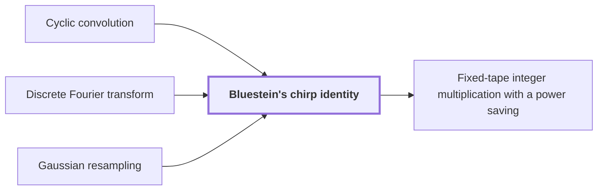

# Bluestein's chirp identity

!!! info "Before this page"

    Bluestein's chirp identity *computes it by* [Cyclic convolution](cyclic-convolution.md "Bluestein's chirp identity rewrites the discrete Fourier transform of a vector and computes it by a cyclic convolution placed between two pointwise multiplications."), *rewrites* [Discrete Fourier transform](fourier-transform.md "Bluestein's chirp identity rewrites the discrete Fourier transform of a vector and computes it by a cyclic convolution placed between two pointwise multiplications.") and *acts on* [Gaussian resampling](gaussian-resampling.md "Bluestein's chirp identity acts on the middle transform of the paper's multiplication algorithm, including its target permutation.").

!!! abstract "Where this fits"

    1. The integer product is computed exactly on one fixed-tape machine in $O(n(\lg n)^{1-\kappa})$ worst-case time, for $\kappa=2^{-182}$. — how: reduce exact multiplication to convolution of radix digits on distinct prime axes, compute the convolution by synthetic transforms on tape layouts, and bound the total tape cost with a power saving ([Fixed-tape integer multiplication with a power saving](fixed-tape-multiplication.md "A deterministic fixed-tape Turing machine that multiplies two n-bit integers exactly in O(n(lg n)^(1−κ)) worst-case time, for a fixed κ = 2^(−182), disproving the n log n optimality conjecture in this model."))
    2. **This page:** Bluestein's chirp identity turns the middle transform, with its target permutation, into normalized cyclic convolution.

??? note "Symbols from earlier pages"

    - $q$ — vector length: The number of entries of the vector $u$, which is the length the transform is taken at. (on [Discrete Fourier transform](fourier-transform.md "The map sending a vector u of length q to the vector whose k-th entry is (1/q) times the sum over j of u_j times exp(−2πijk/q)."))
    - $\hat u$ — transform of u: The discrete Fourier transform of $u$, whose $k$-th entry is $\hat u_k$. (on [Discrete Fourier transform](fourier-transform.md "The map sending a vector u of length q to the vector whose k-th entry is (1/q) times the sum over j of u_j times exp(−2πijk/q)."))
    - $u$ — input vector: The complex vector of length $q$ that the transform acts on. (on [Discrete Fourier transform](fourier-transform.md "The map sending a vector u of length q to the vector whose k-th entry is (1/q) times the sum over j of u_j times exp(−2πijk/q)."))
    - $j$ — input index: The index of an entry of $u$, running from $0$ to $q-1$. (on [Discrete Fourier transform](fourier-transform.md "The map sending a vector u of length q to the vector whose k-th entry is (1/q) times the sum over j of u_j times exp(−2πijk/q)."))
    - $k$ — output index: The index of an entry of $\hat u$, running from $0$ to $q-1$. (on [Discrete Fourier transform](fourier-transform.md "The map sending a vector u of length q to the vector whose k-th entry is (1/q) times the sum over j of u_j times exp(−2πijk/q)."))

Bluestein's chirp identity rewrites the [discrete Fourier transform](fourier-transform.md "The map sending a vector u of length q to the vector whose k-th entry is (1/q) times the sum over j of u_j times exp(−2πijk/q).") of a vector and computes it by a [cyclic convolution](cyclic-convolution.md "The product of two coefficient lists in the ring of polynomials modulo x^S − 1, in which exponents wrap around modulo S.") placed between two pointwise multiplications.

Bluestein's chirp identity acts on the middle transform of the paper's multiplication algorithm, including its [target permutation](gaussian-resampling.md "A rewriting of a Fourier transform of prime length as a transform with power-of-two axis lengths, with source and target coordinate permutations kept inside the transform identity."). It turns the transform into normalized cyclic convolution<cite class="exegenius-ref" data-source="paper" data-locator="§1.3 From transforms to the exact product" data-quote="Bluestein's chirp identity converts the middle transform, including its target permutation, into normalized cyclic convolution" title="Bluestein's chirp identity converts the middle transform, including its target permutation, into normalized cyclic convolution"> (see §1.3 From transforms to the exact product)</cite>.

Take one coordinate of length $q$, so $\hat u_k=\frac1q\sum_j u_j\exp(-2\pi i jk/q)$. Let $\chi_\alpha=\exp(-\pi i \alpha^2/q)$ be the chirp value at an integer $\alpha$, the chirp index here. Since $2jk=j^2+k^2-(k-j)^2$,

$$\exp\left(-\frac{2\pi i\, jk}{q}\right)=\chi_j\,\chi_k\,\overline{\chi_{k-j}},$$

so $q\,\hat u_k=\chi_k\sum_j (u_j\chi_j)\,\overline{\chi_{k-j}}$. The factors $\chi_j$ and $\chi_k$ are pointwise multiplications, and the sum is a convolution in the index $k-j$.

For even $q$, $\chi_{\alpha+q}=\chi_\alpha$, so $\overline{\chi_{k-j}}$ may be read at the residue $(k-j)\bmod q$, and the sum is already a cyclic convolution.

For odd $q$, $\chi_{\alpha+q}=-\chi_\alpha$, so each wrapped term would carry a sign $-1$ that a cyclic convolution lacks. The phase twist removes it. Let $\tau_\alpha=\exp(\pi i \alpha/q)$ be the phase twist at an integer $\alpha$, which satisfies $\tau_{\alpha+q}=-\tau_\alpha$. The twisted sequences are $\mu_j=u_j\chi_j\tau_j$ and $\nu_\alpha=\overline{\chi_\alpha}\,\tau_\alpha$ for $0\le j,\alpha<q$, and the letters $\tau$, $\mu$ and $\nu$ change meaning here. Each product $\mu_j\nu_{(k-j)\bmod q}$ equals $\tau_k\,u_j\chi_j\overline{\chi_{k-j}}$: at a wrap the two sign changes cancel, and $\tau_j\tau_{k-j}=\tau_k$. Therefore

$$q\,\hat u_k=\chi_k\,\overline{\tau_k}\sum_j \mu_j\,\nu_{(k-j)\bmod q}.$$

The paper's own phase twist does this on its last cyclic coordinate, and<cite class="exegenius-ref" data-source="paper" data-locator="§1.3 From transforms to the exact product" data-quote="its negative wrap gives precisely the original cyclic wrap after the twist is removed" title="its negative wrap gives precisely the original cyclic wrap after the twist is removed"> (see §1.3 From transforms to the exact product)</cite>.

## Connections

Used by:

- [Fixed-tape integer multiplication with a power saving](fixed-tape-multiplication.md "It reduces the middle transform by Bluestein's chirp identity.") *reduces the middle transform by* Bluestein's chirp identity

??? quote "From the sources"

    > Next, Bluestein's chirp identity converts the middle transform,
    >
    > — [Integer multiplication below n log n (OpenAI, 2026)](https://github.com/openai/math/tree/fd4aeeb2ee4fc729c18d98444fed42fd0529eeeb/preprints/Integer-multiplication-below-n-log-n-September-23-2026)
