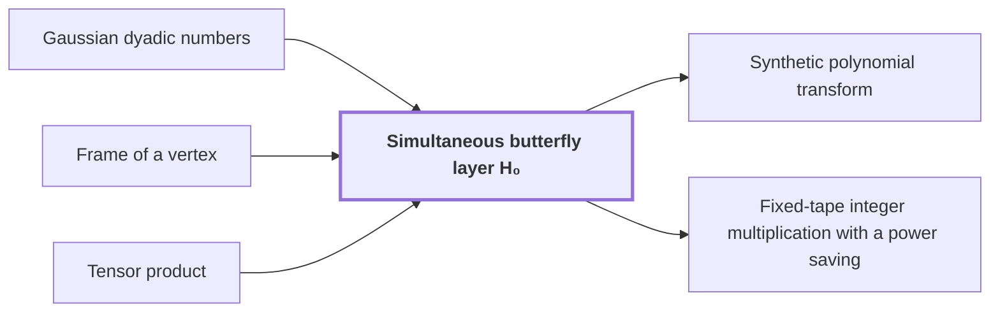

# Simultaneous butterfly layer H₀

!!! info "Before this page"

    Simultaneous butterfly layer H₀ *computes exactly in* [Gaussian dyadic numbers](glossary.md#gaussian-dyadic "The layer computes exactly in Gaussian dyadic numbers, whose real and imaginary parts have power-of-two denominators, each part stored with $p$ bits after the binary point."), *acts on arrays stored in* [Frame of a vertex](frame.md "The layer acts on arrays stored in the Frame of a vertex on each wire.") and *is built by* [Tensor product](tensor-product.md "Applying $B_d$ to all $d$ selected bits is built by the Tensor product of the $d$ single-bit butterflies, so applying them one at a time in any order gives the same result."). Assumed known: Complex numbers.

!!! abstract "Where this fits"

    1. The integer product is computed exactly on one fixed-tape machine in $O(n(\lg n)^{1-\kappa})$ worst-case time, for $\kappa=2^{-182}$. — how: reduce exact multiplication to convolution of radix digits on distinct prime axes, compute the convolution by synthetic transforms on tape layouts, and bound the total tape cost with a power saving ([Fixed-tape integer multiplication with a power saving](fixed-tape-multiplication.md "A deterministic fixed-tape Turing machine that multiplies two n-bit integers exactly in O(n(lg n)^(1−κ)) worst-case time, for a fixed κ = 2^(−182), disproving the n log n optimality conjecture in this model."))
    2. The tape operations of the algorithm cost $O(V(\lg n)^{1-\kappa})$ in total, for stored volume $V=\Theta(n)$. — how: bound the cost of each tape procedure by a fixed power of its width below linear, then choose compatible fixed rational parameters
    3. **This page:** A simultaneous butterfly layer on $d$ equal-width chunks costs $O(Vd^{\lambda'})$ for a fixed $\lambda'<1$.

??? note "Symbols from earlier pages"

    - $u$ — first butterfly input: The first value of an input pair to the butterfly map $H_0$. (on [Gaussian dyadic numbers](glossary.md#gaussian-dyadic "Complex numbers whose real and imaginary parts are both dyadic rationals, that is, have power-of-two denominators."))
    - $v$ — second butterfly input: The second value of an input pair to the butterfly map $H_0$. (on [Gaussian dyadic numbers](glossary.md#gaussian-dyadic "Complex numbers whose real and imaginary parts are both dyadic rationals, that is, have power-of-two denominators."))
    - $p$ — fractional bit count: The number of fractional bits in each stored part, so every stored part is a multiple of $2^{-p}$. (on [Gaussian dyadic numbers](glossary.md#gaussian-dyadic "Complex numbers whose real and imaginary parts are both dyadic rationals, that is, have power-of-two denominators."))

The simultaneous butterfly layer is the map that applies a two-point butterfly to one selected address bit of every chunk in one pass. Here $d$ is the number of chunks, not the number of axes used on the transform page, and the layer is written $B_d$. It is the basic step of the transforms, which need many address bits transformed at once.

The two-point butterfly is $H_0(u,v)=\bigl((u+v)/2,(u-v)/2\bigr)$. It takes two values $u$ and $v$ at the two addresses that differ only in the selected bit. An address chunk is a block of consecutive address bits. Each chunk has the same width, and the selected bits sit at a common offset from the least significant end. The layer applies $H_0$ to all $d$ selected bits at once.

Applying $B_d$ to all $d$ selected bits is built by the [Tensor product](tensor-product.md "The tensor product V ⊗ W of vector spaces is the space spanned by pairs of basis vectors, and the tensor product of linear maps acts on each factor separately, so one-dimensional operations on several coordinates combine into one operation on the product space.") of the $d$ single-bit butterflies, so applying them one at a time in any order gives the same result.

The layer acts on arrays stored in the [Frame of a vertex](frame.md "An invertible linear operator attached to a gate or terminal that sets how the array on each wire there is stored; changing frames along an edge cancels between the two ends of a route.") on each wire. Each address holds a polynomial record of $M$ complex coefficients; $M$ is the number of complex coefficients in a record. $B_d$ acts on each record coefficientwise. For $u=1+i$ and $v=1-i$ the output pair is $(1,\,i)$, since $(u+v)/2=1$ and $(u-v)/2=i$.

The layer computes exactly in [Gaussian dyadic numbers](glossary.md#gaussian-dyadic "Complex numbers whose real and imaginary parts are both dyadic rationals, that is, have power-of-two denominators."), whose real and imaginary parts have power-of-two denominators, each part stored with $p$ bits after the binary point.

The cost counts tape operations on the stored volume $V$. The exponent $\lambda'<1$ is a fixed constant. The pointwise arithmetic costs $O(V)$, since each pair of coefficients takes a fixed number of exact operations. The rest is address movement by [Fast interchange of address chunks](tape-interchange.md "A fixed-tape procedure that swaps two disjoint equal-width address fields of an array in time O(V u^τ) for a fixed τ < 1, where V is the stored volume and u the field width, using XOR combinations of intermediate data."), which moves a group of equal-width chunks by one swap. The layer costs $O(Vd^{\lambda'})$ tape operations,<cite class="exegenius-ref" data-source="paper" data-locator="§1.1 The two tape operations" data-quote="the cost is $O(Vd^{\lambda'})$ for a fixed $\lambda'&lt;1$" title="the cost is $O(Vd^{\lambda'})$ for a fixed $\lambda'&lt;1$"> (see §1.1 The two tape operations)</cite>.

The proof, in the paper's section on fast butterfly layers, splits the chunks into groups of power-of-base sizes, moves each group with swaps, and sums the costs over $O(\log d)$ levels. The sum is $O(d^{\lambda'})$ for any $\lambda'$ above the swap exponents and below 1. Since $d^{\lambda'}<d$ for $d\ge 2$, this beats the $d$ whole-array passes that separate single-bit butterflies would take, each costing $O(V)$.

## Connections

Used by:

- [Synthetic polynomial transform](synthetic-transform.md "The transform is computed by successive layers of Simultaneous butterfly layer H₀.") *is computed by successive layers of* Simultaneous butterfly layer H₀
- [Fixed-tape integer multiplication with a power saving](fixed-tape-multiplication.md "Each transform is built from simultaneous layers of Simultaneous butterfly layer H₀ on polynomial records.") *is built from simultaneous layers of* Simultaneous butterfly layer H₀

??? quote "From the sources"

    > simultaneously on selected coordinate bits of the numerical arrays.
    >
    > — [Integer multiplication below n log n (OpenAI, 2026)](https://github.com/openai/math/tree/fd4aeeb2ee4fc729c18d98444fed42fd0529eeeb/preprints/Integer-multiplication-below-n-log-n-September-23-2026)
