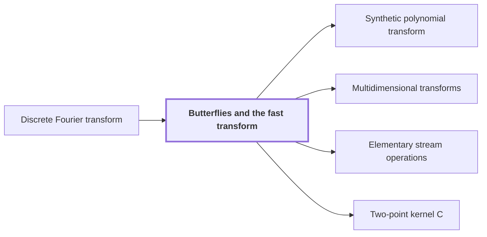

# Butterflies and the fast transform

!!! info "Before this page"

    Butterflies and the fast transform *compute* [Discrete Fourier transform](dft.md "Repeated over the address bits of the array, with twiddle multiplications (multiplications by roots of unity) between layers, butterflies compute the Discrete Fourier transform of $z$ in $\log_2 t$ layers.").

!!! abstract "Where this fits"

    - Relied on to show: Synthetic transforms over $\mathcal R_r$ on $d-1$ axes of lengths $t_i\in\{2^{\ell-1},2^\ell\}$ with outputs kept in a retained layout $LB$ cost $O(Tp[dK+pK^{\tau-1}+\ell d^{\lambda'}])$ with error less than $\sqrt2\ell\,2^{-p}$. ([Tape layout for synthetic transforms](transform-layout.md "Placing the selected bits of the participating axes at a common offset in K-bit chunks so each round of the synthetic transform is one simultaneous layer, costing less than log t passes."))
    - Relied on to show: The synthetic transform $F_t^-$ over $\mathcal R_r=\mathbb C[y]/(y^r+1)$, with roots of unity $\omega_t=y^{2r/t}$, is computed by decimation in frequency with outputs written in bit-reversed order, $B_tF_t^-$; the pointwise product keeps this order and the reverse procedure computes $F_t^+B_t^{-1}$, so no reordering is executed. ([Retained frequency order](frequency-order.md "The forward synthetic transform writes its outputs in bit-reversed order, the pointwise product keeps that order, and the opposite transform consumes it, so no reordering is executed."))

A butterfly is the two-point step $H_0(u,v)=(\frac{u+v}{2},\frac{u-v}{2})$ applied to a pair of values $u,v$. Take input values $z_k$ at positions $0\le k<t$, where $t$ is the transform length, a power of two. Repeated over the address bits of the array, with twiddle multiplications (multiplications by roots of unity) between layers, butterflies compute the [Discrete Fourier transform](dft.md "The normalized transform (F_q u)_k = (1/q) Σ u_j e^{−2πi jk/q}, which turns convolution into pointwise multiplication.") of $z$ in $\log_2 t$ layers. The transform is $(F_tz)_m=\frac1t\sum_{j=0}^{t-1} z_j\omega_t^{-jm}$, where $\omega_t=e^{2\pi i/t}$, $m$ is the output index and $j$ runs over input positions. Every output is a weighted sum of all $t$ inputs, so evaluating the definition directly costs $t^2$ operations; the layers cut this to order $t\log t$.

On a tape machine the arithmetic is not the only cost: the later transforms consist of address rearrangements, signed shifts and<cite class="exegenius-ref" data-source="paper" data-locator="§1.1 The two tape operations" data-quote="two-point butterfly operations" title="two-point butterfly operations"> (see §1.1 The two tape operations)</cite>, and even one scan of the stored bits per level over $\log n$ levels costs order $n\log n$. This is why movement and butterfly arithmetic must both be made cheaper<cite class="exegenius-ref" data-source="paper" data-locator="§1.1 The two tape operations" data-quote="We therefore need savings in both movement and arithmetic." title="We therefore need savings in both movement and arithmetic."> (see §1.1 The two tape operations)</cite>

## One layer

The decimation-in-frequency step pairs $z_k$ with $z_{k+t/2}$ for $0\le k<t/2$<cite class="exegenius-ref" data-source="paper" data-locator="§6.1 Roots, butterflies, and stored frequency order" data-quote="the decimation-in-frequency step pairs $z_k$ with $z_{k+t/2}$" title="the decimation-in-frequency step pairs $z_k$ with $z_{k+t/2}$"> (see §6.1 Roots, butterflies, and stored frequency order)</cite>; these positions differ exactly in the highest address bit. Splitting the sum over $j=k$ and $j=k+t/2$, since $\omega_t^{t/2}=-1$ the second part carries the factor $(-1)^m$. Write $m=2h+b$, where $b\in\{0,1\}$ is the lowest bit of $m$ and $h$ is the remaining index (on this page $h$ is not the ground-set size or wrap indicator of earlier pages). Then
$$(F_tz)_{2h+b}=\frac1{t/2}\sum_{k=0}^{t/2-1}(\omega_t^2)^{-hk}\,\omega_t^{-bk}\,\frac{z_k+(-1)^bz_{k+t/2}}{2}.$$
The pair enters only through $\frac{z_k+z_{k+t/2}}2$ (for $b=0$) and $\frac{z_k-z_{k+t/2}}2$ (for $b=1$), the two outputs of $H_0$. Store them in the slots they came from, so the highest address bit now holds $b$. After multiplying the $b=1$ output by the twiddle factor $\omega_t^{-k}$, each branch needs the same transform of length $t/2$ with output index $h$, because $\omega_t^2$ is the primitive $(t/2)$-th root of unity.

## Recursion and output order

One layer of $t/2$ butterflies and $t/2$ twiddle multiplications reduces a length-$t$ transform to two independent length-$t/2$ transforms. After $\log_2 t$ layers every transform has length one, the identity, for order $t\log t$ operations in all.

Number the address bits from the highest down. Layer one leaves bit $0$ of $m$ in the highest address bit. Within each branch, layer two repeats the argument for $h$: it pairs entries differing in the next address bit and leaves bit $1$ of $m$ there. Inductively, each layer leaves the next higher bit of $m$ in the next lower address bit. The address bits from high to low therefore hold the bits of $m$ from low to high<cite class="exegenius-ref" data-source="paper" data-locator="§6.1 Roots, butterflies, and stored frequency order" data-quote="contain the frequency bits from low to high" title="contain the frequency bits from low to high"> (see §6.1 Roots, butterflies, and stored frequency order)</cite>, so output $m$ lands at the bit-reversed position of $m$.

For $t=4$: the first layer forms $\frac{z_0\pm z_2}2$ and $\frac{z_1\pm z_3}2$ and multiplies the two differences by $1$ and $\omega_4^{-1}=-i$. The second layer applies $H_0$ to each pair. Output $m=1$ (bits $01$) sits in position $2$ (bits $10$).

## Connections

Used by:

- [Synthetic polynomial transform](synthetic-transform.md "As in the complex case, $F_t^-$ is computed by Butterflies and the fast transform in $\log_2 t$ layers, each twiddle multiplication being a signed shift.") *is computed by* Butterflies and the fast transform
- [Multidimensional transforms](multidim-transform.md "Each line transform is computed by the Butterflies and the fast transform in $O(t_i\log t_i)$ operations.") *computes each line transform by* Butterflies and the fast transform
- [Elementary stream operations](stream-ops.md "A transform built from Butterflies and the fast transform applies two-point steps, each on one address bit, so it has $\Theta(\log n)$ levels, and each level needs the data rearranged for the paired entries to meet, then the arithmetic.") *rearranges data for transforms built from* Butterflies and the fast transform
- [Two-point kernel C](phase-kernel.md "The kernel $C$ is obtained from the two-point step of Butterflies and the fast transform by conjugating with $\mathsf S$ and rescaling:") *is obtained from* Butterflies and the fast transform

??? quote "From the sources"

    > the decimation-in-frequency step pairs $z_k$ with $z_{k+t/2}$
    >
    > — [Integer multiplication below n log n (OpenAI, 2026)](https://github.com/openai/math/tree/fd4aeeb2ee4fc729c18d98444fed42fd0529eeeb/preprints/Integer-multiplication-below-n-log-n-September-23-2026)

    > two-point butterfly operations
    >
    > — [Integer multiplication below n log n (OpenAI, 2026)](https://github.com/openai/math/tree/fd4aeeb2ee4fc729c18d98444fed42fd0529eeeb/preprints/Integer-multiplication-below-n-log-n-September-23-2026)
