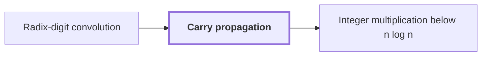

# Carry propagation

!!! info "Before this page"

    Carry propagation *is applied to* [Radix-digit convolution](radix-digit-convolution.md "It is applied to the coefficients of the Radix-digit convolution once they are recovered.").

!!! abstract "Where this fits"

    1. A deterministic fixed-tape machine multiplies two $n$-bit integers exactly in $O(n(\lg n)^{1-\kappa})$ time, with $\kappa=2^{-182}$, below the $n\lg n$ conjecture in this model. — how: bound the cost of an exact multiplication whose transform layers are made cheap by two tape procedures, then fix parameters so every cost term fits ([Integer multiplication below n log n](main-theorem.md "A deterministic fixed-tape machine that multiplies two n-bit integers exactly in O(n (lg n)^(1−κ)) time with κ = 2^−182, which disproves the n log n optimality conjecture in this model."))
    2. The exact product of two $n$-bit integers is obtained from the convolution of their radix-digit coefficients, computed by transforms on a fixed tape layout and then recovered and carried. — how: reduce the convolution by a Chinese-remainder map, Gaussian resampling, Bluestein's identity and a phase twist to a convolution over a polynomial ring, then recover coefficients and propagate carries ([Radix-digit convolution](radix-digit-convolution.md "Writing both integers as polynomials in a power of two whose coefficients are their digits, so that their product is a polynomial convolution of short coefficients."))
    3. **This page:** Carries are propagated through the recovered coefficients to obtain the exact binary product.

??? note "Symbols from earlier pages"

    - $j$ — input index: The index of an input entry, ranging over 0 to q-1. (on [Discrete Fourier transform](discrete-fourier-transform.md "The map sending a vector of q values to its q values weighted by powers of a q-th root of unity, normalized by 1/q."))

Carry propagation is the final step that turns the recovered integer coefficients of a convolution into the binary string of an exact product. It is applied to the coefficients of the [Radix-digit convolution](radix-digit-convolution.md "Writing both integers as polynomials in a power of two whose coefficients are their digits, so that their product is a polynomial convolution of short coefficients.") once they are recovered.

The coefficients are integers that can be larger than the base, so they cannot be read off as bits. Carry propagation processes them from the least significant position upward. At each position it adds the coefficient $c_j$ to the carry from the previous position, writes the low bit of the sum as the next output bit, and passes the high part on as the carry. Each step preserves the total: coefficient plus carry equals bit plus twice the new carry, so the output bits spell the same integer as the coefficients.

Worked example, in base 2 with coefficients 3, 2, 1, which stand for $3 + 2\cdot 2 + 1\cdot 4 = 11$. Position 0 gives $3 = 1 + 2\cdot 1$: bit 1, carry 1. Position 1 gives $2 + 1 = 3 = 1 + 2\cdot 1$: bit 1, carry 1. Position 2 gives $1 + 1 = 2 = 0 + 2\cdot 1$: bit 0, carry 1.

The coefficients run out, but the carry may not. Position 3 has coefficient 0 and gives $0 + 1 = 1 = 1 + 2\cdot 0$: bit 1, carry 0. In general the carry can exceed 1, so after the last coefficient each position writes the low bit of the carry and passes on the high part, until the carry is 0. This stops because the carry after position $j$ is at most the total divided by $2^{j+1}$. The bits from least to most significant are 1, 1, 0, 1; reversing them gives 1011, which is 11.

On the [fixed-tape machine](fixed-tape-model.md "A Turing machine with one fixed finite alphabet and one fixed finite number of one-dimensional tapes, whose size does not grow with the input."), a work tape is a scratch tape. The bits are written to it in the order they are produced, and the stream is then reversed.<cite class="exegenius-ref" data-source="paper" data-locator="§5 Multiply the grid numerators of w, p. 61" data-quote="Write the resulting bits from least to most significant on a work tape, then reverse that stream and output exactly 2n bits in most-significant-first order." title="Write the resulting bits from least to most significant on a work tape, then reverse that stream and output exactly 2n bits in most-significant-first order."> (see §5 Multiply the grid numerators of w, p. 61)</cite>

## Connections

Used by:

- [Integer multiplication below n log n](main-theorem.md "The result ends with carry propagation.") *ends with* Carry propagation

??? quote "From the sources"

    > Propagate radix-2b carries in increasing coefficient order
    >
    > — Integer multiplication below n log n (OpenAI, 2026)
