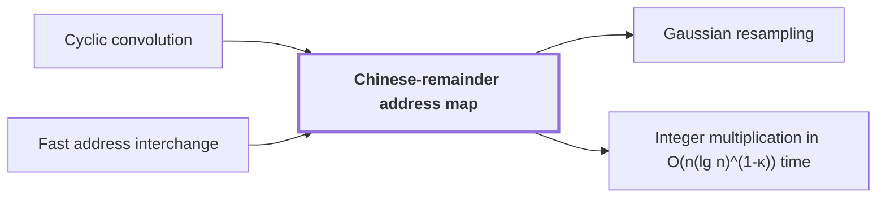

# Chinese-remainder address map

!!! info "Before this page"

    Chinese-remainder address map *preserves* [Cyclic convolution](cyclic-convolution.md "The map preserves cyclic convolution of length $N$; the source paper proves this for the placement, which applies here because the axis lengths are distinct primes.") and *is implemented by* [Fast address interchange](address-interchange.md "It is implemented by fast address interchange steps.").

!!! abstract "Where this fits"

    1. Two $n$-bit integers can be multiplied exactly in $O(n(\lg n)^{1-\kappa})$ worst-case time on a deterministic multitape Turing machine, for a fixed $\kappa=2^{-182}$. — how: reduce the product to a digit convolution, compute that convolution through transform layers whose tape cost saves a power, and recover the exact product by rounding ([Integer multiplication in O(n(lg n)^(1-κ)) time](integer-multiplication-target.md "A deterministic multitape Turing machine that multiplies two n-bit integers exactly in O(n(lg n)^(1-κ)) worst-case time for a fixed κ = 2^(-182) > 0, beating the n log n conjecture in this model."))
    2. **This page:** The radix-digit coefficient list is placed on a product of distinct prime cyclic axes, preserving convolution.

??? note "Symbols from earlier pages"

    - $V$ — stored bit volume: The number of data bits the array holds. (on [Fast address interchange](address-interchange.md "A tape procedure that swaps two disjoint contiguous address fields of an array in time O(V u^τ) for width u, computed through XOR combinations of intermediate data."))
    - $u$ — field width: The number of address bits in one field. (on [Fast address interchange](address-interchange.md "A tape procedure that swaps two disjoint contiguous address fields of an array in time O(V u^τ) for width u, computed through XOR combinations of intermediate data."))
    - $\tau$ — width exponent: A fixed exponent with 0 < tau < 1 in the cost bound O(V u^tau). (on [Fast address interchange](address-interchange.md "A tape procedure that swaps two disjoint contiguous address fields of an array in time O(V u^τ) for width u, computed through XOR combinations of intermediate data."))

The Chinese-remainder address map is a rearrangement that places a coefficient list on a product of distinct prime cyclic axes (dimensions whose indices are taken modulo their lengths) while preserving convolution. It is implemented by [fast address interchange](address-interchange.md "A tape procedure that swaps two disjoint contiguous address fields of an array in time O(V u^τ) for width u, computed through XOR combinations of intermediate data.") steps. It is the first step of the argument, since later transforms treat each axis separately.

Let $N$ be the number of coefficients in the list, and let $P$ be the number of axes. Let $L_1,\dots,L_P$ be the prime lengths of the axes, pairwise distinct, so that $N = L_1 L_2 \cdots L_P$.

Let $J$ be a position in the list, running from $0$ to $N-1$. The map sends $J$ to its residues $(J \bmod L_1, \dots, J \bmod L_P)$, its remainders on each axis. For $N = 15 = 3 \cdot 5$, position $7$ goes to $(1, 2)$. Because the $L_i$ are distinct primes, they are pairwise coprime, so the Chinese remainder theorem says that every tuple of residues, one modulo each $L_i$, comes from exactly one integer modulo $N$. The map is therefore a bijection: each coefficient lands at exactly one tuple of axis positions, and no tuple receives two.

The map preserves [cyclic convolution](cyclic-convolution.md "The product of two sequences in which indices are taken modulo a fixed length, so each coefficient of the result is a sum of products over residues.") of length $N$; the source paper proves this for the placement, which applies here because the axis lengths are distinct primes. In the source, the radix-digit coefficient list is placed on a product of distinct prime cyclic axes<cite class="exegenius-ref" data-source="paper" data-locator="§1.3 From transforms to the exact product" data-quote="by a Chinese-remainder map that preserves convolution" title="by a Chinese-remainder map that preserves convolution"> (see §1.3 From transforms to the exact product)</cite>.

Controlled cyclic shifts, rotations of an axis by an amount set by a control value, are among these steps. The cost measure is worst-case time on the tape: an interchange of two address fields in an array of $V$ stored bits, with field width $u$, takes time at most a constant times $V u^\tau$, so the reordering costs the sum of the times of its interchanges.

## Connections

Used by:

- [Gaussian resampling](gaussian-resampling.md "Gaussian resampling operates on the axes produced by the Chinese-remainder address map.") *operates on* Chinese-remainder address map
- [Integer multiplication in O(n(lg n)^(1-κ)) time](integer-multiplication-target.md "The algorithm arranges its digits by the Chinese-remainder address map on distinct prime cyclic axes.") *arranges its digits by* Chinese-remainder address map

??? quote "From the sources"

    > by a Chinese-remainder map that preserves convolution
    >
    > — [Integer multiplication below n log n (OpenAI, 2026)](https://github.com/openai/math/tree/fd4aeeb2ee4fc729c18d98444fed42fd0529eeeb/preprints/Integer-multiplication-below-n-log-n-September-23-2026)
