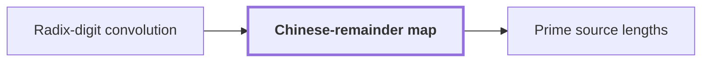

# Chinese-remainder map

!!! info "Before this page"

    Chinese-remainder map *is applied to the coefficients of* [Radix-digit convolution](radix-digit-convolution.md "The map is applied to the coefficients of Radix-digit convolution."). Assumed known: Cyclic convolution.

!!! abstract "Where this fits"

    - Relied on to show: Distinct odd primes $s_1,\dots,s_d$ exist with $(1-2\eta)t_i<s_i\le(1-\eta)t_i$ for every axis $i$, and their product $S=\prod_i s_i$ satisfies $T/2<S<T$. ([Prime source lengths](prime-source-lengths.md "Distinct odd primes chosen close to the powers of two that are the padded axis lengths, so that their product fills a fixed fraction of the padded box."))
    - Relied on to show: Each $\gcd(s_i,t_i)$ equals one, since $t_i$ is a power of two.

The Chinese-remainder map is a relabeling of cyclic positions that turns one cyclic convolution into a convolution over a box of several cyclic axes, so that later steps can treat each axis on its own. It is also called the Agarwal–Cooley map. The map is applied to the coefficients of [Radix-digit convolution](radix-digit-convolution.md "Writing both integers as polynomials in a power of two whose coefficients are their digits, so that their product is a polynomial convolution of short coefficients.").

Write $r$ for the number of cyclic axes, not the digit count of the earlier page. Write $a$ for an axis index, $1 \le a \le r$, and $t_a$ for the number of positions along axis $a$; the lengths $t_1,\dots,t_r$ are pairwise coprime. Put $T = t_1 t_2 \cdots t_r$, the total number of positions.

On this page $p$ and $q$ are cyclic positions, not the coefficient index of the radix-digit page, with $0 \le p, q < T$; and $w$ is an output position, not the digit width there. The map $\phi$ sends a position $p$ to the tuple of its residues:

$$\phi(p) = (p \bmod t_1,\dots,p \bmod t_r).$$

The box is the set of tuples whose $a$th entry lies in $\{0,\dots,t_a-1\}$. By the Chinese remainder theorem, $\phi$ is a bijection that respects sums: $\phi((p+q) \bmod T)=\phi(p)+\phi(q)$, with the sum taken coordinatewise and each entry reduced modulo its $t_a$. Since $\phi$ is injective, $p+q \equiv w \pmod T$ holds exactly when $\phi(p)+\phi(q)=\phi(w)$. So the terms adding into output $w$ are the pairs of box points whose coordinatewise sum is $\phi(w)$, each axis wrapping on its own. This is the $r$-dimensional cyclic convolution on the box.

Example. Take $T=6$, so $t_1=2$ and $t_2=3$. The map sends $0,\dots,5$ to $(0,0),(1,1),(0,2),(1,0),(0,1),(1,2)$. For $p=2$ and $q=5$, $(p+q) \bmod 6 = 1$, and $(0,2)+(1,2)=(1,1)$ coordinatewise, which is $\phi(1)$.

The paper uses the map in this way; there<cite class="exegenius-ref" data-source="paper" data-locator="§11 A consequence for matrix transposition, p. 5" data-quote="the radix-digit coefficient list is placed on a product of distinct prime cyclic axes by a Chinese-remainder map that preserves convolution" title="the radix-digit coefficient list is placed on a product of distinct prime cyclic axes by a Chinese-remainder map that preserves convolution"> (see §11 A consequence for matrix transposition, p. 5)</cite>.

## Connections

Used by:

- [Prime source lengths](prime-source-lengths.md "The lengths $s_a$ are the moduli of the Chinese-remainder map, which turns one cyclic convolution of length $S$ into a multidimensional one over the $s_a$.") *are the moduli of* Chinese-remainder map

??? quote "From the sources"

    > a Chinese-remainder map that preserves convolution
    >
    > — Integer multiplication below n log n (OpenAI, 2026)
