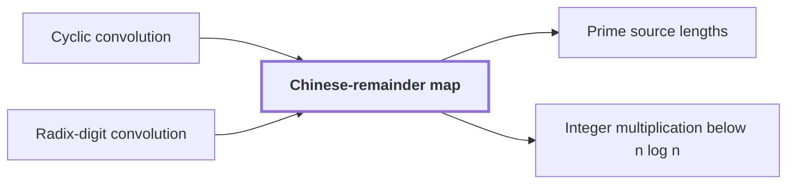

# Chinese-remainder map

!!! info "Before this page"

    Chinese-remainder map *preserves* [Cyclic convolution](glossary.md#cyclic-convolution "It preserves the cyclic convolution of a sequence.") and *acts on the coefficients of* [Radix-digit convolution](radix-digit-convolution.md "It acts on the coefficients of a radix-digit convolution before any transform is computed, turning one cyclic convolution into a convolution over several cyclic axes at once.").

!!! abstract "Where this fits"

    1. A deterministic fixed-tape machine multiplies two $n$-bit integers exactly in $O(n(\lg n)^{1-\kappa})$ time, with $\kappa=2^{-182}$, below the $n\lg n$ conjecture in this model. — how: bound the cost of an exact multiplication whose transform layers are made cheap by two tape procedures, then fix parameters so every cost term fits ([Integer multiplication below n log n](main-theorem.md "A deterministic fixed-tape machine that multiplies two n-bit integers exactly in O(n (lg n)^(1−κ)) time with κ = 2^−182, which disproves the n log n optimality conjecture in this model."))
    2. The exact product of two $n$-bit integers is obtained from the convolution of their radix-digit coefficients, computed by transforms on a fixed tape layout and then recovered and carried. — how: reduce the convolution by a Chinese-remainder map, Gaussian resampling, Bluestein's identity and a phase twist to a convolution over a polynomial ring, then recover coefficients and propagate carries ([Radix-digit convolution](radix-digit-convolution.md "Writing both integers as polynomials in a power of two whose coefficients are their digits, so that their product is a polynomial convolution of short coefficients."))
    3. **This page:** The radix-digit coefficient list is placed on a product of distinct prime cyclic axes by a Chinese-remainder map that preserves convolution.

??? note "Symbols from earlier pages"

    - $a$ — first input sequence: The first sequence of t complex numbers, indexed from 0 to t-1. (on [Cyclic convolution](glossary.md#cyclic-convolution "The product of two sequences in which indices wrap around modulo the sequence length."))
    - $b$ — second input sequence: The second sequence of t complex numbers, indexed from 0 to t-1. (on [Cyclic convolution](glossary.md#cyclic-convolution "The product of two sequences in which indices wrap around modulo the sequence length."))

The Chinese-remainder map is a relabeling of coefficient positions by their residues modulo several pairwise coprime lengths. It preserves the [cyclic convolution](glossary.md#cyclic-convolution "The product of two sequences in which indices wrap around modulo the sequence length.") of a sequence. It acts on the coefficients of a [radix-digit convolution](radix-digit-convolution.md "Writing both integers as polynomials in a power of two whose coefficients are their digits, so that their product is a polynomial convolution of short coefficients.") before any transform is computed, turning one cyclic convolution into a convolution over several cyclic axes at once.

Let $K$ be the number of axes, and let $M_\nu$ be the length of axis $\nu$ for $\nu = 1,\dots,K$, with the lengths pairwise coprime, so no two share a prime factor. Let $N = M_1 M_2 \cdots M_K$ be the number of coefficient positions.

Positions are $p = 0,\dots,N-1$, and $p'$ denotes a second position. The map sends $p$ to the tuple $(p \bmod M_1, \dots, p \bmod M_K)$, a point of the box with sides $M_1,\dots,M_K$, meaning the tuples whose $\nu$-th entry lies in $\{0,\dots,M_\nu-1\}$. The Chinese remainder theorem says these residues determine $p$ and that every tuple arises from exactly one position, so the map is a bijection, a one-to-one correspondence, between the $N$ positions and the $N$ box points.

A convolution over the box sums products of entries over pairs of box points whose coordinates add, each coordinate modulo its own length. The original convolution sums $a_p b_{p'}$ over pairs with $p + p' \equiv \ell \pmod N$, for a target position $\ell$.

Addition is respected: $(p + p') \bmod M_\nu = (p \bmod M_\nu + p' \bmod M_\nu) \bmod M_\nu$ for each $\nu$. Since $M_\nu$ divides $N$, reducing $(p + p') \bmod N$ modulo $M_\nu$ gives the same residue. So the image of $\ell$ is the coordinatewise sum of the images of $p$ and $p'$. As the map is a bijection, each pair with $p + p' \equiv \ell$ corresponds to exactly one pair of box points whose coordinate sums equal the image of $\ell$, so the two sums agree term by term.

Example: $N = 15 = 3 \cdot 5$, so $M_1 = 3$ and $M_2 = 5$. Position $7$ maps to $(1,2)$ and position $11$ maps to $(2,1)$. Their sum is $18 \equiv 3 \pmod{15}$, and position $3$ maps to $(0,3)$, which equals $(1+2 \bmod 3,\ 2+1 \bmod 5)$.

The paper's first step is a relabeling of this kind, with distinct primes as axis lengths.<cite class="exegenius-ref" data-source="paper" data-locator="§11 A consequence for matrix transposition, p. 5" data-quote="First, the radix-digit coefficient list is placed on a product of distinct prime cyclic axes by a Chinese-remainder map that preserves convolution." title="First, the radix-digit coefficient list is placed on a product of distinct prime cyclic axes by a Chinese-remainder map that preserves convolution."> (see §11 A consequence for matrix transposition, p. 5)</cite>

## Connections

Used by:

- [Prime source lengths](prime-source-lengths.md "Distinct primes are pairwise coprime, so the $s_\nu$ supply axis lengths to the Chinese-remainder map, which turns one cyclic convolution into a multidimensional one.") *supply axis lengths to* Chinese-remainder map
- [Integer multiplication below n log n](main-theorem.md "It relabels its axis positions by the Chinese-remainder map.") *relabels its axis positions by* Chinese-remainder map

??? quote "From the sources"

    > a Chinese-remainder map that preserves convolution
    >
    > — Integer multiplication below n log n (OpenAI, 2026)
