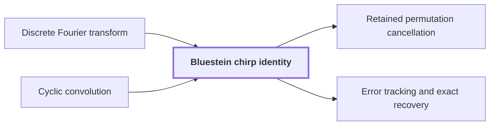

# Bluestein chirp identity

!!! info "Before this page"

    Bluestein chirp identity *rewrites a permuted* [Discrete Fourier transform](dft.md "The Bluestein chirp identity rewrites a permuted Discrete Fourier transform as a pointwise chirp phase, a cyclic convolution, and another chirp phase.") and *is reduced to* [Cyclic convolution](convolution.md "The permuted transform is thus reduced to one Cyclic convolution of length $T$ between two pointwise phase multiplications.").

!!! abstract "Where this fits"

    1. A single deterministic Turing machine with a fixed finite alphabet and a fixed finite number of one-dimensional tapes multiplies two $n$-bit integers exactly in $O(n(\lg n)^{1-\kappa})$ worst-case time with $\kappa=2^{-182}$, disproving the $n\log n$ optimality conjecture of Sch\"onhage and Strassen in this model. — how: Build two power-saving tape procedures (chunk interchange and simultaneous butterfly layer) from fixed finite linear networks; use them to accelerate the synthetic polynomial transforms and ring convolution; use Gaussian resampling with retained permutations and chirps to reduce the prime-length cyclic convolution of the radix-digit coefficients to those power-of-two transforms; assemble the exact product with a proof that the error is below $1/2$; and total the cost to show a power of $\log n$ is saved. ([Power-saving integer multiplication](main-result.md "A deterministic fixed-tape Turing machine multiplying two n-bit integers exactly in O(n(lg n)^{1−κ}) time with κ = 2^{−182}, disproving the n log n optimality conjecture in this model."))
    2. The Fourier transforms of pairwise coprime prime lengths $s_i$ that the integer product needs are computed through power-of-two lengths $t_i$ by Gaussian resampling and Bluestein chirps, with the source and target coordinate permutations left inside the transform identities, so that none is executed as a sort. — how: Retain both permutations of Gaussian resampling in the transform formula: the target permutation $Q$ is absorbed by the chirp convolution, and the source permutation $R$ cancels across the two forward transforms, their pointwise product and the opposite transform. ([Retained permutation cancellation](retained-permutations.md "Leaving the coordinate permutations of resampling inside the transform identity, so the source permutation cancels across the two forward transforms and the opposite one and none is executed as a sort."))
    3. **This page:** For even $t_i$ and the chirp $a_{\boldsymbol j}=\exp(-\pi i\sum_is_ij_i^2/t_i)$ one has $QF_{\boldsymbol t}u=\overline a\cdot\bigl(a*(\overline a\cdot u)\bigr)/T$, so the target permutation $Q$ is absorbed into a cyclic convolution of length $T$ and never executed.

??? note "Symbols from earlier pages"

    - $u$ — input sequence: A sequence of q complex numbers. (on [Discrete Fourier transform](dft.md "The normalized transform (F_q u)_k = (1/q) Σ u_j e^{−2πi jk/q}, which turns convolution into pointwise multiplication."))

The Bluestein chirp identity rewrites a permuted [Discrete Fourier transform](dft.md "The normalized transform (F_q u)_k = (1/q) Σ u_j e^{−2πi jk/q}, which turns convolution into pointwise multiplication.") as a pointwise chirp phase, a cyclic convolution, and another chirp phase. Gaussian resampling leaves a target permutation $Q$, a reordering of the output of a power-of-two transform. The identity converts the transform together with $Q$ into a cyclic convolution<cite class="exegenius-ref" data-source="paper" data-locator="§1.3 From transforms to the exact product" data-quote="including its target permutation, into normalized cyclic convolution." title="including its target permutation, into normalized cyclic convolution."> (see §1.3 From transforms to the exact product)</cite>, so $Q$ never has to be executed as a sort.

## Why avoid executing the permutation

Executing $Q$ means sorting data on tapes, which costs a logarithmic factor beyond a linear pass, the kind of factor the power saving removes. A convolution is also what the next stage needs, after a [Phase twist](phase-twist.md "Multiplying coefficient k by e^{πik/r}, which converts the cyclic coordinate modulo x^r − 1 into the negacyclic ring modulo y^r + 1 and is removed afterwards.") into a polynomial ring. So the aim is an identity with a convolution on the right and $Q$ already inside the left.

## Setting

Arrays have $d$ axes and are indexed by positions $\boldsymbol j=(j_1,\dots,j_d)$. The tuple $\boldsymbol t=(t_1,\dots,t_d)$ lists the axis lengths, each even, and $s_i$ is an integer coprime to $t_i$. Put $T=\prod_i t_i$, the total number of entries. Indices along axis $i$ are taken modulo $t_i$. The letters $j$, $k$, $f$ have new meanings here.

The normalized transform $F_{\boldsymbol t}$ is given by $(F_{\boldsymbol t}u)_{\boldsymbol f}=\frac1T\sum_{\boldsymbol k}u_{\boldsymbol k}\exp(-2\pi i\sum_i k_if_i/t_i)$, where $\boldsymbol k$ runs over input positions and $\boldsymbol f=(f_1,\dots,f_d)$ is the frequency labelling an output entry. The target permutation $Q$ puts at position $\boldsymbol j$ the entry of frequency $(-s_ij_i)_i$. In $QF_{\boldsymbol t}u$ the coefficient of $u_{\boldsymbol k}$ at position $\boldsymbol j$ is $\frac1T\exp(2\pi i\sum_i s_ij_ik_i/t_i)$.

## The identity

Define the chirp $a_{\boldsymbol j}=\exp\left(-\pi i\sum_{i=1}^d s_ij_i^2/t_i\right)$ and let $\overline a$ be its complex conjugate. This $a$ is not a bank index. When every $t_i$ is even<cite class="exegenius-ref" data-source="paper" data-locator="§8.3 The middle transform and the final permutation" data-quote="assume every $t_i$ is even." title="assume every $t_i$ is even."> (see §8.3 The middle transform and the final permutation)</cite>,
$$QF_{\boldsymbol t}u=\overline a\cdot\frac{a*(\overline a\cdot u)}{T},$$
where the dot is coordinatewise multiplication and $*$ is cyclic convolution. The permuted transform is thus reduced to one [Cyclic convolution](convolution.md "The product of two sequences (or elements of a polynomial quotient ring) where indices wrap around: (f∗g)_k = Σ f_j g_{k−j}.") of length $T$ between two pointwise phase multiplications.

## Derivation

The convolution reads $a$ at indices modulo $t_i$, so $a$ must depend only on residues. Replacing $j_i$ by $j_i+t_i$ changes the exponent by $-\pi i s_i\frac{(j_i+t_i)^2-j_i^2}{t_i}=-\pi i s_i(2j_i+t_i)$, which is an integral multiple of $2\pi i$ because $t_i$ is even, so $a$ has period $t_i$ in coordinate $i$.

In the right side, the coefficient of $u_{\boldsymbol k}$ at position $\boldsymbol j$ is $\frac1T\overline a_{\boldsymbol j}a_{\boldsymbol j-\boldsymbol k}\overline a_{\boldsymbol k}$. Using $(j_i-k_i)^2=j_i^2-2j_ik_i+k_i^2$, the exponent of this product is $\sum_i\frac{\pi i s_i}{t_i}\bigl(j_i^2-(j_i^2-2j_ik_i+k_i^2)+k_i^2\bigr)$, so the coefficient is $\frac1T\overline a_{\boldsymbol j}a_{\boldsymbol j-\boldsymbol k}\overline a_{\boldsymbol k}=\frac1T\exp(2\pi i\sum_is_ij_ik_i/t_i)$.

This is precisely the coefficient of $QF_{\boldsymbol t}$ above, because $Q$ reads frequency $(-s_ij_i)_i$ from the negative-sign transform. The factor $s_i$ in the chirp is what encodes $Q$. A convolution depends on $\boldsymbol j-\boldsymbol k$, and expanding the square leaves the cross term $2j_ik_i$, the exponent of a Fourier kernel, while $j_i^2$ and $k_i^2$ involve one position each and become pointwise phases. The factor $s_i$ scales the cross term, so position $\boldsymbol j$ reads frequency $-s_ij_i$, which is the reordering $Q$ prescribes.

For $d=1$, $t_1=2$, $s_1=1$: $a_0=1$, $a_1=-i$, and $j=k=1$ gives $\overline a_1a_0\overline a_1=i\cdot1\cdot i=-1=\exp(2\pi i\cdot\tfrac12)$, as required.

## Connections

Used by:

- [Retained permutation cancellation](retained-permutations.md "The target permutation $Q$ sits between $\mathcal A$ and $\mathcal B_0$ and is absorbed by the Bluestein chirp identity.") *is absorbed by* Bluestein chirp identity
- [Error tracking and exact recovery](precision-recovery.md "The computed chirp transform $\widetilde{\mathscr C}$ is built from the Bluestein chirp identity: a phase product, a complex convolution with the chirp kernel, and a last phase product.") *is built from* Bluestein chirp identity

??? quote "From the sources"

    > Bluestein's chirp identity converts the middle transform,
    >
    > — [Integer multiplication below n log n (OpenAI, 2026)](https://github.com/openai/math/tree/fd4aeeb2ee4fc729c18d98444fed42fd0529eeeb/preprints/Integer-multiplication-below-n-log-n-September-23-2026)

    > Chirp and permutation cancellation
    >
    > — [Integer multiplication below n log n (OpenAI, 2026)](https://github.com/openai/math/tree/fd4aeeb2ee4fc729c18d98444fed42fd0529eeeb/preprints/Integer-multiplication-below-n-log-n-September-23-2026)
