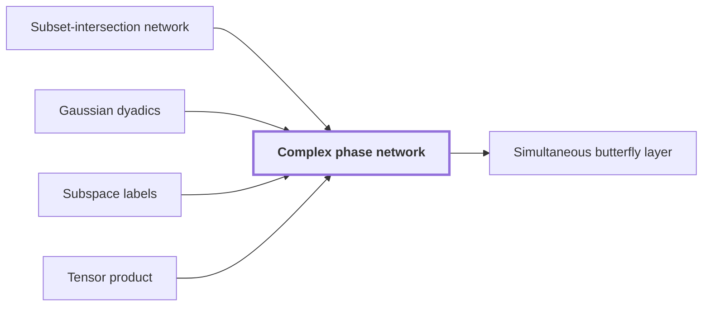

# Complex phase network

!!! info "Before this page"

    Complex phase network *is built on* [Subset-intersection network](subset-intersection-network.md "A complex phase network is built on a Subset-intersection network with a frame change on each edge."), *takes its scalars from* [Gaussian dyadics](glossary.md#gaussian-dyadics "Each frame change takes its scalars from Gaussian dyadics, so every sum and product stays exact, with no rounding."), *is labelled by* [Subspace labels](subspace-labels.md "Each wire is labelled by Subspace labels.") and *is a tensor product of* [Tensor product](glossary.md#tensor-product "Applied to all selected address bits at once, the network is a Tensor product of one kernel per bit, evaluated on all addresses.").

!!! abstract "Where this fits"

    1. A deterministic fixed-tape machine multiplies two $n$-bit integers exactly in $O(n(\lg n)^{1-\kappa})$ time, with $\kappa=2^{-182}$, below the $n\lg n$ conjecture in this model. — how: bound the cost of an exact multiplication whose transform layers are made cheap by two tape procedures, then fix parameters so every cost term fits ([Integer multiplication below n log n](main-theorem.md "A deterministic fixed-tape machine that multiplies two n-bit integers exactly in O(n (lg n)^(1−κ)) time with κ = 2^−182, which disproves the n log n optimality conjecture in this model."))
    2. A simultaneous normalized butterfly layer on $d$ selected chunks of stored volume $V$ costs $O(V d^{\lambda'})$. — how: realize the tensor product of the two-point kernel by an exact complex phase network with dyadic frame changes, then convert it to the normalized $H_0$ layer ([Simultaneous butterfly layer](simultaneous-butterfly-layer.md "The tensor product of the two-point map H0 applied to several selected address bits at once, computed exactly in one pass rather than one axis at a time."))
    3. **This page:** The completed complex layer becomes the simultaneous $H_0$ layer after diagonal phase operations and a dyadic scale.

A complex phase network is built on a [Subset-intersection network](subset-intersection-network.md "A linear network on the three-element subsets of a ground set, whose wires carry scalars and whose gates combine them by intersection size, so that it swaps two banks while cancelling arbitrary scratch values.") with a frame change on each edge. It is the device that turns the completed complex layer into the simultaneous $H_0$ layer.

Each frame change is a product of two-point kernels, where $I$ is the identity on two points and $X$ is the map that swaps them. Each kernel is $\alpha I+\beta X$, where $\alpha$ is the first scalar of the kernel and $\beta$ is the second scalar. Acting on a pair $(u,v)$, the kernel sends it to $(\alpha u+\beta v,\ \beta u+\alpha v)$. For $\alpha=\frac{1+i}{2}$ and $\beta=\frac{1-i}{2}$, the kernel sends $(1,0)$ to $\left(\frac{1+i}{2},\frac{1-i}{2}\right)$.

Each frame change takes its scalars from [Gaussian dyadics](glossary.md#gaussian-dyadics "Complex numbers whose real and imaginary parts are integers divided by a power of two, with the Gaussian integer part also an integer."), so every sum and product stays exact, with no rounding. Each wire is labelled by [Subspace labels](subspace-labels.md "Nondegenerate subspaces of a fixed bilinear space attached to each wire of a network, whose inclusions control how much work a change of representation costs.").

Applied to all selected address bits at once, the network is a [Tensor product](glossary.md#tensor-product "The product of vector spaces, whose basis is formed by pairing basis vectors of the factors, so that a tensor power of a space collects several copies of it.") of one kernel per bit, evaluated on all addresses. This is the completed complex layer.

Here $H_0$ sends $u$ and $v$ to their halved sum and halved difference. For the kernel above, multiplying the second point by $i$ before and after the kernel gives $\frac{1+i}{2}$ times the map that sends $(u,v)$ to $(u+v,\,u-v)$. Scaling by $\beta=\frac{1-i}{2}$ cancels the factor $\frac{1+i}{2}$ and halves both outputs, since

$$\frac{1-i}{2}\,\frac{1+i}{2}=\frac{1}{2},$$

so the result is $H_0$ on two points. Multiplying by $i$ changes no magnitude, and each output of $H_0$ is at most the largest input in magnitude; this is what normalized means here.

Applying these operations to the completed complex layer gives the simultaneous $H_0$ layer, the map applied to several selected address bits at once ([Simultaneous butterfly layer](simultaneous-butterfly-layer.md "The tensor product of the two-point map H0 applied to several selected address bits at once, computed exactly in one pass rather than one axis at a time.")),<cite class="exegenius-ref" data-source="paper" data-locator="§11 A consequence for matrix transposition, p. 4" data-quote="after diagonal phase operations and a dyadic scale" title="after diagonal phase operations and a dyadic scale"> (see §11 A consequence for matrix transposition, p. 4)</cite>.

## Connections

Used by:

- [Simultaneous butterfly layer](simultaneous-butterfly-layer.md "The layer's complex form $C^{\otimes D}$ is realized by a complex phase network with dyadic frame changes.") *is realized by* Complex phase network

??? quote "From the sources"

    > The complex phase network of Proposition 8
    >
    > — Integer multiplication below n log n (OpenAI, 2026)
