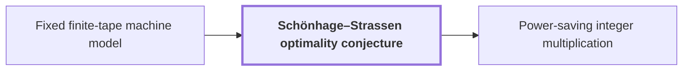

# Schönhage–Strassen optimality conjecture

!!! info "Before this page"

    Schönhage–Strassen optimality conjecture *is stated for* [Fixed finite-tape machine model](machine-model.md "The conjecture is stated for the Fixed finite-tape machine model: a multitape Turing machine with a fixed alphabet and a fixed number of one-dimensional tapes."). Assumed known: Big-O notation.

!!! abstract "Where this fits"

    - Relied on to show: A single deterministic Turing machine with a fixed finite alphabet and a fixed finite number of one-dimensional tapes multiplies two $n$-bit integers exactly in $O(n(\lg n)^{1-\kappa})$ worst-case time with $\kappa=2^{-182}$, disproving the $n\log n$ optimality conjecture of Sch\"onhage and Strassen in this model. ([Power-saving integer multiplication](main-result.md "A deterministic fixed-tape Turing machine multiplying two n-bit integers exactly in O(n(lg n)^{1−κ}) time with κ = 2^{−182}, disproving the n log n optimality conjecture in this model."))

The Schönhage–Strassen optimality conjecture is the claim that $n\log n$ is the best possible order of growth for the time to multiply two integers, where $n$ is the number of bits in each; it is the statement that the main result of this wiki disproves.

In 1971 Schönhage and Strassen gave a multiplication algorithm running in $O(n\log n\log\log n)$ time, and proposed $n\log n$ as the optimal order of growth<cite class="exegenius-ref" data-source="paper" data-locator="§1 Introduction" data-quote="and proposed $n\log n$ as the optimal order of growth" title="and proposed $n\log n$ as the optimal order of growth"> (see §1 Introduction)</cite>. This is a lower-bound statement, not a claim about one algorithm: for every multiplication machine there are a constant $c>0$ and a threshold such that the machine needs at least $c\,n\log n$ steps whenever $n$ exceeds the threshold. Both may depend on the machine, but not on $n$.

The conjecture is stated for the [Fixed finite-tape machine model](machine-model.md "The computation model of the main theorem: one fixed finite alphabet and a fixed number of one-dimensional tapes, each head moving at most one cell per step."): a multitape Turing machine with a fixed alphabet and a fixed number of one-dimensional tapes. Running time is counted in steps of such a machine, so a counterexample must be a machine of this kind; a speedup with, say, random access to memory would not refute it.

Refuting a "for every machine, for all large $n$" statement needs only one machine for which no constant $c>0$ works. Beating $n\log n\log\log n$ is not enough; the time must fall below every constant multiple of $n\log n$ along some inputs.

For decades the gap between $n\log n\log\log n$ and $n\log n$ was the open part. After a sequence of improvements, Harvey and van der Hoeven reached an $O(n\log n)$ bound that holds without any unproved assumption<cite class="exegenius-ref" data-source="paper" data-locator="§1 Introduction" data-quote="Harvey and van der Hoeven reached the unconditional $O(n\log n)$ upper" title="Harvey and van der Hoeven reached the unconditional $O(n\log n)$ upper"> (see §1 Introduction)</cite>. That matches the conjectured order, so the best known algorithms were consistent with the conjecture.

The main result gives the required machine. Its running time is $O(n(\lg n)^{1-\kappa})$, where $\kappa>0$ is a fixed constant, the amount by which the exponent of the logarithm is lowered. Its time divided by $n\lg n$ is at most a constant times $(\lg n)^{-\kappa}$, which tends to zero for all large $n$, not merely along a subsequence. This is stronger than the refutation needs. The conjecture is therefore false in this model, although the saving is tiny because $\kappa$ is extremely small.

## Connections

Used by:

- [Power-saving integer multiplication](main-result.md "Power-saving integer multiplication is the main result: for $n$, the number of bits in each input, and $\kappa=2^{-182}$, the exponent saved from the power of $\lg n$, one fixed Turing machine multiplies two $n$-bit integers exactly in time $O(n(\lg n)^{1-\kappa})$, which is $o(n\log n)$, so it refutes the Schönhage–Strassen optimality conjecture in this model.") *refutes* Schönhage–Strassen optimality conjecture

??? quote "From the sources"

    > and proposed $n\log n$ as the optimal order of growth
    >
    > — [Integer multiplication below n log n (OpenAI, 2026)](https://github.com/openai/math/tree/fd4aeeb2ee4fc729c18d98444fed42fd0529eeeb/preprints/Integer-multiplication-below-n-log-n-September-23-2026)

    > Harvey and van der Hoeven reached the unconditional $O(n\log n)$ upper
    >
    > — [Integer multiplication below n log n (OpenAI, 2026)](https://github.com/openai/math/tree/fd4aeeb2ee4fc729c18d98444fed42fd0529eeeb/preprints/Integer-multiplication-below-n-log-n-September-23-2026)
