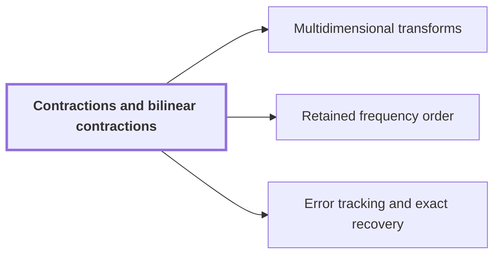

# Contractions and bilinear contractions

!!! info "Before this page"

    Assumed known: Norms and the triangle inequality and Matrices and linear operators.

!!! abstract "Where this fits"

    - Relied on to show: The error on the recovered integer coefficients is below $1/2$, so rounding gives the exact integer coefficients, and carry propagation yields the exact binary product. ([Error tracking and exact recovery](precision-recovery.md "Each normalized transform and product is a contraction with a bounded rounding error, and the total error on the recovered convolution coefficients is below 1/2, so rounding gives exact integers."))

??? note "Symbols from earlier pages"

    - $u$ — input sequence: A sequence of q complex numbers. (on [Discrete Fourier transform](dft.md "The normalized transform (F_q u)_k = (1/q) Σ u_j e^{−2πi jk/q}, which turns convolution into pointwise multiplication."))
    - $f$ — first array: A complex array with d axes, the last of length r. (on [Phase twist](phase-twist.md "Multiplying coefficient k by e^{πik/r}, which converts the cyclic coordinate modulo x^r − 1 into the negacyclic ring modulo y^r + 1 and is removed afterwards."))
    - $g$ — second array: The second complex array, with the same shape as f. (on [Phase twist](phase-twist.md "Multiplying coefficient k by e^{πik/r}, which converts the cyclic coordinate modulo x^r − 1 into the negacyclic ring modulo y^r + 1 and is removed afterwards."))
    - $\|f\|$ — sup norm: The largest modulus of a scalar coefficient of f. (on [Phase twist](phase-twist.md "Multiplying coefficient k by e^{πik/r}, which converts the cyclic coordinate modulo x^r − 1 into the negacyclic ring modulo y^r + 1 and is removed afterwards."))
    - $q$ — sequence length: The number of entries of a sequence. (on [Discrete Fourier transform](dft.md "The normalized transform (F_q u)_k = (1/q) Σ u_j e^{−2πi jk/q}, which turns convolution into pointwise multiplication."))
    - $k$ — coefficient index: The index of a coefficient along the last axis (here not a depth). (on [Phase twist](phase-twist.md "Multiplying coefficient k by e^{πik/r}, which converts the cyclic coordinate modulo x^r − 1 into the negacyclic ring modulo y^r + 1 and is removed afterwards."))
    - $T$ — coefficient count: The number of complex coefficients in an array. (on [Cyclic convolution](convolution.md "The product of two sequences (or elements of a polynomial quotient ring) where indices wrap around: (f∗g)_k = Σ f_j g_{k−j}."))

A contraction is a linear map that cannot increase the size of a vector, and a bilinear contraction is its two-argument analogue; they let the error analysis show that errors in the inputs of a transform or product do not grow in its output.

Size means the sup norm $\|u\|$, the largest modulus among the entries of $u$. A linear map $L$ is a *contraction* if $\|Lu\|\le\|u\|$ for every $u$. A map $\mathcal M(f,g)$ that is linear in each operand $f$ and $g$ separately is a *bilinear contraction* if $\|\mathcal M(f,g)\|\le\|f\|\,\|g\|$.

## Why errors stay controlled

Suppose a computed input $u'$ replaces the exact input $u$. Linearity gives $Lu'-Lu=L(u'-u)$, so the output error is at most the input error<cite class="exegenius-ref" data-source="paper" data-locator="§9.7.1 Scales and disk margins" data-quote="A linear contraction propagates an input error without increasing it." title="A linear contraction propagates an input error without increasing it."> (see §9.7.1 Scales and disk margins)</cite>

For a bilinear contraction, replace operands $f,g$ by $f',g'$. Adding and subtracting $\mathcal M(f,g')$ gives
$$\mathcal M(f',g')-\mathcal M(f,g)=\mathcal M(f'-f,g')+\mathcal M(f,g'-g),$$
so the output error is at most $\|f'-f\|\,\|g'\|+\|f\|\,\|g'-g\|$. If all four operands have norm at most $1$ (every entry in the unit disk), the two input errors simply add<cite class="exegenius-ref" data-source="paper" data-locator="§9.7.1 Scales and disk margins" data-quote="When all four operands are in the disk, their two errors therefore add." title="When all four operands are in the disk, their two errors therefore add."> (see §9.7.1 Scales and disk margins)</cite>

Errors of successive steps also add: insert the exact map at the computed input and apply its contraction bound to the accumulated input error<cite class="exegenius-ref" data-source="paper" data-locator="§8 Resampling with the permutations left in the transform" data-quote="Composing such algorithms adds their errors" title="Composing such algorithms adds their errors"> (see §8 Resampling with the permutations left in the transform)</cite>. Only the exact map must be a contraction; the computed approximation may be nonlinear.

## Where it holds

Contraction applies to the normalized [Discrete Fourier transform](dft.md "The normalized transform (F_q u)_k = (1/q) Σ u_j e^{−2πi jk/q}, which turns convolution into pointwise multiplication."),
$$(F_q u)_k=\frac1q\sum_{j=0}^{q-1}u_j e^{-2\pi i jk/q},$$
where $F_q$ is the transform on sequences of $q$ entries. Each output entry averages inputs multiplied by complex numbers of modulus one, so by the triangle inequality its modulus is at most the largest input modulus<cite class="exegenius-ref" data-source="paper" data-locator="§8 Resampling with the permutations left in the transform" data-quote="Each normalized Fourier transform above is a contraction, since each output averages inputs multiplied by complex numbers of modulus one." title="Each normalized Fourier transform above is a contraction, since each output averages inputs multiplied by complex numbers of modulus one."> (see §8 Resampling with the permutations left in the transform)</cite> For $q=2$ the outputs are $(u_0+u_1)/2$ and $(u_0-u_1)/2$, both of modulus at most $\max(|u_0|,|u_1|)$. The factor $1/q$ is what makes this work: the unnormalized sum could grow by a factor $q$.

Bilinear contraction applies to the normalized [Cyclic convolution](convolution.md "The product of two sequences (or elements of a polynomial quotient ring) where indices wrap around: (f∗g)_k = Σ f_j g_{k−j}.") $f*g/T$, where $T$ counts all entries involved. A fixed output coefficient averages $T$ signed products of one entry of $f$ with one entry of $g$<cite class="exegenius-ref" data-source="paper" data-locator="§7.1 The normalized convolution interface" data-quote="Thus that coefficient averages $rM$ signed scalar products, and $\mathcal M_r$ is a bilinear contraction" title="Thus that coefficient averages $rM$ signed scalar products, and $\mathcal M_r$ is a bilinear contraction"> (see §7.1 The normalized convolution interface)</cite>, each of modulus at most $\|f\|\,\|g\|$, hence $\|f*g/T\|\le\|f\|\,\|g\|$.

Coordinate permutations and multiplication by unit-modulus phases leave the norm unchanged, so they are contractions too. A composite of such maps, such as twist, convolution and untwist, is again a contraction or bilinear contraction

## Connections

Used by:

- [Multidimensional transforms](multidim-transform.md "Both maps are contractions, so each has input errors bounded as in Contractions and bilinear contractions.") *has input errors bounded as in* Contractions and bilinear contractions
- [Retained frequency order](frequency-order.md "The forward synthetic transform writes its outputs in bit-reversed order, the pointwise product keeps that order, and the opposite transform consumes it, so no reordering is executed.") — The forward synthetic transform writes its outputs in bit-reversed order, the pointwise product keeps that order, and the opposite transform consumes it, so no reordering is executed.
- [Error tracking and exact recovery](precision-recovery.md "Errors add through the Contractions and bilinear contractions making up each transform and product.") *adds errors through* Contractions and bilinear contractions
