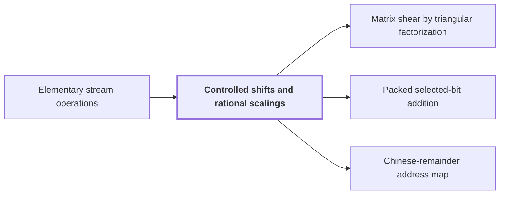

# Controlled shifts and rational scalings

!!! info "Before this page"

    Controlled shifts and rational scalings *is carried out by* [Elementary stream operations](stream-ops.md "Each operation below is carried out by splitting into streams and merging back, as in Elementary stream operations.").

!!! abstract "Where this fits"

    - Relied on to show: Bit variant: two disjoint address chunks of $u$ bits can be interchanged on a fixed number of tapes in $O(Vu^\tau)$ time, $\tau=1-2^{-50}$, although the intermediate steps form XOR combinations of data. ([Fast address-chunk interchange](address-interchange.md "The first tape procedure: exchanging two disjoint equal-width address fields of u digits in time O(V·u^τ) for a fixed τ < 1, using XOR combinations of intermediate data."))
    - Relied on to show: For a rational $m\times m$ matrix $A$ of rank $a$ and fields over $\mathbb Z/q^b\mathbb Z$, the shear $(H,D)\mapsto(H+AD,D)$ can be performed with exactly $a$ interchanges of pairs of $b$-digit fields and $O(V)$ further work. ([Matrix shear by triangular factorization](matrix-shear.md "Factoring a rational matrix as A = E₁ΠE₂ with lower triangular E₁, E₂ and partial permutation Π lets the shear (H,D)→(H+AD,D) be done with exactly rank(A) field interchanges."))
    - Relied on to show: Selected bits of two chunks can be XORed (with a third chunk as restored scratch) by eight cyclic shifts of whole chunk ranges plus a repair of an explicitly bounded exceptional set of addresses, in time $O(V(L^\tau+1)+MA_{\rm rect}^3+\delta_{\rm bad}MA_{\rm rect}(R+A_{\rm rect}))$. ([Packed selected-bit addition](packed-bit-addition.md "XORing selected bits between two address chunks (with a third chunk as restored scratch) using cyclic shifts of whole chunk ranges plus a repair of explicitly bounded exceptional addresses."))
    - Relied on to show: The Chinese-remainder map $\Phi:\mathbb C[x]/(x^S-1)\to\mathbb C[x_1,\dots,x_d]/(x_i^{s_i}-1)$, $x\mapsto\prod_ix_i^{\mu_i}$, is an isomorphism preserving cyclic convolution, and it (with its inverse and padding) is implemented by triangular controlled shifts in $O(Tp\,d^2(1+\ell^\tau))$ time. ([Chinese-remainder address map](crt-map.md "An isomorphism that places a cyclic convolution of length S = s₁⋯s_d on pairwise coprime prime axes, implemented as triangular controlled shifts."))

A controlled shift adds to one field of each record an offset computed from earlier fields, and a rational scaling multiplies that field by a fixed unit; both run in time linear in the array volume.

Each operation below is carried out by splitting into streams and merging back, as in [Elementary stream operations](stream-ops.md "Linear-time scans on arrays stored in lexicographic order: swapping two digits, moving a digit, splitting into streams, applying a pointwise map and merging back.").

Fix a prime $q$, the radix of the stored digits; this $q$ is a prime radix, not a sequence length as on the [cyclic convolution](convolution.md "The product of two sequences (or elements of a polynomial quotient ring) where indices wrap around: (f∗g)_k = Σ f_j g_{k−j}.") and [discrete Fourier transform](dft.md "The normalized transform (F_q u)_k = (1/q) Σ u_j e^{−2πi jk/q}, which turns convolution into pointwise multiplication.") pages. Let $b\ge1$ be the number of base-$q$ digits of a field; this $b$ is not the lowest bit of an output index as on the butterfly page. Put $Q=q^b$, the number of values a field can take. The target field has value $y\in\{0,\dots,Q-1\}$; here $y$ is a field value, not the ring variable. It follows a fixed number of control fields. The update is
$$y\longmapsto y+a \pmod Q,$$
where $a$ is the offset prepared from the control values; this $a$ is not a bank index. The update costs $O(V)$<cite class="exegenius-ref" data-source="paper" data-locator="§2.1 Array order and elementary scans" data-quote="costs $O(V)$ if the offset can be prepared in $b^{O(1)}$ time from the fixed number of control values" title="costs $O(V)$ if the offset can be prepared in $b^{O(1)}$ time from the fixed number of control values"> (see §2.1 Array order and elementary scans)</cite> when each control used in the offset has $O(b)$ digits and the offset can be prepared in $b^{O(1)}$ time from the fixed number of control values. A fixed rational linear combination of the controls, reduced modulo $Q$, qualifies.

**Why a shift is linear.** Because the target follows its controls, fixing everything before the target fixes $a$. Let $B$ be the number of digits that follow the target; this $B$ is not the number of entries per row on the stream-operations page. The target and its suffix form $Q$ consecutive blocks of $B$ digits, and adding $a$ modulo $Q$ rotates these blocks. Split them at $Q-a$, append the two pieces to two tapes, then merge by reading the second piece before the first. Reading the controls and computing $a$ takes $b^{O(1)}=O(Q)$ time per prefix, absorbed by the $QB\ge Q$ digits of the blocks.

**Scaling.** Let $c$ be a fixed positive integer prime to $q$. The map $y\mapsto cy \pmod Q$ sends the block at position $y$ to position $y'=cy-jQ$, where $j=\lfloor cy/Q\rfloor$ is the number of times $cy$ wraps past $Q$; this $j$ is not a digit value as on the stream-operations page. So the map consists of $c$ increasing pieces, one per $j$. Split the blocks into $c$ streams by $j$; each stream is in increasing order of $y$, hence of $y'$. Then produce output positions $y'=0,\dots,Q-1$ in order, each time taking the next block of the stream $j$ with $y'+jQ\equiv 0\pmod c$, where $y=(y'+jQ)/c$. This $j$ is unique since $\gcd(Q,c)=1$.

**Inverse scaling.** Multiplication by $c^{-1}$ must put at position $y$ the block from position $y'=cy-jQ$. The positions $y$ sharing one $j$ form a consecutive range, and their sources $y'$ increase in steps of $c$ through a single class of residues modulo $c$, namely $y'\equiv -jQ$. So the roles of split and merge are exchanged: split the input into $c$ streams by the residue of its position modulo $c$, then write the output range by range, filling range $j$ from the stream of class $-jQ \bmod c$. Different $j$ give different classes because $\gcd(Q,c)=1$, so each stream is consumed by exactly one range, in order. This is again one split and one merge<cite class="exegenius-ref" data-source="paper" data-locator="§2.1 Array order and elementary scans" data-quote="Reversing the roles of this split and merge implements multiplication by $c^{-1}$ modulo $Q$." title="Reversing the roles of this split and merge implements multiplication by $c^{-1}$ modulo $Q$."> (see §2.1 Array order and elementary scans)</cite>

**Negation and units.** Negation sends block $y$ to block $Q-y$: it leaves block $0$ fixed and reverses the other $Q-1$ blocks<cite class="exegenius-ref" data-source="paper" data-locator="§2.1 Array order and elementary scans" data-quote="Negation leaves the block at zero fixed and reverses the order of the other $Q-1$ blocks." title="Negation leaves the block at zero fixed and reverses the order of the other $Q-1$ blocks."> (see §2.1 Array order and elementary scans)</cite> Push them onto a temporary tape and pop them, then reverse each popped block again on a second tape to restore its digits.

A rational unit is a signed ratio $c/c'$ of positive integers $c,c'$ both prime to $q$. Multiply by $c$, multiply by the inverse of $c'$, and negate if the sign is negative: a fixed number of $O(V)$ passes, so the unit and its inverse cost $O(V)$.

## Connections

Used by:

- [Matrix shear by triangular factorization](matrix-shear.md "Each lower triangular transformation of $H$ or of $D$ is carried out by Controlled shifts and rational scalings.") *is carried out by* Controlled shifts and rational scalings
- [Packed selected-bit addition](packed-bit-addition.md "It rotates chunks by Controlled shifts and rational scalings in $O(V)$ time and swaps by Fast address-chunk interchange in $O(VL^\tau)$, for $\tau<1$.") *rotates chunks by* Controlled shifts and rational scalings
- [Chinese-remainder address map](crt-map.md "The map is implemented by these shifts, each of linear cost by Controlled shifts and rational scalings, which includes computing the offsets.") *is implemented by* Controlled shifts and rational scalings

??? quote "From the sources"

    > Controlled shifts and fixed rational scalings
    >
    > — [Integer multiplication below n log n (OpenAI, 2026)](https://github.com/openai/math/tree/fd4aeeb2ee4fc729c18d98444fed42fd0529eeeb/preprints/Integer-multiplication-below-n-log-n-September-23-2026)

    > Suppose a target field $y\in[Q]$ follows its control fields
    >
    > — [Integer multiplication below n log n (OpenAI, 2026)](https://github.com/openai/math/tree/fd4aeeb2ee4fc729c18d98444fed42fd0529eeeb/preprints/Integer-multiplication-below-n-log-n-September-23-2026)
