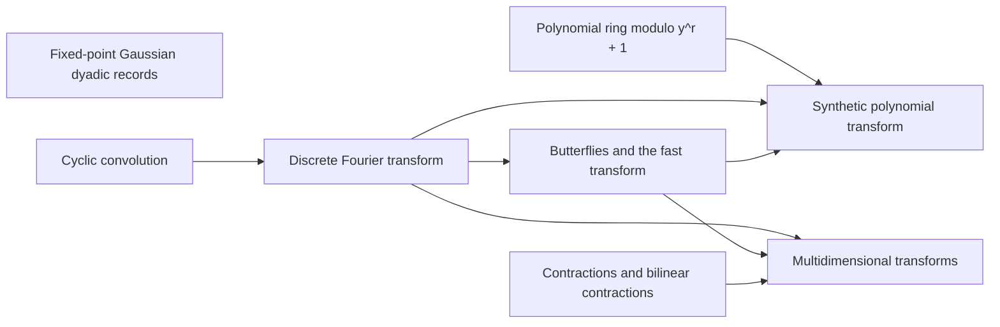

# Convolution and Fourier Tools

Multiplying integers reduces to [cyclic convolution](../convolution.md "The product of two sequences (or elements of a polynomial quotient ring) where indices wrap around: (f∗g)_k = Σ f_j g_{k−j}."), and the [discrete Fourier transform](../dft.md "The normalized transform (F_q u)_k = (1/q) Σ u_j e^{−2πi jk/q}, which turns convolution into pointwise multiplication.") turns convolution into a pointwise product. This part covers [butterflies](../butterfly.md "A two-point averaging/differencing step H₀(u,v) = ((u+v)/2, (u−v)/2) whose repeated use over address bits, with twiddle multiplications, computes a transform in log t layers."), [multidimensional transforms](../multidim-transform.md "A transform over several axes at once, the tensor product of one-dimensional transforms, applied to an array one axis at a time."), the [ring modulo $y^r+1$](../ring-y.md "Polynomials of degree below r over the complex numbers with y^r = −1, so multiplying by a power of y is a signed shift of the coefficient list.") with its [synthetic transform](../synthetic-transform.md "A transform over the ring modulo y^r + 1 whose roots of unity are powers of y, so every twiddle multiplication is a signed shift of a coefficient list."), [contractions](../contraction-maps.md "A linear map that never increases the norm of a vector, and a bilinear map whose output norm is at most the product of the input norms, so errors in the inputs do not grow beyond a controlled bound.") for bounding error, and [fixed-point records](../fixed-point.md "Complex values stored as signed two's-complement integers over a power-of-two denominator 2^{-p}; intermediate values are exact and one truncation Q_p rounds back to the p-bit grid.") for storing complex values. The later tape and error arguments assume all of these.

## Pages

1. [Polynomial ring modulo y^r + 1](../ring-y.md "Polynomials of degree below r over the complex numbers with y^r = −1, so multiplying by a power of y is a signed shift of the coefficient list.") — Polynomials of degree below r over the complex numbers with y^r = −1, so multiplying by a power of y is a signed shift of the coefficient list.
2. [Fixed-point Gaussian dyadic records](../fixed-point.md "Complex values stored as signed two's-complement integers over a power-of-two denominator 2^{-p}; intermediate values are exact and one truncation Q_p rounds back to the p-bit grid.") — Complex values stored as signed two's-complement integers over a power-of-two denominator 2^{-p}; intermediate values are exact and one truncation Q_p rounds back to the p-bit grid.
3. [Cyclic convolution](../convolution.md "The product of two sequences (or elements of a polynomial quotient ring) where indices wrap around: (f∗g)_k = Σ f_j g_{k−j}.") — The product of two sequences (or elements of a polynomial quotient ring) where indices wrap around: (f∗g)_k = Σ f_j g_{k−j}.
4. [Discrete Fourier transform](../dft.md "The normalized transform (F_q u)_k = (1/q) Σ u_j e^{−2πi jk/q}, which turns convolution into pointwise multiplication.") — The normalized transform (F_q u)_k = (1/q) Σ u_j e^{−2πi jk/q}, which turns convolution into pointwise multiplication.
5. [Butterflies and the fast transform](../butterfly.md "A two-point averaging/differencing step H₀(u,v) = ((u+v)/2, (u−v)/2) whose repeated use over address bits, with twiddle multiplications, computes a transform in log t layers.") — A two-point averaging/differencing step H₀(u,v) = ((u+v)/2, (u−v)/2) whose repeated use over address bits, with twiddle multiplications, computes a transform in log t layers.
6. [Synthetic polynomial transform](../synthetic-transform.md "A transform over the ring modulo y^r + 1 whose roots of unity are powers of y, so every twiddle multiplication is a signed shift of a coefficient list.") — A transform over the ring modulo y^r + 1 whose roots of unity are powers of y, so every twiddle multiplication is a signed shift of a coefficient list.
7. [Contractions and bilinear contractions](../contraction-maps.md "A linear map that never increases the norm of a vector, and a bilinear map whose output norm is at most the product of the input norms, so errors in the inputs do not grow beyond a controlled bound.") — A linear map that never increases the norm of a vector, and a bilinear map whose output norm is at most the product of the input norms, so errors in the inputs do not grow beyond a controlled bound.
8. [Multidimensional transforms](../multidim-transform.md "A transform over several axes at once, the tensor product of one-dimensional transforms, applied to an array one axis at a time.") — A transform over several axes at once, the tensor product of one-dimensional transforms, applied to an array one axis at a time.

## Map

Arrows point from a page to the pages that build on it.

