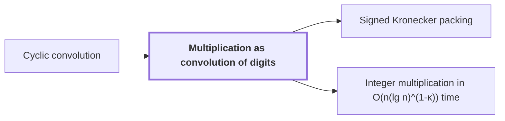

# Multiplication as convolution of digits

!!! info "Before this page"

    Multiplication as convolution of digits *reduces to* [Cyclic convolution](cyclic-convolution.md "Multiplication reduces to Cyclic convolution of short integer coefficients."). Assumed known: Polynomials.

!!! abstract "Where this fits"

    1. Two $n$-bit integers can be multiplied exactly in $O(n(\lg n)^{1-\kappa})$ worst-case time on a deterministic multitape Turing machine, for a fixed $\kappa=2^{-182}$. — how: reduce the product to a digit convolution, compute that convolution through transform layers whose tape cost saves a power, and recover the exact product by rounding ([Integer multiplication in O(n(lg n)^(1-κ)) time](integer-multiplication-target.md "A deterministic multitape Turing machine that multiplies two n-bit integers exactly in O(n(lg n)^(1-κ)) worst-case time for a fixed κ = 2^(-182) > 0, beating the n log n conjecture in this model."))
    2. **This page:** The integer product is the carried convolution of the radix-$2^b$ digit sequences of the two inputs.

??? note "Symbols from earlier pages"

    - $r$ — sequence length: The number of complex coefficients in each input sequence, so both sequences have length r. (on [Cyclic convolution](cyclic-convolution.md "The product of two sequences in which indices are taken modulo a fixed length, so each coefficient of the result is a sum of products over residues."))

Multiplication as convolution of digits is the reduction that turns an integer product into a convolution of short coefficient sequences, followed by a carry back to binary. It is the first step of the argument: the convolution is what the transform machinery later computes.

Let $b$ be the number of bits in one digit; here $b$ does not mean the second input sequence of the cyclic convolution page. Let $m$ be the number of digits in each input. Let $U$ be the first input and $V$ the second. The digit sequence of $U$ is its radix-$2^b$ digits, least significant first, so $U$ has $m$ digits, each between $0$ and $2^b-1$. The digit sequence of $V$ is defined the same way.

Multiplication reduces to [Cyclic convolution](cyclic-convolution.md "The product of two sequences in which indices are taken modulo a fixed length, so each coefficient of the result is a sum of products over residues.") of short integer coefficients. Pad both digit sequences with zeros to length $r \ge 2m-1$. The convolution of two length-$m$ sequences has $2m-1$ terms, so no term wraps around and mixes with another. The paper opens with this reduction.<cite class="exegenius-ref" data-source="paper" data-locator="§1.1 The two tape operations" data-quote="Splitting the inputs into radix digits reduces multiplication to convolution of short integer coefficients." title="Splitting the inputs into radix digits reduces multiplication to convolution of short integer coefficients."> (see §1.1 The two tape operations)</cite>

For example, in radix $4$ ($b=2$), $U=13$ has digits $(1,3)$ and $V=11$ has digits $(3,2)$, since $13=1+3\cdot 4$ and $11=3+2\cdot 4$. Their convolution has coefficients $(3,11,6)$: the coefficient of $4^0$ is $1\cdot 3$, that of $4^1$ is $1\cdot 2+3\cdot 3$, and that of $4^2$ is $3\cdot 2$. The coefficient $11$ is larger than a digit, so the result is not yet in binary. Carrying evaluates the coefficient list at $4=2^b$: $3+11\cdot 4+6\cdot 16=143=13\cdot 11$.

The point of short coefficients is size, so that the transform machinery can work on small fixed-size records instead of whole integers. Each coefficient is a sum of at most $m$ products of $b$-bit digits, so it is at most $m(2^b-1)^2 < 2^{2b+\lceil \lg m\rceil}$ and fits in $2b+\lceil \lg m\rceil$ bits. A transform layer handles the coefficients as records of $r$ entries, each of this bounded width, and its arithmetic on a record uses numbers of that width. What grows with the input length is the number of records, not their width, and the width grows only logarithmically in $m$. The carry into binary is done once, at the end, on the whole integer.

## Connections

Used by:

- [Signed Kronecker packing](kronecker-packing.md "Signed Kronecker packing is an instance of Multiplication as convolution of digits: the coefficients act as digits and the evaluation point as the radix.") *is an instance of* Multiplication as convolution of digits
- [Integer multiplication in O(n(lg n)^(1-κ)) time](integer-multiplication-target.md "The integer product is reduced to a convolution of radix-$2^b$ digit sequences, with carries restored to binary, as in Multiplication as convolution of digits.") *is reduced to* Multiplication as convolution of digits

??? quote "From the sources"

    > reduces multiplication to convolution of short integer coefficients
    >
    > — [Integer multiplication below n log n (OpenAI, 2026)](https://github.com/openai/math/tree/fd4aeeb2ee4fc729c18d98444fed42fd0529eeeb/preprints/Integer-multiplication-below-n-log-n-September-23-2026)
