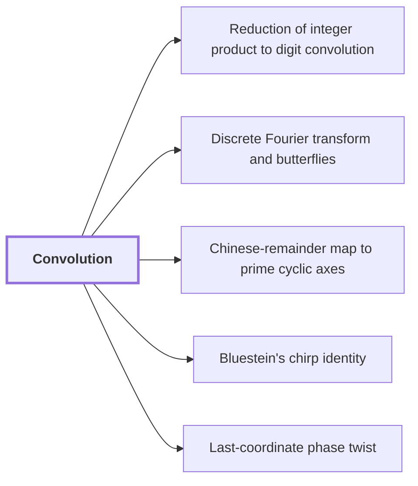

# Convolution

!!! info "Before this page"

    Assumed known: Polynomials.

!!! abstract "Where this fits"

    - Relied on to show: Splitting the inputs into radix digits reduces the integer product to a convolution of short integer coefficients. ([Reduction of integer product to digit convolution](radix-digit-reduction.md "Splitting the inputs into radix digits turns the integer product into a convolution of short integer coefficients, followed by carry propagation."))
    - Relied on to show: The radix-digit coefficient list is placed on a product of distinct prime cyclic axes by a convolution-preserving Chinese-remainder map. ([Chinese-remainder map to prime cyclic axes](crt-address-map.md "Places the coefficient list on a product of distinct prime cyclic axes by a map preserving convolution, implemented via triangular controlled shifts and axis moves."))
    - Relied on to show: Bluestein's chirp identity converts the middle transform into normalized cyclic convolution. ([Bluestein's chirp identity](bluestein-chirp.md "Rewrites a discrete Fourier transform as a cyclic convolution via chirp phases."))
    - Relied on to show: A phase twist turns the last cyclic coordinate into a polynomial modulo $y^r+1$, whose negative wrap gives the original cyclic wrap after untwisting. ([Last-coordinate phase twist](phase-twist-convolution.md "Twisting the last cyclic coordinate into a polynomial modulo y^r+1 whose negative wrap equals the original cyclic wrap after untwisting."))
    - Relied on to show: Convolution over $\mathbb C[y]/(y^r+1)$ on the remaining axes is computed by synthetic transforms and packed polynomial products. ([Convolution with retained transform order and cancelled permutations](ring-convolution-retained-order.md "Two forward synthetic transforms keep the same frequency order through the pointwise product, and the opposite transform consumes it, so retained permutations cancel without separate sorts."))
    - Relied on to show: Synthetic transforms over the polynomial ring need only signed shifts, address rearrangements and butterflies. ([Synthetic polynomial transforms](synthetic-transforms.md "Nussbaumer-style transforms over the polynomial ring where root multiplications are signed shifts, leaving address rearrangements, shifts and butterflies."))
    - Relied on to show: Polynomial products use signed packing and the ordinary $O(n\log n)$ multiplier as a subroutine. ([Signed coefficient packing (Kronecker substitution)](signed-packing.md "Packs polynomial coefficients into one integer so polynomial products are done by an ordinary n log n integer multiplier."))

Convolution combines two coefficient lists into one by summing products into entries indexed by the sum of their positions, with indices past the end wrapping around. A coefficient list is a list of numbers, one per power of a variable. The target needs this operation because integer multiplication reduces to it.<cite class="exegenius-ref" data-source="paper" data-locator="§1.1 The two tape operations" data-quote="Splitting the inputs into radix digits reduces multiplication to convolution of short integer coefficients." title="Splitting the inputs into radix digits reduces multiplication to convolution of short integer coefficients."> (see §1.1 The two tape operations)</cite>

Let $n$ be the length of the lists, the number of entries in each coefficient list. Let $a=(a_0,\dots,a_{n-1})$ and $b=(b_0,\dots,b_{n-1})$ be the two input coefficient lists. The cyclic convolution of $a$ and $b$ is the list $c$ with entries

$$c_k=\sum_{\substack{0\le i,j\le n-1\\ i+j\equiv k \pmod n}} a_i b_j,\qquad 0\le k\le n-1.$$

Here $i$ and $j$ index the entries of $a$ and $b$, and $k$ indexes the entries of $c$. Each product $a_ib_j$ is added into the entry $c_k$ where $k$ is $i+j$ reduced modulo $n$, so the $n^2$ products are distributed over the $n$ entries of $c$.

Equivalently, let $y$ be an indeterminate, a symbol with no value, and let $A(y)=\sum_i a_i y^i$ and $B(y)=\sum_j b_j y^j$. Working modulo $y^n-1$ sets $y^n=1$, so the term $a_ib_jy^{i+j}$ becomes $a_ib_jy^{i+j-n}$ when $i+j\ge n$. Hence $c$ is the coefficient list of $A(y)B(y)$ reduced modulo $y^n-1$.

Without the wrap, the product $A(y)B(y)$ has $2n-1$ coefficients. Cyclic convolution folds the entries at indices $n$ to $2n-2$ back onto indices $0$ to $n-2$.

For example, take $n=2$, $a=(1,2)$ and $b=(3,4)$. Then $c_0=a_0b_0+a_1b_1=11$ and $c_1=a_0b_1+a_1b_0=10$. Check: $(1+2y)(3+4y)=3+10y+8y^2$, and $y^2=1$ turns $8y^2$ into $8$, giving $11+10y$.

## Connections

Used by:

- [Reduction of integer product to digit convolution](radix-digit-reduction.md "Splitting the inputs into radix digits reduces the integer product to a convolution of short integer coefficients.") *reduces the integer product to* Convolution
- [Discrete Fourier transform and butterflies](dft-fft.md "The discrete Fourier transform (DFT) evaluates a coefficient list at powers of a root of unity, reducing Convolution to a pointwise product.") *reduces* Convolution
- [Chinese-remainder map to prime cyclic axes](crt-address-map.md "This map preserves convolution on the axes, so a cyclic product of two lists on $\mathbb{Z}_N$ becomes a product on the prime axes: the cyclic convolution is carried out along every axis at once.") *preserves* Convolution
- [Bluestein's chirp identity](bluestein-chirp.md "So the identity computes its transform by a cyclic Convolution, with the phase $\zeta^{j^2-j}$ applied to each output.") *computes its transform by* Convolution
- [Last-coordinate phase twist](phase-twist-convolution.md "The twist rescales the coefficients of a Convolution so that its cyclic wrap on the last axis becomes a negative wrap in $\mathbb C[y]/(y^r+1)$.") *rescales the coefficients of* Convolution

??? quote "From the sources"

    > Splitting the inputs into radix digits reduces multiplication to
    >
    > — [Integer multiplication below n log n (OpenAI, 2026)](https://github.com/openai/math/tree/fd4aeeb2ee4fc729c18d98444fed42fd0529eeeb/preprints/Integer-multiplication-below-n-log-n-September-23-2026)
