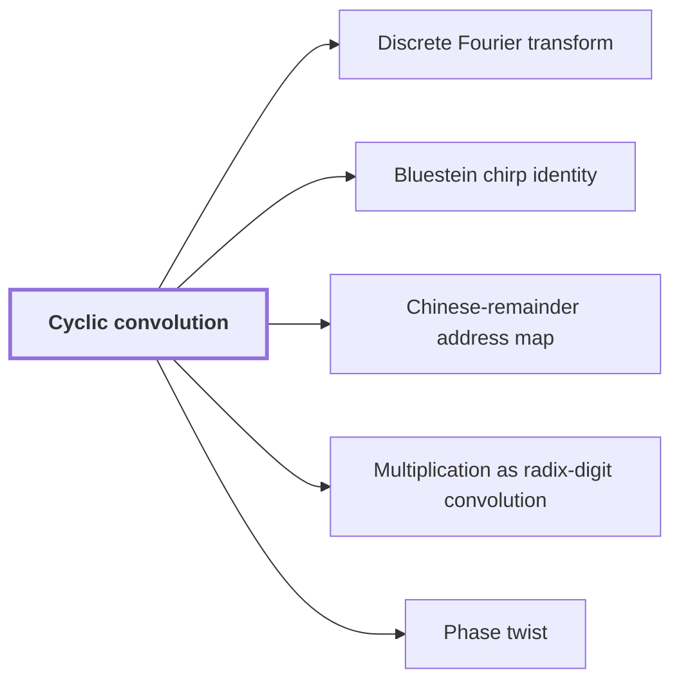

# Cyclic convolution

!!! info "Before this page"

    Assumed known: Polynomials.

!!! abstract "Where this fits"

    - Relied on to show: Normalized cyclic convolution over the polynomial ring $\mathbb C[y]/(y^r+1)$ on the remaining $d-1$ axes is computed from two forward synthetic transforms in retained order, $M$ pointwise polynomial products and the opposite transform, in $O(Tp[dK+pK^{\tau-1}+\ell d^{\lambda'}+\log(rp)])$ time with error less than $\sqrt2\,M(3\ell+1)2^{-p}$. ([Convolution from the retained transform layout](ring-convolution.md "Convolution over the ring modulo y^r + 1 on the remaining axes by two forward synthetic transforms, pointwise polynomial products and the opposite transform, normalized by 1/(rM)."))
    - Relied on to show: Normalized convolution $\mathcal M_r(f,g)=f*g/(rM)=f*g/T$ on arrays over $\mathcal R_r$ is approximated with error less than $\sqrt2\,M(3\ell+1)2^{-p}$ in $O(Tp[dK+pK^{\tau-1}+\ell d^{\lambda'}+\log(rp)])$ time.
    - Relied on to show: The Fourier transforms of pairwise coprime prime lengths $s_i$ that the integer product needs are computed through power-of-two lengths $t_i$ by Gaussian resampling and Bluestein chirps, with the source and target coordinate permutations left inside the transform identities, so that none is executed as a sort. ([Retained permutation cancellation](retained-permutations.md "Leaving the coordinate permutations of resampling inside the transform identity, so the source permutation cancels across the two forward transforms and the opposite one and none is executed as a sort."))
    - Relied on to show: For even $t_i$ and the chirp $a_{\boldsymbol j}=\exp(-\pi i\sum_is_ij_i^2/t_i)$ one has $QF_{\boldsymbol t}u=\overline a\cdot\bigl(a*(\overline a\cdot u)\bigr)/T$, so the target permutation $Q$ is absorbed into a cyclic convolution of length $T$ and never executed. ([Bluestein chirp identity](chirp.md "An identity that rewrites a (permuted) Fourier transform as a pointwise chirp phase, a cyclic convolution, and another chirp phase."))
    - Relied on to show: The retained source permutation cancels: $(RF_{\boldsymbol s}^+)[(RF_{\boldsymbol s}u)\cdot(RF_{\boldsymbol s}v)]=u*v/S^2$ with $S=\prod_is_i$, so no source permutation is executed across the two forward transforms, their pointwise product and the opposite transform.
    - Relied on to show: The exact $2n$-bit product of the two inputs is obtained from the radix-digit convolution by the chain: radix digits, Chinese-remainder address map to a product of prime cyclic axes, two forward source transforms (resampling and chirps), pointwise product, opposite transform, rescaling, rounding, and carry propagation, with total error below $1/2$. ([The multiplication algorithm](multiplication-algorithm.md "Digits, then the CRT map, two forward transforms with resampling and chirps, a pointwise product, the opposite transform, rescaling, rounding and carry propagation yield the exact 2n-bit product."))
    - Relied on to show: Writing the two inputs in radix $2^b$ with $q=\lceil n/b\rceil$ digits each, the product polynomial has degree at most $2q-2<2n/b\le T/2<S$, so convolution modulo $x^S-1$ has no wraparound, and every coefficient $c_j\le q(2^b-1)^2<2^{3b}$. ([Multiplication as radix-digit convolution](radix-digit-reduction.md "Splitting each integer into radix-2^b digits turns the product into a convolution of short integer coefficients, which carry propagation turns back into a binary number."))
    - Relied on to show: The Chinese-remainder map $\Phi:\mathbb C[x]/(x^S-1)\to\mathbb C[x_1,\dots,x_d]/(x_i^{s_i}-1)$, $x\mapsto\prod_ix_i^{\mu_i}$, is an isomorphism preserving cyclic convolution, and it (with its inverse and padding) is implemented by triangular controlled shifts in $O(Tp\,d^2(1+\ell^\tau))$ time. ([Chinese-remainder address map](crt-map.md "An isomorphism that places a cyclic convolution of length S = s₁⋯s_d on pairwise coprime prime axes, implemented as triangular controlled shifts."))
    - Relied on to show: With $\zeta=e^{\pi i/r}$ the map $\Theta:\mathbb C[x_d]/(x_d^r-1)\to\mathcal R_r$, $x_d\mapsto\zeta y$, is an isomorphism multiplying coefficient $k$ by $\zeta^k$; hence normalized complex cyclic convolution is $\mathcal M_{\mathbb C}(f,g)=D_-\iota^{-1}\mathcal M_r(\iota D_+f,\iota D_+g)=f*g/T$. ([Phase twist](phase-twist.md "Multiplying coefficient k by e^{πik/r}, which converts the cyclic coordinate modulo x^r − 1 into the negacyclic ring modulo y^r + 1 and is removed afterwards."))
    - Relied on to show: The error on the recovered integer coefficients is below $1/2$, so rounding gives the exact integer coefficients, and carry propagation yields the exact binary product. ([Error tracking and exact recovery](precision-recovery.md "Each normalized transform and product is a contraction with a bounded rounding error, and the total error on the recovered convolution coefficients is below 1/2, so rounding gives exact integers."))

??? note "Symbols from earlier pages"

    - $r$ — record length: The number of complex coefficients in a polynomial of the ring, always a power of two. (on [Polynomial ring modulo y^r + 1](ring-y.md "Polynomials of degree below r over the complex numbers with y^r = −1, so multiplying by a power of y is a signed shift of the coefficient list."))
    - $y$ — ring variable: The indeterminate of the polynomials; it satisfies y^r = -1 in the ring. (on [Polynomial ring modulo y^r + 1](ring-y.md "Polynomials of degree below r over the complex numbers with y^r = −1, so multiplying by a power of y is a signed shift of the coefficient list."))

Cyclic convolution is the product of two sequences whose indices wrap around; the multiplication algorithm reduces integer multiplication to it, because Fourier-type transforms turn it into pointwise multiplication (see [Discrete Fourier transform](dft.md "The normalized transform (F_q u)_k = (1/q) Σ u_j e^{−2πi jk/q}, which turns convolution into pointwise multiplication.")).

For two sequences $f,g$ indexed by $\mathbb Z/q\mathbb Z$, where $q$ is the number of entries in each sequence, the cyclic convolution is
$$(f*g)_k=\sum_{j\in\mathbb Z/q\mathbb Z} f_j\,g_{k-j},$$
with $k-j$ taken modulo $q$ (here $j,k$ are sequence indices, not the depth of earlier pages). Equivalently, $f*g$ is the product of the polynomials $\sum_j f_jx^j$ and $\sum_j g_jx^j$ reduced modulo $x^q-1$: since $x^q=1$, a term $x^m$ with $m\ge q$ lands on index $m-q$.

Take $q=3$, $f=1+2x+3x^2$ and $g=1+x$. The ordinary product is $1+3x+5x^2+3x^3$, and the wrapped term $3x^3$ becomes $3$, giving $4+3x+5x^2$. If the ordinary product has degree below $q$, nothing wraps and $f*g$ is the ordinary product.

## Arrays over the negacyclic ring

The algorithm convolves arrays with several axes. Here $d$ is the number of axes of the underlying cyclic convolution, and $t_i$ is the length of axis $i$. After the last axis is turned into polynomial coefficients, an array $f$ assigns to each address in the other $d-1$ axes one entry of the ring of [Polynomial ring modulo y^r + 1](ring-y.md "Polynomials of degree below r over the complex numbers with y^r = −1, so multiplying by a power of y is a signed shift of the coefficient list."). The convolution $f*g$ wraps each cyclic axis independently and multiplies entries by the ring product, where wrapping past $y^r$ flips the sign.

Let $M=\prod_{i<d}t_i$ be the number of addresses, and $T=rM$ the number of complex coefficients in an array. The normalized convolution is
$$\mathcal M_r(f,g)=\frac{f*g}{rM}=\frac{f*g}{T}.$$
A fixed output coefficient is the average of $rM$ signed products of one coefficient of $f$ and one of $g$<cite class="exegenius-ref" data-source="paper" data-locator="§7.1 The normalized convolution interface" data-quote="Thus that coefficient averages $rM$ signed scalar products, and $\mathcal M_r$ is a bilinear contraction" title="Thus that coefficient averages $rM$ signed scalar products, and $\mathcal M_r$ is a bilinear contraction"> (see §7.1 The normalized convolution interface)</cite>, so with $\|\cdot\|_\infty$ the largest modulus of a coefficient,
$$\|\mathcal M_r(f,g)\|_\infty\le\|f\|_\infty\|g\|_\infty.$$
Dividing by $T$ cancels the growth of a sum of $T$ products, which is the reason for the normalization.

## Why index permutations are never executed

Gaussian resampling lets the algorithm compute transforms of prime length through power-of-two lengths ([Gaussian resampling](gaussian-resampling.md "Re-expressing a Fourier transform of prime length s through a transform of nearby power-of-two length t using Gaussian weights, so that only power-of-two transforms are needed.")), but its formula reads the input and writes the output in permuted index order. Executing such a permutation is a sort of data on a tape, costing time proportional to the line length times a logarithm of it<cite class="exegenius-ref" data-source="paper" data-locator="§8.1 The one-dimensional interface" data-quote="Its two label-and-sort operations implement $P_t$ and $P_s^{-1}$, each costing $O(tp\log t)$." title="Its two label-and-sort operations implement $P_t$ and $P_s^{-1}$, each costing $O(tp\log t)$."> (see §8.1 The one-dimensional interface)</cite> The extra logarithmic factor is what the power saving cannot afford, so the permutations stay inside the identities, and convolution is what lets them vanish. Write $\pi$ for a permutation of the indices, $F$ for the normalized Fourier transform of length $q$, and $F^+$ for the transform with the opposite sign in the exponent.

Source side. Convolution is computed as a forward transform of each input, an entrywise product $\cdot$, and an opposite transform: $F(f*g)=q\,(Ff)\cdot(Fg)$ and $F^+F=I/q$, so $f*g=q^2F^+\bigl((Ff)\cdot(Fg)\bigr)$. An entrywise product pairs entries at the same position, so $\pi(a\cdot b)=(\pi a)\cdot(\pi b)$ for any permutation: scrambled forward outputs multiply to the scrambled product. The resampling permutation multiplies indices by a unit modulo the length, and for it $F^+\pi=\pi^{-1}F^+$, so applying the same $\pi$ in the opposite transform undoes the scramble. Thus the retained source permutation cancels when computing a convolution<cite class="exegenius-ref" data-source="paper" data-locator="§8.3 The middle transform and the final permutation" data-quote="retained source permutation $R$ cancels when computing a convolution." title="retained source permutation $R$ cancels when computing a convolution."> (see §8.3 The middle transform and the final permutation)</cite>, and no sort occurs across the whole chain.

Target side. The middle transform has its output relabelled, which is a single use with nothing to cancel against. The [Bluestein chirp identity](chirp.md "An identity that rewrites a (permuted) Fourier transform as a pointwise chirp phase, a cyclic convolution, and another chirp phase.") writes it as a chirp phase, a cyclic convolution and another chirp phase. The product of the chirp phases at $j$, $j-k$ and $k$ is the Fourier kernel evaluated at the relabelled frequency, so the relabelling sits in the phases and costs nothing beyond a convolution the algorithm performs anyway.

## Connections

Used by:

- [Discrete Fourier transform](dft.md "The transform diagonalizes cyclic convolution: the transform of a convolution is a pointwise product of transforms.") *diagonalizes* Cyclic convolution
- [Bluestein chirp identity](chirp.md "The permuted transform is thus reduced to one Cyclic convolution of length $T$ between two pointwise phase multiplications.") *is reduced to* Cyclic convolution
- [Chinese-remainder address map](crt-map.md "Hence $\Phi$ is an isomorphism and preserves Cyclic convolution, the product in the ring.") *preserves* Cyclic convolution
- [Multiplication as radix-digit convolution](radix-digit-reduction.md "Multiplication therefore reduces to a Cyclic convolution of length $S$ on short integer coefficients.") *is reduced to* Cyclic convolution
- [Phase twist](phase-twist.md "The twist reproduces Cyclic convolution on that axis.") *reproduces* Cyclic convolution

??? quote "From the sources"

    > let $*$ denote cyclic convolution in the displayed axes
    >
    > — [Integer multiplication below n log n (OpenAI, 2026)](https://github.com/openai/math/tree/fd4aeeb2ee4fc729c18d98444fed42fd0529eeeb/preprints/Integer-multiplication-below-n-log-n-September-23-2026)
