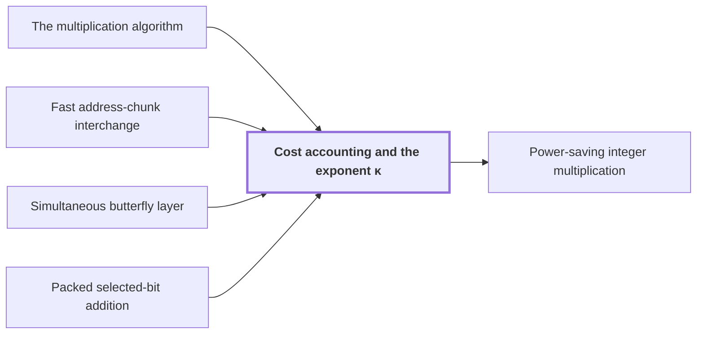

# Cost accounting and the exponent κ

!!! info "Before this page"

    Cost accounting and the exponent κ *totals the running time of* [The multiplication algorithm](multiplication-algorithm.md "Cost accounting totals the running time of every step of The multiplication algorithm and shows that it is $O(n(\lg n)^{1-\kappa})$, with $\kappa=2^{-182}$ fixed by the smallest margin below."), *costs each chunk exchange by* [Fast address-chunk interchange](address-interchange.md "Each chunk exchange costs $O(VK^\tau)$ by Fast address-chunk interchange, and the normalized total is $O(p/K)K^\tau=O(pK^{\tau-1})$."), *costs simultaneous rounds by* [Simultaneous butterfly layer](simultaneous-layer.md "Each of at most $\ell$ simultaneous rounds costs $O(Vd^{\lambda'})$ by Simultaneous butterfly layer.") and *bounds the exceptional addresses of* [Packed selected-bit addition](packed-bit-addition.md "Exceptional addresses, where the packed shifts of Packed selected-bit addition fail, are bounded to a fraction $O(d2^{-K})$ of addresses.").

!!! abstract "Where this fits"

    1. A single deterministic Turing machine with a fixed finite alphabet and a fixed finite number of one-dimensional tapes multiplies two $n$-bit integers exactly in $O(n(\lg n)^{1-\kappa})$ worst-case time with $\kappa=2^{-182}$, disproving the $n\log n$ optimality conjecture of Sch\"onhage and Strassen in this model. — how: Build two power-saving tape procedures (chunk interchange and simultaneous butterfly layer) from fixed finite linear networks; use them to accelerate the synthetic polynomial transforms and ring convolution; use Gaussian resampling with retained permutations and chirps to reduce the prime-length cyclic convolution of the radix-digit coefficients to those power-of-two transforms; assemble the exact product with a proof that the error is below $1/2$; and total the cost to show a power of $\log n$ is saved. ([Power-saving integer multiplication](main-result.md "A deterministic fixed-tape Turing machine multiplying two n-bit integers exactly in O(n(lg n)^{1−κ}) time with κ = 2^{−182}, disproving the n log n optimality conjecture in this model."))
    2. **This page:** The total time of the machine is $O(n(\lg n)^{1-\kappa})$ with $\kappa=2^{-182}$: after dividing each cost by $V=Tp=\Theta(n)$ the dominant terms are powers of $p$ below one, with minimum margin $2^{-181}=2\kappa$.

??? note "Symbols from earlier pages"

    - $\kappa$ — power saving: A fixed positive constant, the amount by which the exponent of the logarithm is lowered. (on [Schönhage–Strassen optimality conjecture](conjecture.md "The 1971 proposal that n log n is the optimal order of growth for multiplying n-bit integers on a multitape Turing machine."))
    - $n$ — bit length: The number of bits in each of the two integers being multiplied. (on [Schönhage–Strassen optimality conjecture](conjecture.md "The 1971 proposal that n log n is the optimal order of growth for multiplying n-bit integers on a multitape Turing machine."))
    - $p$ — fractional bits: The number of fractional bits of the grid on which stored values lie. (on [Fixed-point Gaussian dyadic records](fixed-point.md "Complex values stored as signed two's-complement integers over a power-of-two denominator 2^{-p}; intermediate values are exact and one truncation Q_p rounds back to the p-bit grid."))
    - $\epsilon$ — axis-count exponent: The exponent of the axis count d=floor(b^epsilon). (on [Parameter and prime-length choice](parameter-choice.md "Fixed rational exponents and sizes (precision p = 6b, d axes, K = d^c, T and r powers of two, prime lengths s_i just below t_i) making every hypothesis of the lemmas hold."))
    - $c$ — chunk-width exponent: The exponent of the address-chunk width K=floor(d^c). (on [Parameter and prime-length choice](parameter-choice.md "Fixed rational exponents and sizes (precision p = 6b, d axes, K = d^c, T and r powers of two, prime lengths s_i just below t_i) making every hypothesis of the lemmas hold."))
    - $\delta$ — resampling slack: The fixed slack in the exponent of the resampling cost, delta=1/16. (on [Parameter and prime-length choice](parameter-choice.md "Fixed rational exponents and sizes (precision p = 6b, d axes, K = d^c, T and r powers of two, prime lengths s_i just below t_i) making every hypothesis of the lemmas hold."))
    - $\tau$ — interchange exponent: The exponent in the cost of a chunk interchange. (on [Parameter and prime-length choice](parameter-choice.md "Fixed rational exponents and sizes (precision p = 6b, d axes, K = d^c, T and r powers of two, prime lengths s_i just below t_i) making every hypothesis of the lemmas hold."))
    - $\lambda'$ — layer exponent: The final exponent of the layer cost V d^{lambda'}. (on [Parameter and prime-length choice](parameter-choice.md "Fixed rational exponents and sizes (precision p = 6b, d axes, K = d^c, T and r powers of two, prime lengths s_i just below t_i) making every hypothesis of the lemmas hold."))
    - $d$ — axis count: The number of axes of the underlying cyclic convolution. (on [Cyclic convolution](convolution.md "The product of two sequences (or elements of a polynomial quotient ring) where indices wrap around: (f∗g)_k = Σ f_j g_{k−j}."))
    - $K$ — chunk width: The width in bits of an address chunk. (on [Parameter and prime-length choice](parameter-choice.md "Fixed rational exponents and sizes (precision p = 6b, d axes, K = d^c, T and r powers of two, prime lengths s_i just below t_i) making every hypothesis of the lemmas hold."))
    - $\ell$ — address bits: The number of address bits of an axis of length r. (on [Chinese-remainder address map](crt-map.md "An isomorphism that places a cyclic convolution of length S = s₁⋯s_d on pairwise coprime prime axes, implemented as triangular controlled shifts."))
    - $\alpha$ — width parameter: The integer width parameter of the Gaussian weights, with 2 <= alpha < sqrt p. (on [Gaussian resampling](gaussian-resampling.md "Re-expressing a Fourier transform of prime length s through a transform of nearby power-of-two length t using Gaussian weights, so that only power-of-two transforms are needed."))
    - $N$ — factor bit length: The number of bits in each of the two integers given to the established multiplier. (on [Established O(n log n) multiplier](hvdh-multiplier.md "The earlier Harvey–van der Hoeven multitape algorithm multiplying N-bit integers in O(N log N) time, used here only as an ordinary subroutine."))
    - $r$ — record length: The number of complex coefficients in a polynomial of the ring, always a power of two. (on [Polynomial ring modulo y^r + 1](ring-y.md "Polynomials of degree below r over the complex numbers with y^r = −1, so multiplying by a power of y is a signed shift of the coefficient list."))
    - $t_i$ — padded axis length: The length of axis i after padding with zero records, a power of two between r/2 and r. (on [Chinese-remainder address map](crt-map.md "An isomorphism that places a cyclic convolution of length S = s₁⋯s_d on pairwise coprime prime axes, implemented as triangular controlled shifts."))
    - $i$ — axis index: The index of an axis, from 1 to d. (on [Chinese-remainder address map](crt-map.md "An isomorphism that places a cyclic convolution of length S = s₁⋯s_d on pairwise coprime prime axes, implemented as triangular controlled shifts."))

Cost accounting totals the running time of every step of [The multiplication algorithm](multiplication-algorithm.md "Digits, then the CRT map, two forward transforms with resampling and chirps, a pointwise product, the opposite transform, rescaling, rounding and carry propagation yield the exact 2n-bit product.") and shows that it is $O(n(\lg n)^{1-\kappa})$, with $\kappa=2^{-182}$ fixed by the smallest margin below.

Let $V=Tp=\Theta(n)$, the number of stored bits when $T$ coefficients carry $\Theta(p)$ bits each. With the fixed exponents of [Parameter and prime-length choice](parameter-choice.md "Fixed rational exponents and sizes (precision p = 6b, d axes, K = d^c, T and r powers of two, prime lengths s_i just below t_i) making every hypothesis of the lemmas hold."), namely $\epsilon=2^{-75}$, $c=2^{-56}$, $\delta=1/16$, $1-\tau=2^{-50}$ and $1-\lambda'=2^{-54}$, the sizes are $d=\Theta(p^\epsilon)$ axes, chunk width $K=\Theta(p^{\epsilon c})$ bits, $\ell=\Theta(p^{1-\epsilon})$ address bits per axis and $\alpha=\Theta(p^{1/4+\epsilon/2})$.

Dividing by $V$, seven operations dominate, each a power $p^{1-g_i}$ with margin $g_i>0$ below one.

| Operation | Cost$/V$ | Power of $p$ | Margin |
|---|---|---|---|
| Prefix moves | $dK$ | $\epsilon(1+c)$ | $g_1=1-\epsilon(1+c)$ |
| Chunk exchanges | $pK^{\tau-1}$ | $1-\epsilon c(1-\tau)$ | $g_2=\epsilon c(1-\tau)$ |
| Layer rounds | $\ell d^{\lambda'}$ | $1-\epsilon(1-\lambda')$ | $g_3=\epsilon(1-\lambda')$ |
| Axis layouts | $d^2(1+\ell^\tau)$ | $\tau+\epsilon(2-\tau)$ | $g_4=1-\tau-\epsilon(2-\tau)$ |
| Gaussian lines | $dp^{1/2+\delta}\alpha$ | $3/4+\delta+3\epsilon/2$ | $g_5=1/4-\delta-3\epsilon/2$ |
| Chirps | $dp^\delta$ | $\epsilon+\delta$ | $g_6=1-\delta-\epsilon$ |
| Products | $\log(rp)$ | $1-\epsilon$ | $g_7=\epsilon$ |

- Prefix moves and single butterfly rounds are $O(dK)$ linear scans of cost $O(V)$ each, in [Tape layout for synthetic transforms](transform-layout.md "Placing the selected bits of the participating axes at a common offset in K-bit chunks so each round of the synthetic transform is one simultaneous layer, costing less than log t passes.").
- The layout rearranges the $d\ell=O(p)$ address bits of the records by exchanging width-$K$ chunks, so it needs $O(p/K)$ exchanges<cite class="exegenius-ref" data-source="paper" data-locator="§9.8 The complete time bound" data-quote="Its positional layout uses $O(p/K)$ exchanges of width-$K$ chunks, because $d\ell=O(p)$." title="Its positional layout uses $O(p/K)$ exchanges of width-$K$ chunks, because $d\ell=O(p)$."> (see §9.8 The complete time bound)</cite> Each chunk exchange costs $O(VK^\tau)$ by [Fast address-chunk interchange](address-interchange.md "The first tape procedure: exchanging two disjoint equal-width address fields of u digits in time O(V·u^τ) for a fixed τ < 1, using XOR combinations of intermediate data."), and the normalized total is $O(p/K)K^\tau=O(pK^{\tau-1})$. The permutations of [Gaussian resampling](gaussian-resampling.md "Re-expressing a Fourier transform of prime length s through a transform of nearby power-of-two length t using Gaussian weights, so that only power-of-two transforms are needed.") are never executed, since they cancel ([Retained permutation cancellation](retained-permutations.md "Leaving the coordinate permutations of resampling inside the transform identity, so the source permutation cancels across the two forward transforms and the opposite one and none is executed as a sort.")), so no row charges them.
- Each of at most $\ell$ simultaneous rounds costs $O(Vd^{\lambda'})$ by [Simultaneous butterfly layer](simultaneous-layer.md "The second tape procedure: applying H₀ coefficientwise on the same bit of up to d address chunks in time O(V·d^λ′) for a fixed λ′ < 1, instead of d passes.").
- The [Chinese-remainder address map](crt-map.md "An isomorphism that places a cyclic convolution of length S = s₁⋯s_d on pairwise coprime prime axes, implemented as triangular controlled shifts.") needs $O(d^2)$ adjacent axis moves. Each costs $O(V(1+\ell^\tau))$<cite class="exegenius-ref" data-source="paper" data-locator="§9.8 The complete time bound" data-quote="Each costs $O(V(1+\ell^\tau))$: peel a single excess bit when widths" title="Each costs $O(V(1+\ell^\tau))$: peel a single excess bit when widths"> (see §9.8 The complete time bound)</cite>. Here $d^2\ell^\tau=p^{2\epsilon}p^{(1-\epsilon)\tau}$.
- In [Gaussian resampling](gaussian-resampling.md "Re-expressing a Fourier transform of prime length s through a transform of nearby power-of-two length t using Gaussian weights, so that only power-of-two transforms are needed."), axis $i$ of length $t_i$ has at most $T/t_i$ lines, each costing $O(t_ip^{3/2+\delta}\alpha)$, totalling $O(dTp^{3/2+\delta}\alpha)$.
- The chirp numerators of the [Bluestein chirp identity](chirp.md "An identity that rewrites a (permuted) Fourier transform as a pointwise chirp phase, a cyclic convolution, and another chirp phase.") have $O(p)$ bits and sum $d$ terms. The [Established O(n log n) multiplier](hvdh-multiplier.md "The earlier Harvey–van der Hoeven multitape algorithm multiplying N-bit integers in O(N log N) time, used here only as an ordinary subroutine."), taking $O(N\log 2N)$ on $N$ bits, forms their squares and products in $O(dp^{1+\delta})$ per entry.
- There are $T/r$ ring-product records, each needing four products on $O(rp)$ bits after [Signed packing](signed-packing.md "A signed Kronecker substitution that evaluates polynomials with signed coefficients at 2^{4p} to form large integers, multiplies them with the O(n log n) multiplier, and recovers the product coefficients."). These calls have length $o(n)$. The total is $O(Tp\log(rp))$, and $\log(rp)=O(p^{1-\epsilon})$ because $r$ is at most $2^{O(p/d)}$.

Substitution gives $g_1>1/2$, $g_2=2^{-75}2^{-56}2^{-50}=2^{-181}$, $g_3=2^{-75}2^{-54}=2^{-129}$, $g_4>2^{-51}$, $g_5>1/8$, $g_6>1/2$ and $g_7=2^{-75}$, so the smallest margin is $2^{-181}=2\kappa$<cite class="exegenius-ref" data-source="paper" data-locator="§9.8 The complete time bound" data-quote="Thus $\min_i g_i=2^{-181}=2\kappa$." title="Thus $\min_i g_i=2^{-181}=2\kappa$."> (see §9.8 The complete time bound)</cite>

Plain scans would be $\tau=1$, costing $p$ per unit volume and giving margin $0$; likewise $\lambda'=1$ gives the layer row margin $0$. Address movement saves a power of $p$ only through the two new tape procedures, and each saving is tiny. In $g_3$ the layer saving $1-\lambda'$ is scaled by $\epsilon$, since only $d=\Theta(p^\epsilon)$ axes share a layer. In $g_2$ there is a further factor $c$: an exchange acts on chunks of only $K=\Theta(p^{\epsilon c})$ bits and saves a factor $K^{-(1-\tau)}=p^{-\epsilon c(1-\tau)}$ against a full pass.

For setup, a visit is a node of the layer or address-layout recursions, or a round or group invocation inside them. They have constant branching, depth $O(\log p)$ and polynomially many rounds and groups. Fix an exponent $A$ with at most $p^A$ visits in total, and an exponent $C$ with descriptor setup of at most $p^C$ steps per visit. The setup costs at most $p^{A+C}=o(Tp)$<cite class="exegenius-ref" data-source="paper" data-locator="§9.8 The complete time bound" data-quote="costs at most $p^{A+C}=o(Tp)$." title="costs at most $p^{A+C}=o(Tp)$."> (see §9.8 The complete time bound)</cite> Per-record and per-line setup, $O(Tp^{A+C}/r)$ and $O(dTp^C/r)$, is $o(Tp)$ since $r$ exceeds every fixed power of $p$.

Exceptional addresses, where the packed shifts of [Packed selected-bit addition](packed-bit-addition.md "XORing selected bits between two address chunks (with a third chunk as restored scratch) using cyclic shifts of whole chunk ranges plus a repair of explicitly bounded exceptional addresses.") fail, are bounded to a fraction $O(d2^{-K})$ of addresses. Let $V_{\rm call}$ be the volume of one packed change of basis. A record has $\Theta(rp)$ bits and an exceptional one adds an $O(p)$-bit key, so the stream of exceptional records has length $O\left(\frac{V_{\rm call}}{rp}d2^{-K}(rp+p)\right)=O(V_{\rm call}d2^{-K})$. Stable bit sorting scans it $O(p)$ times, so over at most $p^A$ visits repair costs $O(Vp^{O(1)}2^{-K})=o(V)$, because $2^{-K}$ beats every power of $p$. Global setup and prime search cost $o(V)$.

The table rounds each bound up to a power of $p$. The lemmas may leave fixed powers of $\log p$, for example from the $O(\log p)$ recursion depth; the sources do not itemize them. The slack covers them: a fixed power of $\log p$ is at most $p^\kappa$ for large $p$, since it grows more slowly than any positive power of $p$. Each of the seven powers is at most $p^{1-2\kappa}$, so with these logarithms it is at most $p^{1-2\kappa}p^{\kappa}=p^{1-\kappa}$. Half the smallest margin pays for logarithms and half remains as the saving. Any positive $\kappa$ below $2^{-181}$ would pass the same test; $g_2$ sets the scale of $\kappa$. The total is $O(Tp\,p^{1-\kappa})=O(n(\log n)^{1-\kappa})$<cite class="exegenius-ref" data-source="paper" data-locator="§9.8 The complete time bound" data-quote="O(Tp\,p^{1-\kappa})=O(n(\log n)^{1-\kappa})." title="O(Tp\,p^{1-\kappa})=O(n(\log n)^{1-\kappa})."> (see §9.8 The complete time bound)</cite>

The bound needs inputs beyond a cutoff chosen past all the size, precision, margin and layout conditions. Below it the machine uses schoolbook multiplication; only finitely many lengths lie there, so their running times are bounded by one constant<cite class="exegenius-ref" data-source="paper" data-locator="§9.8 The complete time bound" data-quote="many smaller lengths are included by enlarging the implicit constant." title="many smaller lengths are included by enlarging the implicit constant."> (see §9.8 The complete time bound)</cite> With $\lg n=\max\{\lceil\log_2n\rceil,1\}$, within a constant factor of $\log n$ and at least $1$, the single machine therefore runs in $O(n(\lg n)^{1-\kappa})$ for every $n\ge1$.

## Connections

Used by:

- [Power-saving integer multiplication](main-result.md "The running time is totalled by Cost accounting and the exponent κ after dividing every cost by $V=Tp=\Theta(n)$, where $T$ counts the complex coefficients and $p$, of order $\lg n$, is the number of fractional bits of each.") *is totalled by* Cost accounting and the exponent κ

??? quote "From the sources"

    > Thus $\min_i g_i=2^{-181}=2\kappa$.
    >
    > — [Integer multiplication below n log n (OpenAI, 2026)](https://github.com/openai/math/tree/fd4aeeb2ee4fc729c18d98444fed42fd0529eeeb/preprints/Integer-multiplication-below-n-log-n-September-23-2026)

    > The complete time bound
    >
    > — [Integer multiplication below n log n (OpenAI, 2026)](https://github.com/openai/math/tree/fd4aeeb2ee4fc729c18d98444fed42fd0529eeeb/preprints/Integer-multiplication-below-n-log-n-September-23-2026)
