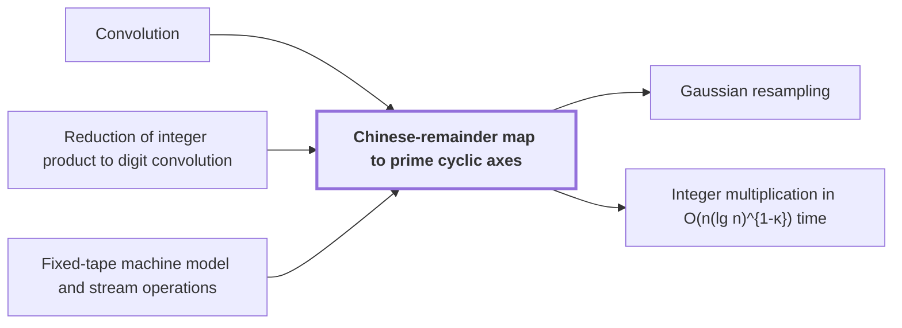

# Chinese-remainder map to prime cyclic axes

!!! info "Before this page"

    Chinese-remainder map to prime cyclic axes *preserves* [Convolution](convolution.md "This map preserves convolution on the axes, so a cyclic product of two lists on $\mathbb{Z}_N$ becomes a product on the prime axes: the cyclic convolution is carried out along every axis at once."), *is applied to* [Reduction of integer product to digit convolution](radix-digit-reduction.md "The map is applied to the radix-digit coefficient list produced by reduction of integer product to digit convolution.") and *is costed in* [Fixed-tape machine model and stream operations](fixed-tape-model.md "The map's axis moves are costed in the fixed-tape machine model and stream operations, which counts each such step as data movement, since each step touches one cell per tape.").

!!! abstract "Where this fits"

    1. An $n$-bit integer product is computed by a fixed-tape machine in $O(n(\lg n)^{1-\kappa})$ time, $\kappa=2^{-182}$. — how: reduce multiplication to ring convolution and speed up its address moves and butterfly layers ([Integer multiplication in O(n(lg n)^{1-κ}) time](main-theorem.md "Deterministic fixed-tape Turing machine multiplying n-bit integers in O(n(lg n)^{1-κ}), κ=2^{-182}, by reducing to ring convolution with fast address interchanges and simultaneous butterfly layers, disproving the n log n conjecture in this model."))
    2. **This page:** The radix-digit coefficient list is placed on a product of distinct prime cyclic axes by a convolution-preserving Chinese-remainder map.

??? note "Symbols from earlier pages"

    - $a$ — input list a: The first input coefficient list, with entries $a_0,\dots,a_{n-1}$. (on [Convolution](convolution.md "Product of polynomials / combination of coefficient lists where entries sum by index (cyclic if indices wrap)."))
    - $b$ — input list b: The second input coefficient list, with entries $b_0,\dots,b_{n-1}$. (on [Convolution](convolution.md "Product of polynomials / combination of coefficient lists where entries sum by index (cyclic if indices wrap)."))
    - $c$ — output list: The cyclic convolution of $a$ and $b$, a list of $n$ entries. (on [Convolution](convolution.md "Product of polynomials / combination of coefficient lists where entries sum by index (cyclic if indices wrap)."))
    - $i$ — index i: An index into the entries of the input list $a$. (on [Convolution](convolution.md "Product of polynomials / combination of coefficient lists where entries sum by index (cyclic if indices wrap)."))
    - $j$ — index j: An index into the entries of the input list $b$. (on [Convolution](convolution.md "Product of polynomials / combination of coefficient lists where entries sum by index (cyclic if indices wrap)."))
    - $k$ — output index: An index into the entries of the output list $c$. (on [Convolution](convolution.md "Product of polynomials / combination of coefficient lists where entries sum by index (cyclic if indices wrap)."))

The Chinese-remainder map to prime cyclic axes is the rearrangement that places a coefficient list on a product of cyclic axes whose lengths are distinct primes.

Let $N$, the number of coefficients in the list, be written $N = P_1 P_2 \cdots P_T$, where $T$ is the number of distinct primes and $P_\nu$ is the $\nu$-th of them, for $\nu = 1,\dots,T$. Each index $e \in \{0,\dots,N-1\}$ is sent to the tuple of its residues $(e \bmod P_1, \dots, e \bmod P_T)$. Each $\mathbb{Z}_{P_\nu}$, the set of residues modulo $P_\nu$, is one axis of length $P_\nu$. An axis is cyclic because its values wrap around modulo its length.

The $P_\nu$ are pairwise coprime, since distinct primes share no factor. The Chinese remainder theorem then says that each tuple comes from exactly one index modulo $N$. There are $N$ indices and $N$ tuples, so the map is a bijection. Moreover, two indices agree modulo $N$ exactly when they agree modulo every $P_\nu$: the forward direction holds because each $P_\nu$ divides $N$, and the reverse is the uniqueness part of the theorem.

For example, take $N = 15$ with $P_1 = 3$ and $P_2 = 5$. Index $7$ goes to $(1, 2)$ and index $8$ goes to $(2, 3)$. Their sum $15 \equiv 0$ goes to $(0, 0)$, which is $(1+2, 2+3)$ reduced modulo $(3, 5)$.

Let $a$ and $b$ be lists of length $N$, and let $c_k=\sum_{i+j\equiv k \pmod N} a_i b_j$ be their cyclic [convolution](convolution.md "Product of polynomials / combination of coefficient lists where entries sum by index (cyclic if indices wrap)."). Under the map, a pair of indices contributes to $c_k$ exactly when, in every coordinate, the residues add to the residue of $k$. So the sum is cyclic along each axis separately. This map preserves [convolution](convolution.md "Product of polynomials / combination of coefficient lists where entries sum by index (cyclic if indices wrap).") on the axes, so a cyclic product of two lists on $\mathbb{Z}_N$ becomes a product on the prime axes: the cyclic convolution is carried out along every axis at once.

The map is applied to the radix-digit coefficient list produced by [reduction of integer product to digit convolution](radix-digit-reduction.md "Splitting the inputs into radix digits turns the integer product into a convolution of short integer coefficients, followed by carry propagation."). The paper's map targets a product of<cite class="exegenius-ref" data-source="paper" data-locator="§1.3 From transforms to the exact product" data-quote="distinct prime cyclic axes" title="distinct prime cyclic axes"> (see §1.3 From transforms to the exact product)</cite>. [Gaussian resampling](gaussian-resampling.md "Harvey–van der Hoeven reduction expressing each Fourier transform of prime-length axes through a multidimensional transform with power-of-two axis lengths.") expresses the Fourier transform on each prime-length axis through a multidimensional transform with power-of-two axis lengths, so the placement on prime axes is what lets it apply.

The paper's assembly section implements the map through<cite class="exegenius-ref" data-source="paper" data-locator="§1.3 From transforms to the exact product" data-quote="triangular controlled shifts and charged axis moves" title="triangular controlled shifts and charged axis moves"> (see §1.3 From transforms to the exact product)</cite>. A shift or move rearranges the stored entries. The map's axis moves are costed in the [fixed-tape machine model and stream operations](fixed-tape-model.md "Machine with one fixed finite alphabet and a fixed number of one-dimensional tapes; each step touches one cell per tape, so data movement (scans, shifts, permutations) is the cost to minimize."), which counts each such step as data movement, since each step touches one cell per tape.

## Connections

Used by:

- [Gaussian resampling](gaussian-resampling.md "Gaussian resampling acts on the axes placed by the Chinese-remainder map to prime cyclic axes.") *acts on the axes placed by* Chinese-remainder map to prime cyclic axes
- [Integer multiplication in O(n(lg n)^{1-κ}) time](main-theorem.md "The machine places its coefficient list by the Chinese-remainder map to prime cyclic axes.") *places its coefficient list by* Chinese-remainder map to prime cyclic axes

??? quote "From the sources"

    > Chinese-remainder map that preserves
    >
    > — [Integer multiplication below n log n (OpenAI, 2026)](https://github.com/openai/math/tree/fd4aeeb2ee4fc729c18d98444fed42fd0529eeeb/preprints/Integer-multiplication-below-n-log-n-September-23-2026)
