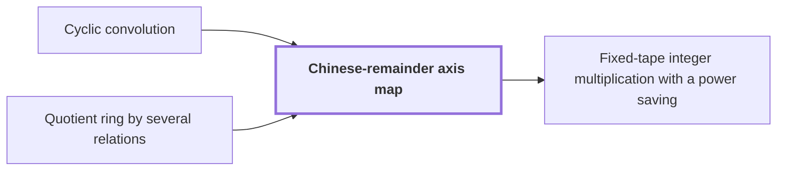

# Chinese-remainder axis map

!!! info "Before this page"

    Chinese-remainder axis map *preserves* [Cyclic convolution](cyclic-convolution.md "Because $\Phi$ is an isomorphism, it preserves Cyclic convolution: products of lists map to products of images.") and *maps into* [Quotient ring by several relations](quotient-ring.md "Let $\Phi$ be the algebra map (respecting sums, products and scalars) with $\Phi(x)=\prod_\alpha x_\alpha^{\mu_\alpha}$ that maps $\mathbb C[x]/(x^S-1)$ into the Quotient ring by several relations $\mathcal R$.").

!!! abstract "Where this fits"

    1. The integer product is computed exactly on one fixed-tape machine in $O(n(\lg n)^{1-\kappa})$ worst-case time, for $\kappa=2^{-182}$. — how: reduce exact multiplication to convolution of radix digits on distinct prime axes, compute the convolution by synthetic transforms on tape layouts, and bound the total tape cost with a power saving ([Fixed-tape integer multiplication with a power saving](fixed-tape-multiplication.md "A deterministic fixed-tape Turing machine that multiplies two n-bit integers exactly in O(n(lg n)^(1−κ)) worst-case time, for a fixed κ = 2^(−182), disproving the n log n optimality conjecture in this model."))
    2. **This page:** The radix-digit coefficient list is placed on distinct prime cyclic axes by a Chinese-remainder map that preserves convolution.

The Chinese-remainder axis map is a bijection that places the coefficients of a [Cyclic convolution](cyclic-convolution.md "The product of two coefficient lists in the ring of polynomials modulo x^S − 1, in which exponents wrap around modulo S.") on the axes of a product of cyclic rings, so that the convolution becomes multidimensional.

Let $d$ be the number of axes, with $\alpha$ and $\beta$ running from $1$ to $d$ as axis indices (not list positions), and let $s_\alpha$ be the length of axis $\alpha$, with $s_1,\ldots,s_d$ pairwise coprime. Let $S=s_1\cdots s_d$ be the number of coefficients, and let $x$ be the variable of $\mathbb C[x]/(x^S-1)$. Let $x_\alpha$ be the variable of axis $\alpha$, and let $\mathcal R=\mathbb C[x_1,\ldots,x_d]/(x_1^{s_1}-1,\ldots,x_d^{s_d}-1)$ be the target ring.

Let $P_\alpha=s_1\cdots s_{\alpha-1}$, so $P_1=1$. Since $P_\alpha$ is coprime to $s_\alpha$, it has an inverse $\mu_\alpha$ modulo $s_\alpha$, so $\mu_\alpha P_\alpha\equiv1\pmod{s_\alpha}$.

Let $\Phi$ be the algebra map (respecting sums, products and scalars) with $\Phi(x)=\prod_\alpha x_\alpha^{\mu_\alpha}$ that maps $\mathbb C[x]/(x^S-1)$ into the [Quotient ring by several relations](quotient-ring.md "The quotient ring of a polynomial ring by several relations is the ring obtained by identifying two polynomials whenever their difference lies in the ideal generated by those relations.") $\mathcal R$. A map sending $x$ to an element $g$ of a ring kills $x^S-1$, and so descends to the quotient, exactly when $g^S=1$. Here $\Phi(x)^S=\prod_\alpha x_\alpha^{\mu_\alpha S}=1$, because each $s_\alpha$ divides $S$.

For a coefficient index $\iota$ with $0\le\iota<S$ (the position of a coefficient in the list), $\Phi(x^\iota)=\prod_\alpha x_\alpha^{\mu_\alpha\iota}$ is a monomial whose exponent on $x_\alpha$ is $b_\alpha$, where $0\le b_\alpha<s_\alpha$ and $b_\alpha\equiv\mu_\alpha\iota\pmod{s_\alpha}$. The monomials $x_1^{e_1}\cdots x_d^{e_d}$ with $0\le e_\alpha<s_\alpha$ are a basis of $\mathcal R$, and there are $S$ of them. If $\iota$ and $\iota'$ (another index with $0\le\iota'<S$) give the same $b_\alpha$ for every $\alpha$, then each $s_\alpha$ divides $\iota-\iota'$. The Chinese remainder theorem says that congruences with pairwise coprime moduli combine into one modulo their product, so $S\mid\iota-\iota'$ and $\iota=\iota'$. Thus the $S$ powers $\Phi(x)^0,\ldots,\Phi(x)^{S-1}$ reach $S$ distinct basis monomials, which are all of them. So $\Phi$ is a bijective algebra map, an isomorphism.

Because $\Phi$ is an isomorphism, it preserves [Cyclic convolution](cyclic-convolution.md "The product of two coefficient lists in the ring of polynomials modulo x^S − 1, in which exponents wrap around modulo S."): products of lists map to products of images. In $\mathcal R$, multiplying monomials adds exponents on each axis modulo $s_\alpha$, so the convolution becomes a $d$-dimensional cyclic convolution.

Each $\iota$ has a unique expansion $\iota=\sum_{\beta=1}^d\delta_\beta P_\beta$ with $0\le\delta_\beta<s_\beta$. Here $\delta_\beta$ is the digit of $\iota$ on axis $\beta$, and $\delta_\alpha$ means the same with $\alpha$ in place of $\beta$. Then
$$b_\alpha\equiv\delta_\alpha+\mu_\alpha\sum_{\beta<\alpha}\delta_\beta P_\beta\pmod{s_\alpha},$$
since $\mu_\alpha\iota=\sum_\beta\mu_\alpha\delta_\beta P_\beta$, the terms with $\beta>\alpha$ are multiples of $s_\alpha$, and $\mu_\alpha P_\alpha\equiv1$.

So for fixed earlier digits, $\delta_\alpha\mapsto b_\alpha$ is a cyclic shift of axis $\alpha$ by an amount that depends only on axes $\beta<\alpha$. The shifts must run from axis $d$ down to axis $1$. A shift of axis $\alpha$ reads the digits $\delta_\beta$ with $\beta<\alpha$, which stay unchanged until their own shift. Shifting axis $1$ first would change $\delta_1$ before the shift on axis $2$ reads it. The result moves the coefficient at $(\delta_1,\ldots,\delta_d)$ to position $(b_1,\ldots,b_d)$.

Take $S=6$, $s_1=2$, $s_2=3$. Then $\mu_1=1$, $\mu_2=2$, and $\Phi(x)=x_1x_2^2$. For $\iota=3=1\cdot1+1\cdot2$, the digits are $\delta_1=1$ and $\delta_2=1$, giving $b_1=1$ and $b_2\equiv1+2\cdot1\equiv0\pmod 3$. Directly, $(x_1x_2^2)^3=x_1^3x_2^6=x_1$ in $\mathcal R$.

This is the Chinese-remainder split used by<cite class="exegenius-ref" data-source="paper" data-locator="§9.3 An explicit cyclic-convolution layout" data-quote="Agarwal and Cooley used the Chinese remainder" title="Agarwal and Cooley used the Chinese remainder"> (see §9.3 An explicit cyclic-convolution layout)</cite>.

## Connections

Used by:

- [Fixed-tape integer multiplication with a power saving](fixed-tape-multiplication.md "It places the coefficients on axes by the Chinese-remainder axis map.") *places the coefficients on axes by* Chinese-remainder axis map

??? quote "From the sources"

    > Agarwal and Cooley used the Chinese remainder
    >
    > — [Integer multiplication below n log n (OpenAI, 2026)](https://github.com/openai/math/tree/fd4aeeb2ee4fc729c18d98444fed42fd0529eeeb/preprints/Integer-multiplication-below-n-log-n-September-23-2026)
