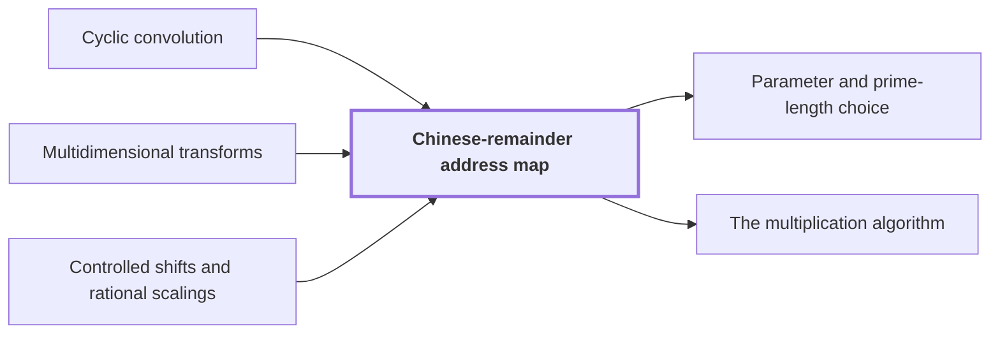

# Chinese-remainder address map

!!! info "Before this page"

    Chinese-remainder address map *preserves* [Cyclic convolution](convolution.md "Hence $\Phi$ is an isomorphism and preserves Cyclic convolution, the product in the ring."), *prepares the data for* [Multidimensional transforms](multidim-transform.md "This prepares the data for Multidimensional transforms, which act on one axis at a time.") and *is implemented by* [Controlled shifts and rational scalings](controlled-shifts.md "The map is implemented by these shifts, each of linear cost by Controlled shifts and rational scalings, which includes computing the offsets.").

!!! abstract "Where this fits"

    1. A single deterministic Turing machine with a fixed finite alphabet and a fixed finite number of one-dimensional tapes multiplies two $n$-bit integers exactly in $O(n(\lg n)^{1-\kappa})$ worst-case time with $\kappa=2^{-182}$, disproving the $n\log n$ optimality conjecture of Sch\"onhage and Strassen in this model. — how: Build two power-saving tape procedures (chunk interchange and simultaneous butterfly layer) from fixed finite linear networks; use them to accelerate the synthetic polynomial transforms and ring convolution; use Gaussian resampling with retained permutations and chirps to reduce the prime-length cyclic convolution of the radix-digit coefficients to those power-of-two transforms; assemble the exact product with a proof that the error is below $1/2$; and total the cost to show a power of $\log n$ is saved. ([Power-saving integer multiplication](main-result.md "A deterministic fixed-tape Turing machine multiplying two n-bit integers exactly in O(n(lg n)^{1−κ}) time with κ = 2^{−182}, disproving the n log n optimality conjecture in this model."))
    2. The exact $2n$-bit product of the two inputs is obtained from the radix-digit convolution by the chain: radix digits, Chinese-remainder address map to a product of prime cyclic axes, two forward source transforms (resampling and chirps), pointwise product, opposite transform, rescaling, rounding, and carry propagation, with total error below $1/2$. — how: Reduce the integer product to a cyclic convolution of $S$ short coefficients and compute it through the chain of reductions (digits, CRT address map, Gaussian resampling with chirps, twist to the polynomial ring, synthetic-transform convolution); recover exact integers because the accumulated error is below $1/2$. ([The multiplication algorithm](multiplication-algorithm.md "Digits, then the CRT map, two forward transforms with resampling and chirps, a pointwise product, the opposite transform, rescaling, rounding and carry propagation yield the exact 2n-bit product."))
    3. **This page:** The Chinese-remainder map $\Phi:\mathbb C[x]/(x^S-1)\to\mathbb C[x_1,\dots,x_d]/(x_i^{s_i}-1)$, $x\mapsto\prod_ix_i^{\mu_i}$, is an isomorphism preserving cyclic convolution, and it (with its inverse and padding) is implemented by triangular controlled shifts in $O(Tp\,d^2(1+\ell^\tau))$ time.

??? note "Symbols from earlier pages"

    - $x$ — polynomial variable: The variable of the digit polynomials, evaluated at 2^b to recover the integers. (on [Multiplication as radix-digit convolution](radix-digit-reduction.md "Splitting each integer into radix-2^b digits turns the product into a convolution of short integer coefficients, which carry propagation turns back into a binary number."))
    - $t_i$ — axis length: The number of addresses along cyclic axis i. (on [Cyclic convolution](convolution.md "The product of two sequences (or elements of a polynomial quotient ring) where indices wrap around: (f∗g)_k = Σ f_j g_{k−j}."))
    - $r$ — record length: The number of complex coefficients in a polynomial of the ring, always a power of two. (on [Polynomial ring modulo y^r + 1](ring-y.md "Polynomials of degree below r over the complex numbers with y^r = −1, so multiplying by a power of y is a signed shift of the coefficient list."))
    - $p$ — fractional bits: The number of fractional bits of the grid on which stored values lie. (on [Fixed-point Gaussian dyadic records](fixed-point.md "Complex values stored as signed two's-complement integers over a power-of-two denominator 2^{-p}; intermediate values are exact and one truncation Q_p rounds back to the p-bit grid."))
    - $b$ — digit bits: The number of bits in one radix-2^b digit. (on [Multiplication as radix-digit convolution](radix-digit-reduction.md "Splitting each integer into radix-2^b digits turns the product into a convolution of short integer coefficients, which carry propagation turns back into a binary number."))

The Chinese-remainder address map rewrites one cyclic convolution of length $S$ as a convolution on several short axes of pairwise coprime lengths, moving data on tape by controlled shifts and axis reorderings only. Let $d$ be the number of axes (unlike on the [Cyclic convolution](convolution.md "The product of two sequences (or elements of a polynomial quotient ring) where indices wrap around: (f∗g)_k = Σ f_j g_{k−j}.") page, no coefficient axis is counted), let $i$ index them, let $s_i$ be the length of axis $i$, the lengths being pairwise coprime, and let $S=s_1\cdots s_d$. The split is due to Agarwal and Cooley<cite class="exegenius-ref" data-source="paper" data-locator="§9.3 An explicit cyclic-convolution layout" data-quote="Agarwal and Cooley used the Chinese remainder theorem to convert one cyclic convolution into multidimensional cyclic convolution" title="Agarwal and Cooley used the Chinese remainder theorem to convert one cyclic convolution into multidimensional cyclic convolution"> (see §9.3 An explicit cyclic-convolution layout)</cite>.

The reason for the split is that a transform of length $S$ has no power-of-two structure, while over coprime axes it becomes a product of short one-axis transforms, each treated separately. This prepares the data for [Multidimensional transforms](multidim-transform.md "A transform over several axes at once, the tensor product of one-dimensional transforms, applied to an array one axis at a time."), which act on one axis at a time.

## The isomorphism

Let $P_i=\prod_{j<i}s_j$ be the product of the lengths of the axes before axis $i$, and $\mu_i=P_i^{-1}\pmod{s_i}$. It is invertible because $P_i$ is coprime to $s_i$.

Define $\Phi:\mathbb C[x]/(x^S-1)\to\mathbb C[x_1,\dots,x_d]/(x_i^{s_i}-1)$ by $x\mapsto\prod_i x_i^{\mu_i}$, with one variable $x_i$ per axis. Since $s_i\mid S$, each $x_i^{\mu_iS}=1$, so $\Phi$ respects $x^S=1$ and defines an algebra map.

For a coefficient index $k$ (an exponent of $x$), $\Phi(x^k)=1$ exactly when $s_i\mid\mu_ik$ for every $i$; as $\mu_i$ is a unit modulo $s_i$ this means $s_i\mid k$ for every $i$, and as the $s_i$ are pairwise coprime, $S\mid k$. So the image of $x$ has order $S$ and its $S$ powers are distinct. The target has exactly $S$ monomials, so the powers run through all of them exactly once. Hence $\Phi$ is an isomorphism and preserves [Cyclic convolution](convolution.md "The product of two sequences (or elements of a polynomial quotient ring) where indices wrap around: (f∗g)_k = Σ f_j g_{k−j}."), the product in the ring.

## Where each coefficient goes

Write $k=\sum_ja_jP_j$ in mixed radix, with digits $0\le a_j<s_j$. The axis-$i$ coordinate $b_i$ of $\Phi(x^k)$ is $\mu_ik\bmod s_i$. Terms with $j>i$ vanish modulo $s_i$, since $s_i$ divides $P_j$, and $\mu_iP_i\equiv1$ modulo $s_i$. Hence
$$b_i=a_i+\mu_i\sum_{j<i}a_jP_j\pmod{s_i},$$
which depends only on lower-index digits: it is a triangular system.

Example: $s=(3,5)$, so $S=15$, $P_2=3$, $\mu_1=1$, $\mu_2=3^{-1}=2\pmod 5$. For $k=4=1+3\cdot1$ we have $(a_1,a_2)=(1,1)$, so $b_1=1$ and $b_2=1+2\cdot1=3$. Directly, $x_1^4x_2^8$ has exponents $(4\bmod3,\,8\bmod5)=(1,3)$.

## Implementation on tape

Coefficients are stored in the order of $k$, which is lexicographic in $(a_d,\dots,a_1)$ with $a_d$ outermost. Pad axis $i$ with zero records to a length $t_i$, a power of two with $r/2\le t_i\le r$, where $r=2^\ell$ and $\ell$ is the number of address bits of an axis of length $r$. Let $T=\prod_it_i$ be the number of padded records, each of $O(p)$ bits. One nested scan of the box $\prod_i[0,t_i)$ copies the next coefficient at addresses with every $a_i<s_i$ and writes a zero record elsewhere. The counters fit in $O(p)$ bits because $T<2^p$ by [Parameter and prime-length choice](parameter-choice.md "Fixed rational exponents and sizes (precision p = 6b, d axes, K = d^c, T and r powers of two, prime lengths s_i just below t_i) making every hypothesis of the lemmas hold.")<cite class="exegenius-ref" data-source="paper" data-locator="§9.2.2 Prime source lengths" data-quote="$t_i\leq r\leq T&lt;8n/b&lt;2^{6b}=2^p$" title="$t_i\leq r\leq T&lt;8n/b&lt;2^{6b}=2^p$"> (see §9.2.2 Prime source lengths)</cite>, so the scan costs $O(Tp)$.

In the stored order the controls $a_j$, $j<i$, come after the target $a_i$. Reorder the padded axes to $(a_1,\dots,a_d)$, so that coordinates below $i$ precede coordinate $i$. Then update the targets in the order $i=d,d-1,\dots,1$. When target $i$ is updated, none of its lower-index controls has yet changed, so the offset is computed from the original digits $a_j$ required by the formula. Each update is a prefix-controlled cyclic shift of the valid interval $[0,s_i)$ with identity on $[s_i,t_i)$, so zero padding stays zero. The map is implemented by these shifts, each of linear cost by [Controlled shifts and rational scalings](controlled-shifts.md "Updating a target address field by an offset computed from earlier control fields, or multiplying it by a unit, in time linear in the array volume."), which includes computing the offsets. The inverse applies the subtractions for $i=1,\dots,d$, then reorders back and deletes the padding.

The only expensive part is reordering. Let $\tau<1$ be a fixed exponent. A [chunk interchange](address-interchange.md "The first tape procedure: exchanging two disjoint equal-width address fields of u digits in time O(V·u^τ) for a fixed τ < 1, using XOR combinations of intermediate data.") exchanges two axes of equal address width $L$ in $O(VL^\tau)$ time<cite class="exegenius-ref" data-source="paper" data-locator="§5.2 Packed changes of selected address bits" data-quote="equal width $L$ in $O(VL^\tau)$ time" title="equal width $L$ in $O(VL^\tau)$ time"> (see §5.2 Packed changes of selected address bits)</cite>, where $V=Tp$ is the volume of the array. Axes have $\ell$ or $\ell-1$ address bits. To exchange two adjacent axes of unequal width, move the longer axis's leading bit outside their equal-width pair, swap that pair, and put the leading bit at its new position, adding a fixed number of linear passes. Reversing all axes uses $O(d^2)$ such moves. The shifts and scans cost only $O(dTp)$, so the map, its inverse and the padding cost $O(Tp\,d^2(1+\ell^\tau))$<cite class="exegenius-ref" data-source="paper" data-locator="§9.3 An explicit cyclic-convolution layout" data-quote="O\bigl(Tp\,d^2(1+\ell^\tau)\bigr)." title="O\bigl(Tp\,d^2(1+\ell^\tau)\bigr)."> (see §9.3 An explicit cyclic-convolution layout)</cite>

## Connections

Used by:

- [Parameter and prime-length choice](parameter-choice.md "This choice supplies the prime axis lengths of the Chinese-remainder address map.") *supplies the prime axis lengths of* Chinese-remainder address map
- [The multiplication algorithm](multiplication-algorithm.md "It rewrites a length-$S$ coefficient sequence by the Chinese-remainder address map $\Phi$ as an array with one cyclic axis of each length $s_i$, preserving convolution, so that the Fourier transform acts one short axis at a time.") *rewrites its coefficient sequence by* Chinese-remainder address map

??? quote "From the sources"

    > by a Chinese-remainder map that preserves
    >
    > — [Integer multiplication below n log n (OpenAI, 2026)](https://github.com/openai/math/tree/fd4aeeb2ee4fc729c18d98444fed42fd0529eeeb/preprints/Integer-multiplication-below-n-log-n-September-23-2026)

    > Agarwal and Cooley used the Chinese remainder theorem to convert one cyclic convolution into multidimensional cyclic convolution
    >
    > — [Integer multiplication below n log n (OpenAI, 2026)](https://github.com/openai/math/tree/fd4aeeb2ee4fc729c18d98444fed42fd0529eeeb/preprints/Integer-multiplication-below-n-log-n-September-23-2026)
