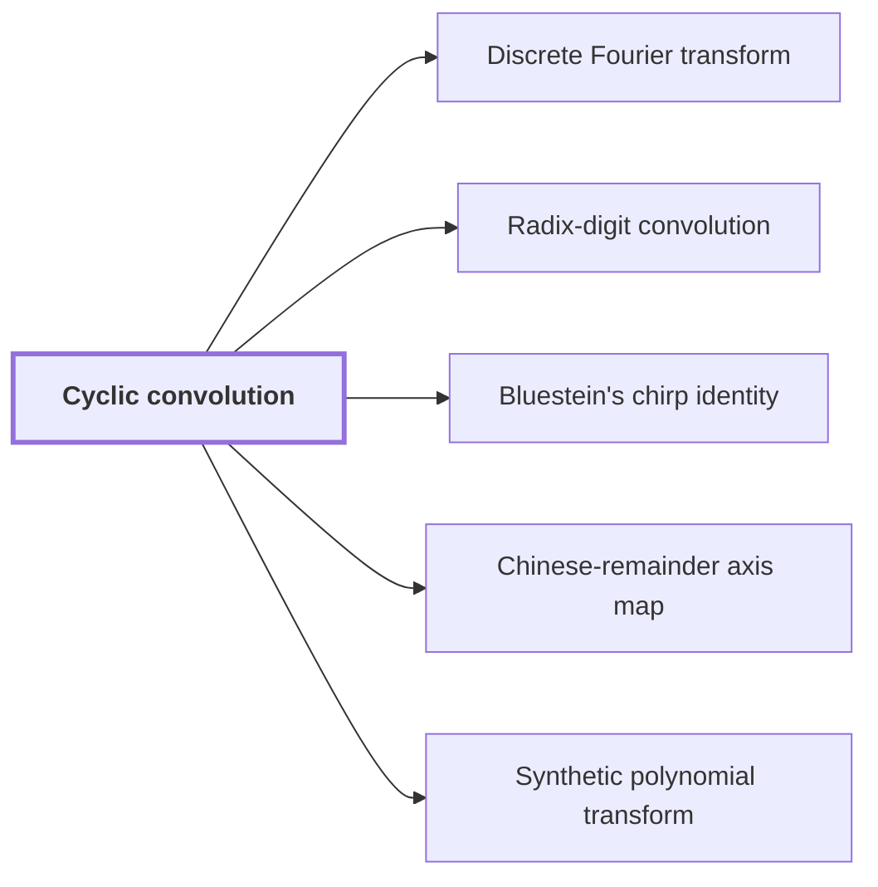

# Cyclic convolution

!!! info "Before this page"

    Assumed known: Polynomials.

!!! abstract "Where this fits"

    - Relied on to show: The radix-digit coefficient list is placed on distinct prime cyclic axes by a Chinese-remainder map that preserves convolution. ([Chinese-remainder axis map](crt-axis-map.md "The bijection sending a coefficient index written in mixed radix with pairwise coprime lengths to coordinates on a product of cyclic axes, which turns one cyclic convolution into a multidimensional one."))
    - Relied on to show: Bluestein's chirp identity turns the middle transform, with its target permutation, into normalized cyclic convolution. ([Bluestein's chirp identity](bluestein.md "An identity writing a Fourier transform as a cyclic convolution sandwiched between pointwise multiplications by chirp sequences exp(−πi s j² / t)."))
    - Relied on to show: Normalized cyclic convolution on the power-of-two axes is computed over the polynomial ring $\mathbb C[y]/(y^r+1)$ by synthetic transforms and packed polynomial products. ([Synthetic polynomial transform](synthetic-transform.md "A discrete Fourier transform whose roots of unity are powers of y in the polynomial ring, so that each twiddle multiplication is a signed shift and the transform is computed by simultaneous butterfly layers."))

Cyclic convolution is the product of two coefficient lists in which exponents wrap around, so that each exponent is taken modulo the list length. The later pages compute it on power-of-two lengths, where fast transforms make it cheap.

Let $x$ be a formal variable. Let $S$ be the number of coefficients in each list. Let $i$, $j$ and $k$ be indices in $\{0,\dots,S-1\}$. Write the first list as $a(x)=\sum_{i=0}^{S-1} a_i x^i$ and the second as $b(x)=\sum_{j=0}^{S-1} b_j x^j$, with complex coefficients. Let $c=a\ast b$ be the cyclic convolution of $a$ and $b$, a list of $S$ coefficients. On this page the letters $a$, $b$, $c$, $i$, $j$, $k$, $S$ and $x$ take these meanings, not the ones bound on earlier pages.

Their ordinary product has terms up to $x^{2S-2}$. Modulo $x^S-1$, the power $x^S$ is replaced by $1$, so every exponent at least $S$ wraps around to its remainder modulo $S$. The entries of $c$ are the coefficients of this reduced product:

$$c_k=\sum_{\substack{i,j\in\{0,\dots,S-1\}\\ i+j\equiv k \ (\mathrm{mod}\ S)}} a_i\,b_j, \qquad 0\le k\le S-1.$$

For example, let $S=3$, $a(x)=1+2x$ and $b(x)=x+3x^2$. The ordinary product is $x+5x^2+6x^3$, and replacing $x^3$ by $1$ gives $c(x)=6+x+5x^2$, that is, $c=(6,1,5)$.

If the ordinary product has degree below $S$, no term wraps, so the cyclic product equals the ordinary product.<cite class="exegenius-ref" data-source="paper" data-locator="§9.2.3 The radix-digit polynomials" data-quote="Thus convolution modulo $x^S-1$ has no nonzero wraparound." title="Thus convolution modulo $x^S-1$ has no nonzero wraparound."> (see §9.2.3 The radix-digit polynomials)</cite>

## Connections

Used by:

- [Discrete Fourier transform](fourier-transform.md "It matters because it turns cyclic convolution into entrywise products.") *turns* Cyclic convolution
- [Radix-digit convolution](radix-digit-convolution.md "Computing $W$ from the digit lists is a Cyclic convolution of length $S$, so the integer product is reduced to a cyclic convolution.") *is reduced to* Cyclic convolution
- [Bluestein's chirp identity](bluestein.md "Bluestein's chirp identity rewrites the discrete Fourier transform of a vector and computes it by a cyclic convolution placed between two pointwise multiplications.") *computes it by* Cyclic convolution
- [Chinese-remainder axis map](crt-axis-map.md "Because $\Phi$ is an isomorphism, it preserves Cyclic convolution: products of lists map to products of images.") *preserves* Cyclic convolution
- [Synthetic polynomial transform](synthetic-transform.md "It computes normalized Cyclic convolution on the power-of-two axes.") *computes normalized* Cyclic convolution

??? quote "From the sources"

    > Thus convolution modulo $x^S-1$ has no nonzero wraparound.
    >
    > — [Integer multiplication below n log n (OpenAI, 2026)](https://github.com/openai/math/tree/fd4aeeb2ee4fc729c18d98444fed42fd0529eeeb/preprints/Integer-multiplication-below-n-log-n-September-23-2026)
