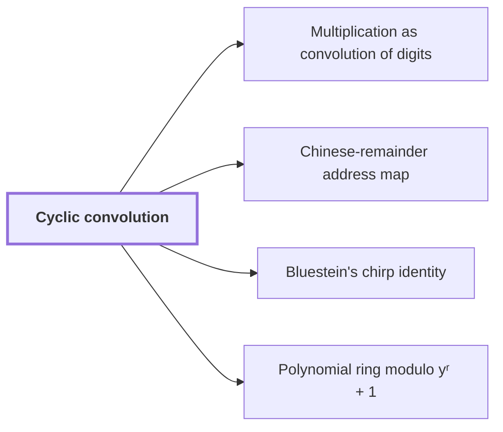

# Cyclic convolution

!!! info "Before this page"

    Assumed known: Polynomials.

!!! abstract "Where this fits"

    - Relied on to show: The radix-digit coefficient list is placed on a product of distinct prime cyclic axes, preserving convolution. ([Chinese-remainder address map](chinese-remainder-address-map.md "A rearrangement that places a digit sequence on a product of distinct prime cyclic axes while preserving convolution, implemented with address interchanges."))
    - Relied on to show: The middle transform, with its target permutation, becomes normalized cyclic convolution. ([Bluestein's chirp identity](bluestein-chirp.md "The identity that converts a Fourier transform into a cyclic convolution by multiplying by chirp factors before and after it."))

??? note "Symbols from earlier pages"

    - $k$ — output position: The index of an output entry $\hat a_k$, running from $0$ to $n-1$; on this page it is not the power exponent it denotes on the roots-of-unity page. (on [Discrete Fourier transform](fourier-transform.md "The map sending a length-n sequence to its values at the n-th roots of unity, i.e. the sums of the sequence weighted by powers of a root of unity."))
    - $j$ — input position: The index of an input entry $a_j$, running from $0$ to $n-1$; on this page it is not the power exponent it denotes on the roots-of-unity page. (on [Discrete Fourier transform](fourier-transform.md "The map sending a length-n sequence to its values at the n-th roots of unity, i.e. the sums of the sequence weighted by powers of a root of unity."))

Cyclic convolution is the product of two equal-length sequences in which indices are taken modulo that length, so each output coefficient is a sum of products over residues; it is also called normalized cyclic convolution. The argument needs it because Bluestein's chirp identity rewrites a [Fourier transform](fourier-transform.md "The map sending a length-n sequence to its values at the n-th roots of unity, i.e. the sums of the sequence weighted by powers of a root of unity.") in this form, and because a digit sequence placed on suitable cyclic axes still convolves cyclically.

Let $a = (a_0, \ldots, a_{r-1})$ and $b = (b_0, \ldots, b_{r-1})$ be two complex sequences of length $r$, where $r$ is the number of complex coefficients in each. Their cyclic convolution, written $c = a \circledast b$, is the length-$r$ sequence with coefficients

$$c_k = \sum_{j=0}^{r-1} a_j \, b_{(k-j) \bmod r}, \qquad k = 0, \ldots, r-1,$$

where $k$ is the output index and $j$ indexes the terms of the sum. The index $(k-j) \bmod r$ is the residue of $k-j$ in $\{0, \ldots, r-1\}$, so an index outside that range wraps to the other end.

For example, take $r = 3$, $a = (1, 2, 0)$ and $b = (0, 1, 1)$. Then

$$c_0 = a_0 b_0 + a_1 b_2 + a_2 b_1 = 2, \quad c_1 = a_0 b_1 + a_1 b_0 + a_2 b_2 = 1, \quad c_2 = a_0 b_2 + a_1 b_1 + a_2 b_0 = 3,$$

so $c = (2, 1, 3)$.

The wrap is exact, and a polynomial shows why. Let $x$ be a formal variable, an indeterminate not evaluated at any number, and write $a(x) = \sum_j a_j x^j$ and $b(x) = \sum_j b_j x^j$. In the example $a(x)\,b(x) = x + 3x^2 + 2x^3$. Reducing modulo $x^3 - 1$ replaces $x^3$ by $1$, giving $2 + x + 3x^2$, whose coefficients are $c$.

In general, let $l$ be the index of a term of $b$, running over $\{0, \ldots, r-1\}$. Reducing modulo $x^r - 1$ turns each term $a_j b_l x^{j+l}$ into $a_j b_l x^{(j+l) \bmod r}$. The coefficient of $x^k$ after reduction is the sum of $a_j b_l$ over pairs with $(j+l) \bmod r = k$. For each $j$ exactly one $l$ qualifies, namely $l = (k-j) \bmod r$, so this sum is $c_k$. Reduction merges terms and drops none, so the reduced product is exactly $c$.

## Connections

Used by:

- [Multiplication as convolution of digits](convolution-reduction.md "Multiplication reduces to Cyclic convolution of short integer coefficients.") *reduces to* Cyclic convolution
- [Chinese-remainder address map](chinese-remainder-address-map.md "The map preserves cyclic convolution of length $N$; the source paper proves this for the placement, which applies here because the axis lengths are distinct primes.") *preserves* Cyclic convolution
- [Bluestein's chirp identity](bluestein-chirp.md "Bluestein's chirp identity rewrites a Fourier transform as a normalized cyclic convolution that is bracketed by multiplications by chirps, where a chirp is a factor whose exponent is quadratic in an index.") *rewrites a Fourier transform as* Cyclic convolution
- [Polynomial ring modulo yʳ + 1](polynomial-ring-y.md "Multiplication in this ring computes products by a signed form of Cyclic convolution: the coefficient lists are convolved, and any term that wraps past index $r-1$ returns with a minus sign.") *computes products by* Cyclic convolution

??? quote "From the sources"

    > into normalized cyclic convolution
    >
    > — [Integer multiplication below n log n (OpenAI, 2026)](https://github.com/openai/math/tree/fd4aeeb2ee4fc729c18d98444fed42fd0529eeeb/preprints/Integer-multiplication-below-n-log-n-September-23-2026)
