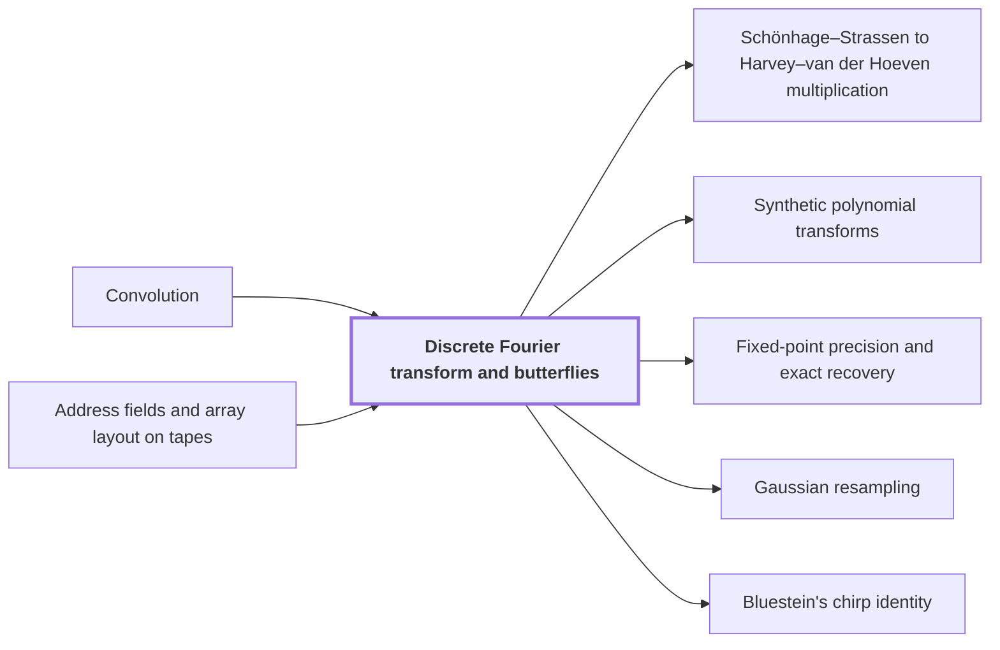

# Discrete Fourier transform and butterflies

!!! info "Before this page"

    Discrete Fourier transform and butterflies *reduces* [Convolution](convolution.md "The discrete Fourier transform (DFT) evaluates a coefficient list at powers of a root of unity, reducing Convolution to a pointwise product.") and *is built from* [Address fields and array layout on tapes](address-fields.md "On tapes, the transform is built from butterflies and the address rearrangements of Address fields and array layout on tapes."). Assumed known: Complex numbers and Polynomials.

!!! abstract "Where this fits"

    - Relied on to show: A simultaneous layer of $H_0(u,v)=((u+v)/2,(u-v)/2)$ on selected address bits of polynomial-valued arrays costs $O(Vd^{\lambda'})$ with $\lambda'<1$, with a single truncation at the end. ([Fast simultaneous butterfly layers](fast-butterfly-layers.md "Applies H0(u,v)=((u+v)/2,(u-v)/2) on selected address bits of polynomial-valued arrays with exact Gaussian dyadics in O(V d^λ') with λ'<1, one truncation at the end."))
    - Relied on to show: Gaussian resampling expresses each source Fourier transform through a power-of-two tensor transform. ([Gaussian resampling](gaussian-resampling.md "Harvey–van der Hoeven reduction expressing each Fourier transform of prime-length axes through a multidimensional transform with power-of-two axis lengths."))
    - Relied on to show: Bluestein's chirp identity converts the middle transform into normalized cyclic convolution. ([Bluestein's chirp identity](bluestein-chirp.md "Rewrites a discrete Fourier transform as a cyclic convolution via chirp phases."))
    - Relied on to show: Convolution over $\mathbb C[y]/(y^r+1)$ on the remaining axes is computed by synthetic transforms and packed polynomial products. ([Convolution with retained transform order and cancelled permutations](ring-convolution-retained-order.md "Two forward synthetic transforms keep the same frequency order through the pointwise product, and the opposite transform consumes it, so retained permutations cancel without separate sorts."))
    - Relied on to show: Synthetic transforms over the polynomial ring need only signed shifts, address rearrangements and butterflies. ([Synthetic polynomial transforms](synthetic-transforms.md "Nussbaumer-style transforms over the polynomial ring where root multiplications are signed shifts, leaving address rearrangements, shifts and butterflies."))

??? note "Symbols from earlier pages"

    - $a$ — input list a: The first input coefficient list, with entries $a_0,\dots,a_{n-1}$. (on [Convolution](convolution.md "Product of polynomials / combination of coefficient lists where entries sum by index (cyclic if indices wrap)."))
    - $n$ — list length: The number of entries in each input and output coefficient list. (on [Convolution](convolution.md "Product of polynomials / combination of coefficient lists where entries sum by index (cyclic if indices wrap)."))
    - $i$ — index i: An index into the entries of the input list $a$. (on [Convolution](convolution.md "Product of polynomials / combination of coefficient lists where entries sum by index (cyclic if indices wrap)."))
    - $k$ — output index: An index into the entries of the output list $c$. (on [Convolution](convolution.md "Product of polynomials / combination of coefficient lists where entries sum by index (cyclic if indices wrap)."))
    - $b$ — input list b: The second input coefficient list, with entries $b_0,\dots,b_{n-1}$. (on [Convolution](convolution.md "Product of polynomials / combination of coefficient lists where entries sum by index (cyclic if indices wrap)."))
    - $c$ — output list: The cyclic convolution of $a$ and $b$, a list of $n$ entries. (on [Convolution](convolution.md "Product of polynomials / combination of coefficient lists where entries sum by index (cyclic if indices wrap)."))

The discrete Fourier transform (DFT) evaluates a coefficient list at powers of a root of unity, reducing [Convolution](convolution.md "Product of polynomials / combination of coefficient lists where entries sum by index (cyclic if indices wrap).") to a pointwise product.

Let $a=(a_0,\dots,a_{n-1})$ have $n$ entries, a power of two. For $0\le m<n$, the letter $m$ is the frequency index (the letter $m$ changes meaning here, from the tape position on the earlier address-fields page). Let $\omega$ be a primitive $n$-th root of unity: $\omega^n=1$ and $\omega^m\ne1$ for $0<m<n$. The transform of $a$ is the list $A=(A_0,\dots,A_{n-1})$ with

$$A_m=\sum_{i=0}^{n-1} a_i\,\omega^{im}.$$

Here the letter $A$ changes meaning from the machine $A$ of the earlier pages.

A butterfly is the two-point operation $(u,v)\mapsto(u+\omega^s v,\;u-\omega^s v)$, where $u$, $v$ are its inputs and $s$ its exponent (these letters change meaning here: on the earlier address-fields page, $u$ is a field width, and on the ring page, $s$ is a reduced exponent).

Since $\omega^{n/2}=-1$, splitting $a$ by the parity of $i$ gives $A_m=E_m+\omega^mO_m$ and $A_{m+n/2}=E_m-\omega^mO_m$ for $0\le m<n/2$, where $E$ and $O$ are the transforms with root $\omega^2$ of the even- and odd-indexed entries.

Let $h$ be the number of entries in a block, and $t$, $0\le t<h/2$, an offset in it. With bit-reversed input, a block of size $h$ computes a transform with root $\omega^{n/h}$ from two halves that are transforms with root $\omega^{2n/h}$. The split above, with $\omega^{n/h}$ in place of $\omega$, pairs offsets $t$ and $t+h/2$ into a butterfly with exponent $s=tn/h$. The levels $h=2,4,\dots,n$ leave $A_0,\dots,A_{n-1}$ in order.

On tapes, the transform is built from butterflies and the address rearrangements of [Address fields and array layout on tapes](address-fields.md "Arrays stored in tape order with addresses forming a Cartesian product of digit fields; rearranging fields costs time."). Each level is one rearrangement that makes partners $t$ and $t+h/2$ adjacent, then one scan of butterflies. The paper's tape-level transform uses the same kinds of operation<cite class="exegenius-ref" data-source="paper" data-locator="§1.1 The two tape operations" data-quote="address rearrangements, signed shifts, and two-point butterfly operations" title="address rearrangements, signed shifts, and two-point butterfly operations"> (see §1.1 The two tape operations)</cite>.

Let $c_k=\sum_i a_i\,b_{(k-i)\bmod n}$ be the convolution, with transforms $B$ of $b$ and $C$ of $c$. Let $l=(k-i)\bmod n$ be the index into $b$ paired with $i$ at output $k$. Since $\omega^{km}=\omega^{(i+l)m}$ and $l$ runs over all indices for fixed $i$, $C_m=\sum_i a_i\omega^{im}\sum_l b_l\omega^{lm}=A_mB_m$.

## Connections

Used by:

- [Schönhage–Strassen to Harvey–van der Hoeven multiplication](ss-hh-background.md "Each algorithm in the chain computes its transforms by the Discrete Fourier transform and butterflies, evaluating its coefficient lists at roots of unity in a suitable ring.") *computes its transforms by* Discrete Fourier transform and butterflies
- [Synthetic polynomial transforms](synthetic-transforms.md "Synthetic transforms follow the butterfly scheme of the Discrete Fourier transform and butterflies.") *follow the butterfly scheme of* Discrete Fourier transform and butterflies
- [Fixed-point precision and exact recovery](fixed-point-precision.md "It computes its transforms by the forward transform of length $S$ and its opposite, which run in finite precision.") *computes its transforms by* Discrete Fourier transform and butterflies
- [Gaussian resampling](gaussian-resampling.md "Gaussian resampling thus computes its transforms by the butterfly layers of Discrete Fourier transform and butterflies, since a transform of length $Q$ has $\lg Q$ layers, each linear in the array size.") *computes its transforms by* Discrete Fourier transform and butterflies
- [Bluestein's chirp identity](bluestein-chirp.md "Bluestein's chirp identity rewrites a discrete Fourier transform as a cyclic Convolution, so that later convolution machinery can compute it.") *rewrites* Discrete Fourier transform and butterflies

??? quote "From the sources"

    > two-point butterfly operations
    >
    > — [Integer multiplication below n log n (OpenAI, 2026)](https://github.com/openai/math/tree/fd4aeeb2ee4fc729c18d98444fed42fd0529eeeb/preprints/Integer-multiplication-below-n-log-n-September-23-2026)
