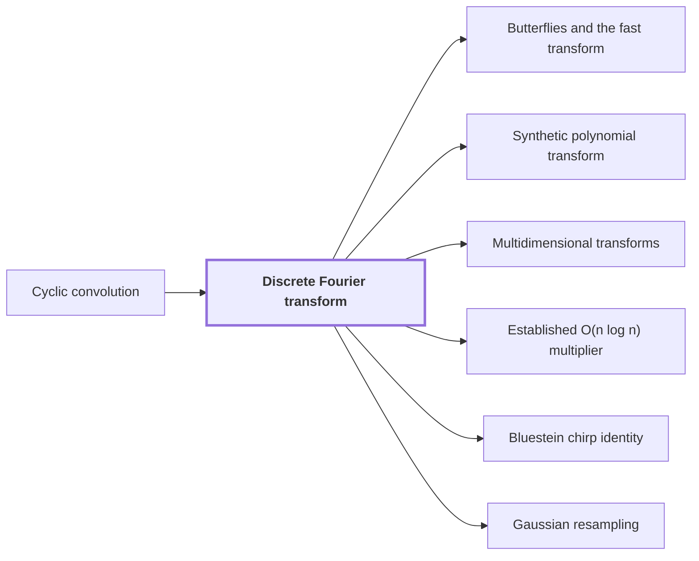

# Discrete Fourier transform

!!! info "Before this page"

    Discrete Fourier transform *diagonalizes* [Cyclic convolution](convolution.md "The transform diagonalizes cyclic convolution: the transform of a convolution is a pointwise product of transforms."). Assumed known: Complex numbers.

!!! abstract "Where this fits"

    - Relied on to show: Synthetic transforms over $\mathcal R_r$ on $d-1$ axes of lengths $t_i\in\{2^{\ell-1},2^\ell\}$ with outputs kept in a retained layout $LB$ cost $O(Tp[dK+pK^{\tau-1}+\ell d^{\lambda'}])$ with error less than $\sqrt2\ell\,2^{-p}$. ([Tape layout for synthetic transforms](transform-layout.md "Placing the selected bits of the participating axes at a common offset in K-bit chunks so each round of the synthetic transform is one simultaneous layer, costing less than log t passes."))
    - Relied on to show: The synthetic transform $F_t^-$ over $\mathcal R_r=\mathbb C[y]/(y^r+1)$, with roots of unity $\omega_t=y^{2r/t}$, is computed by decimation in frequency with outputs written in bit-reversed order, $B_tF_t^-$; the pointwise product keeps this order and the reverse procedure computes $F_t^+B_t^{-1}$, so no reordering is executed. ([Retained frequency order](frequency-order.md "The forward synthetic transform writes its outputs in bit-reversed order, the pointwise product keeps that order, and the opposite transform consumes it, so no reordering is executed."))
    - Relied on to show: Normalized cyclic convolution over the polynomial ring $\mathbb C[y]/(y^r+1)$ on the remaining $d-1$ axes is computed from two forward synthetic transforms in retained order, $M$ pointwise polynomial products and the opposite transform, in $O(Tp[dK+pK^{\tau-1}+\ell d^{\lambda'}+\log(rp)])$ time with error less than $\sqrt2\,M(3\ell+1)2^{-p}$. ([Convolution from the retained transform layout](ring-convolution.md "Convolution over the ring modulo y^r + 1 on the remaining axes by two forward synthetic transforms, pointwise polynomial products and the opposite transform, normalized by 1/(rM)."))
    - Relied on to show: Normalized convolution $\mathcal M_r(f,g)=f*g/(rM)=f*g/T$ on arrays over $\mathcal R_r$ is approximated with error less than $\sqrt2\,M(3\ell+1)2^{-p}$ in $O(Tp[dK+pK^{\tau-1}+\ell d^{\lambda'}+\log(rp)])$ time.
    - Relied on to show: The Fourier transforms of pairwise coprime prime lengths $s_i$ that the integer product needs are computed through power-of-two lengths $t_i$ by Gaussian resampling and Bluestein chirps, with the source and target coordinate permutations left inside the transform identities, so that none is executed as a sort. ([Retained permutation cancellation](retained-permutations.md "Leaving the coordinate permutations of resampling inside the transform identity, so the source permutation cancels across the two forward transforms and the opposite one and none is executed as a sort."))
    - Relied on to show: For coprime $s<t$ with $\theta=t/s-1>p/\alpha^4$ and permutations $(P_su)_j=u_{tj}$, $(P_tv)_k=v_{-sk}$ there are linear contractions $A$, $B_0$ with $P_sF_s=2^{2\alpha^2}B_0P_tF_tA$, computed with error less than $p^2$ in time $O(tp^{3/2+\delta}\alpha)$ without executing $P_s$ or $P_t$. ([Gaussian resampling](gaussian-resampling.md "Re-expressing a Fourier transform of prime length s through a transform of nearby power-of-two length t using Gaussian weights, so that only power-of-two transforms are needed."))
    - Relied on to show: For even $t_i$ and the chirp $a_{\boldsymbol j}=\exp(-\pi i\sum_is_ij_i^2/t_i)$ one has $QF_{\boldsymbol t}u=\overline a\cdot\bigl(a*(\overline a\cdot u)\bigr)/T$, so the target permutation $Q$ is absorbed into a cyclic convolution of length $T$ and never executed. ([Bluestein chirp identity](chirp.md "An identity that rewrites a (permuted) Fourier transform as a pointwise chirp phase, a cyclic convolution, and another chirp phase."))
    - Relied on to show: The retained source permutation cancels: $(RF_{\boldsymbol s}^+)[(RF_{\boldsymbol s}u)\cdot(RF_{\boldsymbol s}v)]=u*v/S^2$ with $S=\prod_is_i$, so no source permutation is executed across the two forward transforms, their pointwise product and the opposite transform.
    - Relied on to show: The exact $2n$-bit product of the two inputs is obtained from the radix-digit convolution by the chain: radix digits, Chinese-remainder address map to a product of prime cyclic axes, two forward source transforms (resampling and chirps), pointwise product, opposite transform, rescaling, rounding, and carry propagation, with total error below $1/2$. ([The multiplication algorithm](multiplication-algorithm.md "Digits, then the CRT map, two forward transforms with resampling and chirps, a pointwise product, the opposite transform, rescaling, rounding and carry propagation yield the exact 2n-bit product."))

??? note "Symbols from earlier pages"

    - $q$ — sequence length: The number of entries in each sequence being convolved. (on [Cyclic convolution](convolution.md "The product of two sequences (or elements of a polynomial quotient ring) where indices wrap around: (f∗g)_k = Σ f_j g_{k−j}."))

The discrete Fourier transform (DFT) is a linear map on sequences of complex numbers that replaces a convolution by a pointwise product, which is what lets the multiplication algorithm turn a convolution into cheap coordinatewise work.

Let $q\ge 1$ be the number of entries of a sequence, and let $u=(u_0,\dots,u_{q-1})$ be a sequence of $q$ complex numbers, with subscripts taken modulo $q$. The normalized transform $F_q u$ has entries $(F_q u)_k = \frac1q\sum_{j=0}^{q-1} u_j\, e^{-2\pi i jk/q}$<cite class="exegenius-ref" data-source="paper" data-locator="§8 Resampling with the permutations left in the transform" data-quote="(F_q u)_k=\frac1q\sum_{j=0}^{q-1}u_j e^{-2\pi i jk/q}" title="(F_q u)_k=\frac1q\sum_{j=0}^{q-1}u_j e^{-2\pi i jk/q}"> (see §8 Resampling with the permutations left in the transform)</cite>. Writing $\omega = e^{2\pi i/q}$ for the primitive $q$-th root of unity, the weights are $\omega^{-jk}$; the opposite transform $F_q^+$ uses $\omega^{+jk}$. Because of the factor $1/q$, each output is an average of inputs multiplied by numbers of modulus one, so neither transform increases the largest entry modulus<cite class="exegenius-ref" data-source="paper" data-locator="§8 Resampling with the permutations left in the transform" data-quote="Each normalized Fourier transform above is a contraction" title="Each normalized Fourier transform above is a contraction"> (see §8 Resampling with the permutations left in the transform)</cite>.

## Why it diagonalizes convolution

The transform diagonalizes [cyclic convolution](convolution.md "The product of two sequences (or elements of a polynomial quotient ring) where indices wrap around: (f∗g)_k = Σ f_j g_{k−j}."): the transform of a convolution is a pointwise product of transforms.

For sequences $u,v$ of length $q$, write $(u*v)_k=\sum_j u_j v_{k-j}$. Substituting $l=k-j$ and using that the wrapped index $l$ runs over a full period gives
$$(F_q(u*v))_m=\frac1q\sum_j u_j\omega^{-jm}\sum_l v_l\omega^{-lm}=q\,(F_qu)_m\,(F_qv)_m .$$

Since $\sum_{m}\omega^{m(k-j)}$ equals $q$ when $k=j$ and $0$ otherwise, applying $F_q^+$ after $F_q$ returns $u/q$. Applying $F_q^+$ to the entrywise product of two transforms therefore gives
$$F_q^+\bigl[(F_qu)\cdot(F_qv)\bigr]=\frac{u*v}{q^2}.$$
A convolution is thus two forward transforms, a pointwise product, an opposite transform and a rescaling.

## Example

For $q=2$ we have $\omega=-1$, and $F_2$ and $F_2^+$ both equal
$$F_2(u_0,u_1)=\Bigl(\frac{u_0+u_1}{2},\ \frac{u_0-u_1}{2}\Bigr).$$
The cyclic convolution of $(1,2)$ with $(3,4)$ is $(11,10)$. The forward transforms are $(1.5,-0.5)$ and $(3.5,-0.5)$, with pointwise product $(5.25,0.25)$. Applying $F_2^+$ gives $(2.75,2.5)=(11,10)/4$, as the identity predicts.

## Speed and output order

Computing $F_q$ directly takes $O(q^2)$ operations. Repeated two-point steps like the one above reduce this to $O(q\log q)$ when $q$ is a power of two, as described in [Butterflies and the fast transform](butterfly.md "A two-point averaging/differencing step H₀(u,v) = ((u+v)/2, (u−v)/2) whose repeated use over address bits, with twiddle multiplications, computes a transform in log t layers."). Such fast algorithms deliver the outputs in a scrambled (bit-reversed) order. Keeping that order costs nothing: a pointwise product does not care how positions are listed, provided both factors use the same order, and the opposite transform can be run to read that order. Convolution then needs no sorting.

Later pages use the ring modulo $y^r+1$, with roots that are powers of $y$, so multiplying by a root only shifts coefficients with signs: the [synthetic polynomial transform](synthetic-transform.md "A transform over the ring modulo y^r + 1 whose roots of unity are powers of y, so every twiddle multiplication is a signed shift of a coefficient list.").

## Connections

Used by:

- [Butterflies and the fast transform](butterfly.md "Repeated over the address bits of the array, with twiddle multiplications (multiplications by roots of unity) between layers, butterflies compute the Discrete Fourier transform of $z$ in $\log_2 t$ layers.") *compute* Discrete Fourier transform
- [Synthetic polynomial transform](synthetic-transform.md "The synthetic transforms are given by the formulas of the Discrete Fourier transform, with $\omega_t$ in place of the complex root of unity:") *is given by the formulas of* Discrete Fourier transform
- [Multidimensional transforms](multidim-transform.md "The transform $F_{\boldsymbol q}$ is the tensor product of the one-dimensional normalized Discrete Fourier transform matrices $F_{q_i}$ of lengths $q_i$.") *is the tensor product of* Discrete Fourier transform
- [Established O(n log n) multiplier](hvdh-multiplier.md "The multiplier is called on the first kind once the new algorithm reduces its Fourier transforms to polynomial products over $\mathbb C[y]/(y^r+1)$.") *is called once the algorithm reduces* Discrete Fourier transform
- [Bluestein chirp identity](chirp.md "The Bluestein chirp identity rewrites a permuted Discrete Fourier transform as a pointwise chirp phase, a cyclic convolution, and another chirp phase.") *rewrites a permuted* Discrete Fourier transform
- [Gaussian resampling](gaussian-resampling.md "Here $F_q$ is the normalised Discrete Fourier transform of length $q$, and the resampling re-expresses $F_s$ through $F_t$.") *re-expresses* Discrete Fourier transform

??? quote "From the sources"

    > (F_q u)_k=\frac1q\sum_{j=0}^{q-1}u_j e^{-2\pi i jk/q}
    >
    > — [Integer multiplication below n log n (OpenAI, 2026)](https://github.com/openai/math/tree/fd4aeeb2ee4fc729c18d98444fed42fd0529eeeb/preprints/Integer-multiplication-below-n-log-n-September-23-2026)
