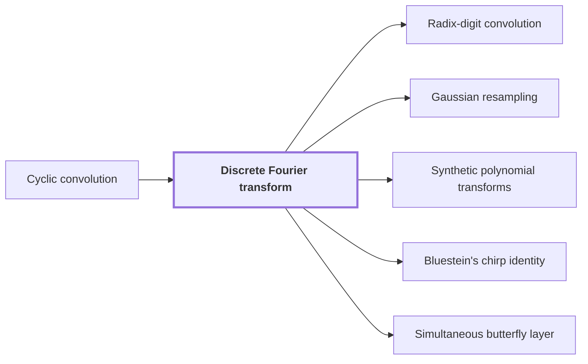

# Discrete Fourier transform

!!! info "Before this page"

    Discrete Fourier transform *reduces* [Cyclic convolution](glossary.md#cyclic-convolution "The transform reduces a Cyclic convolution of two vectors to entrywise multiplication of their transforms, up to a constant factor."). Assumed known: Complex numbers.

!!! abstract "Where this fits"

    - Relied on to show: Gaussian resampling expresses each source Fourier transform through a power-of-two tensor transform. ([Gaussian resampling](gaussian-resampling.md "A technique that replaces a Fourier transform of arbitrary length by transforms whose axis lengths are powers of two, using Gaussian weights to move between the two sets of frequencies."))

??? note "Symbols from earlier pages"

    - $a$ — first input sequence: The first sequence of t complex numbers, indexed from 0 to t-1. (on [Cyclic convolution](glossary.md#cyclic-convolution "The product of two sequences in which indices wrap around modulo the sequence length."))
    - $b$ — second input sequence: The second sequence of t complex numbers, indexed from 0 to t-1. (on [Cyclic convolution](glossary.md#cyclic-convolution "The product of two sequences in which indices wrap around modulo the sequence length."))

The discrete Fourier transform maps a vector of complex numbers to another vector of the same length, and the paper uses this normalized form to compute convolutions<cite class="exegenius-ref" data-source="paper" data-locator="§11 A consequence for matrix transposition, p. 38" data-quote="We now implement the normalized Fourier transforms needed for convolution" title="We now implement the normalized Fourier transforms needed for convolution"> (see §11 A consequence for matrix transposition, p. 38)</cite>.

Let $q$ be the number of entries in a vector. Let $\omega$ be a primitive $q$-th root of unity: a complex number with $\omega^q = 1$ whose powers $\omega^1, \dots, \omega^{q-1}$ all differ from $1$. The transform of a vector $x = (x_0, \dots, x_{q-1})$ is the vector $X = (X_0, \dots, X_{q-1})$ with

$$X_k = \frac{1}{q} \sum_{j=0}^{q-1} x_j\, \omega^{jk}, \qquad k = 0, \dots, q-1.$$

Here $j$ indexes the input entries and $k$ the output entries; $i$ is a second input index used below. Each output weights all inputs by powers of $\omega$; $1/q$ is the normalization. These letters change meaning here.

Its inverse has no extra factor. The key fact is that for an integer $m$, $\sum_{k=0}^{q-1} \omega^{mk}$ equals $q$ when $q$ divides $m$ and $0$ otherwise. When $q$ divides $m$ every term is $1$. Otherwise the sum is the geometric series $(\omega^{mq}-1)/(\omega^m-1)$, whose numerator is $0$. Substituting $X_k$ gives

$$\sum_{k=0}^{q-1} X_k\,\omega^{-jk} = \frac{1}{q}\sum_{i=0}^{q-1} x_i \sum_{k=0}^{q-1} \omega^{(i-j)k}.$$

For $0 \le i, j \le q-1$, the integer $i-j$ lies strictly between $-q$ and $q$, so $q$ divides it only when $i=j$. By the fact, the inner sum is $q$ when $i=j$ and $0$ otherwise, which leaves $x_j$:

$$x_j = \sum_{k=0}^{q-1} X_k\,\omega^{-jk}, \qquad j = 0,\dots,q-1.$$

The transform reduces a [Cyclic convolution](glossary.md#cyclic-convolution "The product of two sequences in which indices wrap around modulo the sequence length.") of two vectors to entrywise multiplication of their transforms, up to a constant factor. To see the factor, let $c = a \ast b$, so $c_m = \sum_{i+j \equiv m \pmod q} a_i b_j$. For each $k$,

$$\frac{1}{q}\sum_{m=0}^{q-1} c_m\,\omega^{mk} = q\Big(\frac{1}{q}\sum_i a_i\,\omega^{ik}\Big)\Big(\frac{1}{q}\sum_j b_j\,\omega^{jk}\Big).$$

The right side is $\frac{1}{q}\sum_{i,j} a_i b_j\,\omega^{(i+j)k}$. Since $\omega^{(i+j)k}$ depends only on $i+j$ modulo $q$, grouping the pairs by $m \equiv i+j$ gives the left side. So the transform of $c$ is $q$ times the entrywise product of the transforms of $a$ and $b$, and convolution can be computed by transforming, multiplying entrywise, dividing by $q$, and inverting.

## Connections

Used by:

- [Radix-digit convolution](radix-digit-convolution.md "The convolution is computed by transforms quickly on a fixed layout, which is why the reduction stops at this form rather than at the integer product.") *is computed by* Discrete Fourier transform
- [Gaussian resampling](gaussian-resampling.md "Gaussian resampling expresses each source Discrete Fourier transform through a power-of-two tensor transform, meaning a transform over several axes at once in which each axis length is a power of two.") *expresses* Discrete Fourier transform
- [Synthetic polynomial transforms](synthetic-transforms.md "A synthetic polynomial transform is based on the Discrete Fourier transform: it has the same form, but its roots of unity are powers of a ring variable, so that multiplying by a root is a signed shift of coefficients.") *is based on* Discrete Fourier transform
- [Bluestein's chirp identity](bluestein-chirp-identity.md "Bluestein's chirp identity rewrites a Discrete Fourier transform so that the transform can be computed with convolution, which the multiplication reduction needs.") *rewrites* Discrete Fourier transform
- [Simultaneous butterfly layer](simultaneous-butterfly-layer.md "The layer is built from the normalized discrete Fourier transform of length 2, namely $H_0$, applied to each selected bit.") *is built from* Discrete Fourier transform

??? quote "From the sources"

    > We now implement the normalized Fourier transforms needed for convolution
    >
    > — Integer multiplication below n log n (OpenAI, 2026)
