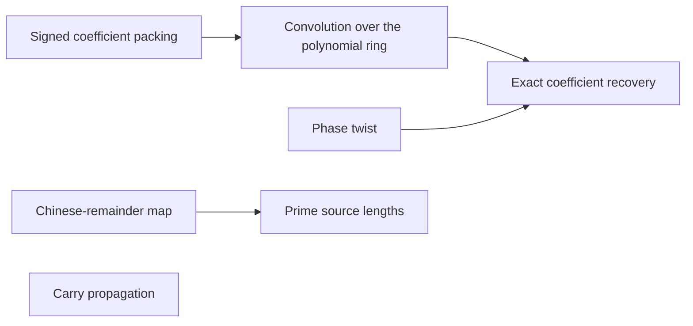

# Exact convolution and recovery

This part assembles the full exact convolution from the earlier transforms and layouts. The [Signed coefficient packing](../signed-packing.md "Encoding polynomial coefficients, including negative ones, as one large integer by fixed-width blocks, so that polynomial multiplication becomes integer multiplication.") and the [Chinese-remainder map](../chinese-remainder-map.md "A relabeling of coefficient positions by mixed-radix digits for pairwise coprime lengths, which turns one cyclic convolution into a multidimensional cyclic convolution."), with [Prime source lengths](../prime-source-lengths.md "Distinct odd primes chosen close to the powers of two that are the padded axis lengths, so that their product fills a fixed fraction of the padded box."), set up the transform lengths. The [Convolution over the polynomial ring](../polynomial-ring-convolution.md "The normalized product of two arrays of records in the polynomial ring, computed by two forward synthetic transforms, a pointwise product, and an opposite transform."), [Phase twist](../phase-twist.md "A coefficientwise multiplication by roots of unity that converts the last cyclic coordinate into a polynomial ring, so its wrap-around becomes the negative wrap of that ring."), and [Exact coefficient recovery](../recovery-and-error.md "The error analysis showing that the computed convolution coefficients are within a half of their true integer values, so rounding recovers them exactly.") show that rounding returns the true coefficients, and [Carry propagation](../carry-propagation.md "Converting the recovered integer radix-digit coefficients into a binary string by adding each coefficient to a carry from the previous position.") turns them into binary.

## Pages

1. [Signed coefficient packing](../signed-packing.md "Encoding polynomial coefficients, including negative ones, as one large integer by fixed-width blocks, so that polynomial multiplication becomes integer multiplication.") — Encoding polynomial coefficients, including negative ones, as one large integer by fixed-width blocks, so that polynomial multiplication becomes integer multiplication.
2. [Chinese-remainder map](../chinese-remainder-map.md "A relabeling of coefficient positions by mixed-radix digits for pairwise coprime lengths, which turns one cyclic convolution into a multidimensional cyclic convolution.") — A relabeling of coefficient positions by mixed-radix digits for pairwise coprime lengths, which turns one cyclic convolution into a multidimensional cyclic convolution.
3. [Phase twist](../phase-twist.md "A coefficientwise multiplication by roots of unity that converts the last cyclic coordinate into a polynomial ring, so its wrap-around becomes the negative wrap of that ring.") — A coefficientwise multiplication by roots of unity that converts the last cyclic coordinate into a polynomial ring, so its wrap-around becomes the negative wrap of that ring.
4. [Convolution over the polynomial ring](../polynomial-ring-convolution.md "The normalized product of two arrays of records in the polynomial ring, computed by two forward synthetic transforms, a pointwise product, and an opposite transform.") — The normalized product of two arrays of records in the polynomial ring, computed by two forward synthetic transforms, a pointwise product, and an opposite transform.
5. [Exact coefficient recovery](../recovery-and-error.md "The error analysis showing that the computed convolution coefficients are within a half of their true integer values, so rounding recovers them exactly.") — The error analysis showing that the computed convolution coefficients are within a half of their true integer values, so rounding recovers them exactly.
6. [Prime source lengths](../prime-source-lengths.md "Distinct odd primes chosen close to the powers of two that are the padded axis lengths, so that their product fills a fixed fraction of the padded box.") — Distinct odd primes chosen close to the powers of two that are the padded axis lengths, so that their product fills a fixed fraction of the padded box.
7. [Carry propagation](../carry-propagation.md "Converting the recovered integer radix-digit coefficients into a binary string by adding each coefficient to a carry from the previous position.") — Converting the recovered integer radix-digit coefficients into a binary string by adding each coefficient to a carry from the previous position.

## Map

Arrows point from a page to the pages that build on it.

