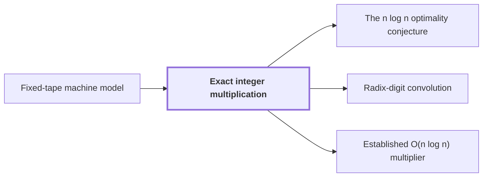

# Exact integer multiplication

!!! info "Before this page"

    Exact integer multiplication *is computed by* [Fixed-tape machine model](fixed-tape-model.md "In the main result of this wiki, exact integer multiplication is computed by a deterministic fixed-tape machine in time below $n\lg n$."). Assumed known: Turing machines and tapes.

!!! abstract "Where this fits"

    - Relied on to show: A deterministic fixed-tape machine multiplies two $n$-bit integers exactly in $O(n(\lg n)^{1-\kappa})$ time, with $\kappa=2^{-182}$, below the $n\lg n$ conjecture in this model. ([Integer multiplication below n log n](main-theorem.md "A deterministic fixed-tape machine that multiplies two n-bit integers exactly in O(n (lg n)^(1−κ)) time with κ = 2^−182, which disproves the n log n optimality conjecture in this model."))

Exact integer multiplication is computing the full product of two binary integers, with no rounding or error. It is the target problem of this wiki, so its input and output must be fixed precisely first.

Let $n$ be the common length of the two inputs. The input is two binary strings $x$ and $y$ of length $n$, and the output is the $2n$-bit binary representation of their product. On a tape the input is written as $x\#y$, with $\#$ a separator symbol.

Write $\mathrm{val}(x)$ for the nonnegative integer whose binary digits are $x$, with the leftmost bit most significant, so $\mathrm{val}(10)=2$ and $\mathrm{val}(11)=3$. For a nonnegative integer $z < 2^{2n}$, write $\mathrm{bin}_{2n}(z)$ for its binary representation padded on the left with zeros to exactly $2n$ bits.

The required output is $\mathrm{bin}_{2n}(\mathrm{val}(x)\,\mathrm{val}(y))$. Since $\mathrm{val}(x)\,\mathrm{val}(y) < 2^{2n}$, the product always fits in $2n$ bits. For $n=2$, $x=10$ and $y=11$, the product is $2 \cdot 3 = 6$, so the output is $\mathrm{bin}_4(6)=0110$.

In the main result of this wiki, exact integer multiplication is computed by a deterministic [fixed-tape machine](fixed-tape-model.md "A Turing machine with one fixed finite alphabet and one fixed finite number of one-dimensional tapes, whose size does not grow with the input.") in time below $n\lg n$. The result is stated for one fixed machine.<cite class="exegenius-ref" data-source="paper" data-locator="§11 A consequence for matrix transposition, p. 3" data-quote="There is one deterministic Turing machine A, with a fixed finite alphabet and a fixed finite number of one-dimensional tapes, that computes this exact product for every n ≥ 1 and every pair of n-bit inputs." title="There is one deterministic Turing machine A, with a fixed finite alphabet and a fixed finite number of one-dimensional tapes, that computes this exact product for every n ≥ 1 and every pair of n-bit inputs."> (see §11 A consequence for matrix transposition, p. 3)</cite>

## Connections

Used by:

- [The n log n optimality conjecture](n-log-n-conjecture.md "The conjecture bounds the cost of Exact integer multiplication, where the input is two $n$-bit binary strings and the output is their $2n$-bit product.") *bounds the cost of* Exact integer multiplication
- [Radix-digit convolution](radix-digit-convolution.md "Radix-digit convolution reduces exact integer multiplication to a convolution of short integer digit lists, which is the first step toward a fast product.") *reduces* Exact integer multiplication
- [Established O(n log n) multiplier](glossary.md#established-multiplier "The established multiplier, also called the Harvey–van der Hoeven multiplier, is a known algorithm for exact integer multiplication: it takes two binary strings and outputs their product.") *is a known algorithm for* Exact integer multiplication

??? quote "From the sources"

    > We consider exact multiplication
    >
    > — Integer multiplication below n log n (OpenAI, 2026)
