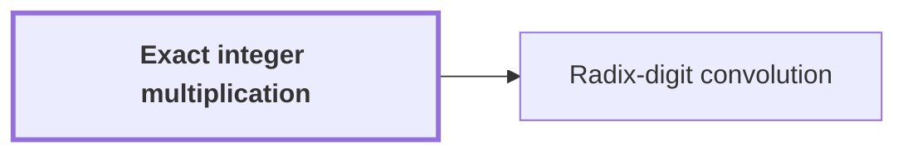

# Exact integer multiplication

!!! info "Before this page"

    Assumed known: Turing machines and tapes.

!!! abstract "Where this fits"

    - Relied on to show: Distinct odd primes $s_1,\dots,s_d$ exist with $(1-2\eta)t_i<s_i\le(1-\eta)t_i$ for every axis $i$, and their product $S=\prod_i s_i$ satisfies $T/2<S<T$. ([Prime source lengths](prime-source-lengths.md "Distinct odd primes chosen close to the powers of two that are the padded axis lengths, so that their product fills a fixed fraction of the padded box."))

Exact integer multiplication is the problem of computing the complete product of two equal-length binary inputs, as a binary string of twice that length, with no rounding and no reduction modulo anything. Every upper bound in the argument bounds the running time of a machine that solves this problem, so this page fixes what that machine must output.

Let $x$ and $y$ be binary strings of length $n$, the number of bits in each input. For a binary string $z$, let $\mathrm{val}(z)$ be its nonnegative integer value, with the leftmost bit most significant. For a length $k$ and an integer $m$ with $0 \le m < 2^k$, let $\mathrm{bin}_k(m)$ be the binary representation of $m$, padded on the left with zeros to length $k$.

The required output is $\mathrm{bin}_{2n}(\mathrm{val}(x)\,\mathrm{val}(y))$. Each factor is below $2^n$, so the product is below $2^{2n}$ and its binary form fits in $2n$ bits. For example, with $n=2$, the strings $x=10$ and $y=11$ have values $2$ and $3$, and the output is $\mathrm{bin}_4(6)=0110$.

The input is written as $x\#y$, where $\#$ is a separator symbol placed between the two inputs; it marks where $x$ ends and $y$ begins, and it is not a bit. A multiplier is a deterministic Turing machine that, on input $x\#y$, halts with the output on its tape. The cost of a multiplier is its worst-case running time as a function of $n$. The unconditional upper bound on this model is $O(n\log n)$, reached by Harvey and van der Hoeven<cite class="exegenius-ref" data-source="paper" data-locator="§11 A consequence for matrix transposition, p. 3" data-quote="Harvey and van der Hoeven reached the unconditional O(n log n) upper bound" title="Harvey and van der Hoeven reached the unconditional O(n log n) upper bound"> (see §11 A consequence for matrix transposition, p. 3)</cite>. One machine therefore serves every input length, with a fixed finite alphabet and a fixed number of one-dimensional tapes<cite class="exegenius-ref" data-source="paper" data-locator="§11 A consequence for matrix transposition, p. 3" data-quote="There is one deterministic Turing machine A, with a fixed finite alphabet and a fixed finite number of one-dimensional tapes, that computes this exact product for every n ≥ 1 and every pair of n-bit inputs" title="There is one deterministic Turing machine A, with a fixed finite alphabet and a fixed finite number of one-dimensional tapes, that computes this exact product for every n ≥ 1 and every pair of n-bit inputs"> (see §11 A consequence for matrix transposition, p. 3)</cite>. The main result saves a strict power of the logarithmic factor in this same fixed finite-tape model.

## Connections

Used by:

- [Radix-digit convolution](radix-digit-convolution.md "Radix-digit convolution reduces exact integer multiplication to a convolution of short integer coefficients, which fast convolution methods can evaluate.") *reduces* Exact integer multiplication

??? quote "From the sources"

    > We consider exact multiplication
    >
    > — Integer multiplication below n log n (OpenAI, 2026)
