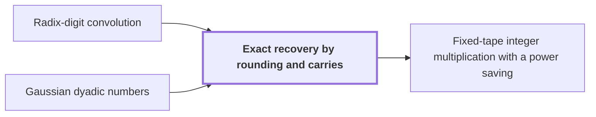

# Exact recovery by rounding and carries

!!! info "Before this page"

    Exact recovery by rounding and carries *recovers the exact coefficients of* [Radix-digit convolution](radix-digit-convolution.md "Exact recovery by rounding and carries recovers the exact coefficients of a Radix-digit convolution, then turns them into the exact binary product by rounding and carrying.") and *rounds the values of* [Gaussian dyadic numbers](glossary.md#gaussian-dyadic "Exact recovery rounds the values of the Gaussian dyadic numbers that hold the coefficients.").

!!! abstract "Where this fits"

    1. The integer product is computed exactly on one fixed-tape machine in $O(n(\lg n)^{1-\kappa})$ worst-case time, for $\kappa=2^{-182}$. — how: reduce exact multiplication to convolution of radix digits on distinct prime axes, compute the convolution by synthetic transforms on tape layouts, and bound the total tape cost with a power saving ([Fixed-tape integer multiplication with a power saving](fixed-tape-multiplication.md "A deterministic fixed-tape Turing machine that multiplies two n-bit integers exactly in O(n(lg n)^(1−κ)) worst-case time, for a fixed κ = 2^(−182), disproving the n log n optimality conjecture in this model."))
    2. **This page:** The recovered coefficient error is strictly below $1/2$, so rounding and carry propagation give the exact binary product.

??? note "Symbols from earlier pages"

    - $w_k$ — convolution coefficient: The $k$-th coefficient of $W$, the sum of $u_i v_j$ over $i+j=k$. (on [Radix-digit convolution](radix-digit-convolution.md "Writing each n-bit input as a polynomial in 2^b with about n/b nonnegative digits, so that integer multiplication becomes a convolution whose coefficients are bounded by a fixed power of two."))
    - $W$ — product polynomial: The product $U(t)V(t)$, a polynomial whose value at $2^\beta$ is the integer product. (on [Radix-digit convolution](radix-digit-convolution.md "Writing each n-bit input as a polynomial in 2^b with about n/b nonnegative digits, so that integer multiplication becomes a convolution whose coefficients are bounded by a fixed power of two."))
    - $U$ — first digit polynomial: The polynomial whose coefficients are the radix digits of the first input. (on [Radix-digit convolution](radix-digit-convolution.md "Writing each n-bit input as a polynomial in 2^b with about n/b nonnegative digits, so that integer multiplication becomes a convolution whose coefficients are bounded by a fixed power of two."))
    - $V$ — second digit polynomial: The polynomial whose coefficients are the radix digits of the second input. (on [Radix-digit convolution](radix-digit-convolution.md "Writing each n-bit input as a polynomial in 2^b with about n/b nonnegative digits, so that integer multiplication becomes a convolution whose coefficients are bounded by a fixed power of two."))
    - $t$ — formal variable: A formal variable whose powers mark the coefficient positions. (on [Radix-digit convolution](radix-digit-convolution.md "Writing each n-bit input as a polynomial in 2^b with about n/b nonnegative digits, so that integer multiplication becomes a convolution whose coefficients are bounded by a fixed power of two."))
    - $p$ — fractional bit count: The number of fractional bits in each stored part, so every stored part is a multiple of $2^{-p}$. (on [Gaussian dyadic numbers](glossary.md#gaussian-dyadic "Complex numbers whose real and imaginary parts are both dyadic rationals, that is, have power-of-two denominators."))
    - $m$ — integer numerator: The integer numerator of a dyadic rational written as $m/2^k$. (on [Gaussian dyadic numbers](glossary.md#gaussian-dyadic "Complex numbers whose real and imaginary parts are both dyadic rationals, that is, have power-of-two denominators."))
    - $n$ — input length in bits: The count of bits in each input of the machine, the length in bits of each input. (on [Fixed-tape machine model](fixed-tape-model.md "A multitape Turing machine with one fixed finite alphabet and a fixed finite number of one-dimensional tapes, the same for every input length."))
    - $b$ — exact-recovery digit width: The digit width as the exact-recovery page names it; this page uses beta for the same width. (on [Radix-digit convolution](radix-digit-convolution.md "Writing each n-bit input as a polynomial in 2^b with about n/b nonnegative digits, so that integer multiplication becomes a convolution whose coefficients are bounded by a fixed power of two."))
    - $u_i$ — first input digit: The $i$-th radix digit of the first input, a value in $\{0,\dots,2^\beta-1\}$. (on [Radix-digit convolution](radix-digit-convolution.md "Writing each n-bit input as a polynomial in 2^b with about n/b nonnegative digits, so that integer multiplication becomes a convolution whose coefficients are bounded by a fixed power of two."))
    - $v_i$ — second input digit: The $i$-th radix digit of the second input, a value in $\{0,\dots,2^\beta-1\}$. (on [Radix-digit convolution](radix-digit-convolution.md "Writing each n-bit input as a polynomial in 2^b with about n/b nonnegative digits, so that integer multiplication becomes a convolution whose coefficients are bounded by a fixed power of two."))

Exact recovery by rounding and carries recovers the exact coefficients of a [Radix-digit convolution](radix-digit-convolution.md "Writing each n-bit input as a polynomial in 2^b with about n/b nonnegative digits, so that integer multiplication becomes a convolution whose coefficients are bounded by a fixed power of two."), then turns them into the exact binary product by rounding and carrying.

Exact recovery rounds the values of the [Gaussian dyadic numbers](glossary.md#gaussian-dyadic "Complex numbers whose real and imaginary parts are both dyadic rationals, that is, have power-of-two denominators.") that hold the coefficients. Let $z_k$ be the computed value that holds $w_k$, the $k$-th coefficient of $W(t)=U(t)V(t)$. The [synthetic transforms](synthetic-transform.md "A discrete Fourier transform whose roots of unity are powers of y in the polynomial ring, so that each twiddle multiplication is a signed shift and the transform is computed by simultaneous butterfly layers.") and pointwise products that compute $z_k$ work at precision $p=6b$. Each stage adds an error of a small multiple of $2^{-p}$. The scale factors that are removed exactly multiply these errors, and the total is below $448b\,2^{-3b/4}$, which is below $1/2$ for large $b$.<cite class="exegenius-ref" data-source="paper" data-locator="§9.7.2 The final integer coefficients" data-quote="The strict error below $1/2$ makes the nearest integer to that value the unique correct coefficient." title="The strict error below $1/2$ makes the nearest integer to that value the unique correct coefficient."> (see §9.7.2 The final integer coefficients)</cite>

The true coefficients $w_k$ are real integers. Since $|z_k-w_k|<1/2$ and $w_k$ is real, the real part satisfies $|\operatorname{Re} z_k-w_k|\le|z_k-w_k|<1/2$, so the imaginary part of $z_k$ can be ignored. Write $\operatorname{Re} z_k=m/2^p$ with $m$ an integer. The nearest integer to $m/2^p$ is $\lfloor (m+2^{p-1})/2^p\rfloor$, which uses only integer arithmetic. A real number within $1/2$ of an integer has that integer as its unique nearest integer, so this rounding returns $w_k$ exactly.

Let $Q$ be the exact product of the two $n$-bit inputs. Each input is its digit polynomial evaluated at $2^b$: the first is $\sum_i u_i 2^{bi}$ with digits in $\{0,\dots,2^b-1\}$, and the second is the same with $v_i$. Evaluating $W(t)=U(t)V(t)$ at $t=2^b$ therefore gives $Q=\sum_k w_k 2^{bk}$.

Carries write $Q$ in radix $2^b$. Let $M$ be the number of positions, with $M$ at least the number of coefficients and $bM\ge 2n$; positions past the last coefficient have $w_k=0$. Let $\sigma_k$ be the carry into position $k$, with $\sigma_0=0$. At each position $k<M$, the digit is $e_k$, the remainder of $w_k+\sigma_k$ modulo $2^b$, and the carry is $\sigma_{k+1}=\lfloor (w_k+\sigma_k)/2^b\rfloor$, rounded down so that negative sums work. So $w_k+\sigma_k=e_k+2^b\sigma_{k+1}$ at every position.

For example, take $b=2$ and coefficients $5,3,-1$. Position 0: $5=1\cdot 4+1$ gives digit 1 and carry 1. Position 1: $3+1=4=1\cdot 4+0$ gives digit 0 and carry 1. Position 2: $-1+1=0$ gives digit 0 and carry 0. The digits $1,0,0$ represent $1=5+3\cdot 4-1\cdot 16$.

Summing the identities $w_k+\sigma_k=e_k+2^b\sigma_{k+1}$ with weights $2^{bk}$ telescopes to $Q=\sum_{k<M}e_k2^{bk}+\sigma_M2^{bM}$. Each $e_k\le 2^b-1$, so the digit sum lies in $[0,2^{bM})$. Also $0\le Q<2^{2n}\le 2^{bM}$. Hence $\sigma_M 2^{bM}$ lies strictly between $-2^{bM}$ and $2^{bM}$, which forces $\sigma_M=0$. No carry is left over, so the digits are the exact product. Since $Q<2^{2n}$, writing the digits in $b$ bits, most significant first, and dropping the zeros above bit $2n$ gives the binary product.

## Connections

Used by:

- [Fixed-tape integer multiplication with a power saving](fixed-tape-multiplication.md "It recovers the exact binary product by Exact recovery by rounding and carries.") *recovers the exact binary product by* Exact recovery by rounding and carries

??? quote "From the sources"

    > Propagate radix-$2^b$ carries in increasing coefficient order.
    >
    > — [Integer multiplication below n log n (OpenAI, 2026)](https://github.com/openai/math/tree/fd4aeeb2ee4fc729c18d98444fed42fd0529eeeb/preprints/Integer-multiplication-below-n-log-n-September-23-2026)
