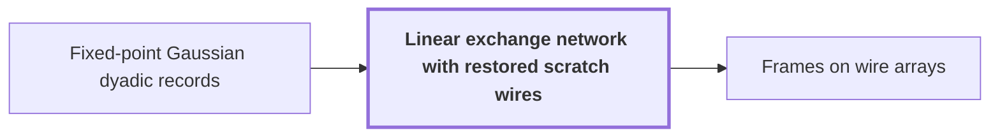

# Linear exchange network with restored scratch wires

!!! info "Before this page"

    Linear exchange network with restored scratch wires *keeps its scalars in* [Fixed-point Gaussian dyadic records](fixed-point.md "In the complex construction the network keeps its scalars in $\mathbb Z[i,1/2]$, the values of Fixed-point Gaussian dyadic records, and the neighbours of a triple are the distinct triples with even intersection (zero or two).").

!!! abstract "Where this fits"

    1. A single deterministic Turing machine with a fixed finite alphabet and a fixed finite number of one-dimensional tapes multiplies two $n$-bit integers exactly in $O(n(\lg n)^{1-\kappa})$ worst-case time with $\kappa=2^{-182}$, disproving the $n\log n$ optimality conjecture of Sch\"onhage and Strassen in this model. — how: Build two power-saving tape procedures (chunk interchange and simultaneous butterfly layer) from fixed finite linear networks; use them to accelerate the synthetic polynomial transforms and ring convolution; use Gaussian resampling with retained permutations and chirps to reduce the prime-length cyclic convolution of the radix-digit coefficients to those power-of-two transforms; assemble the exact product with a proof that the error is below $1/2$; and total the cost to show a power of $\log n$ is saved. ([Power-saving integer multiplication](main-result.md "A deterministic fixed-tape Turing machine multiplying two n-bit integers exactly in O(n(lg n)^{1−κ}) time with κ = 2^{−182}, disproving the n log n optimality conjecture in this model."))
    2. Both tape primitives (the interchange of two address chunks of $u$ digits and the simultaneous butterfly layer on up to $d$ axes) cost the volume times a power below one of their width, because a call at parameter $mf$ makes $s$ calls at parameter $f$ on streams of volume $V/W$ with $s<Wm$, so the cost per unit volume grows by $s/W<m$ per factor $m$ of the parameter. — how: Build a fixed finite linear network of $W$ wires that exchanges two banks and restores all scratch values, make the representation of each wire's array vary along the network through frames so that an edge costs one smaller call per unit of rank, show the total rank $s$ is below $Wm$, fix an exponent, and solve the recurrence in the bit variant (interchange) and the complex variant (butterfly layer). ([Recursive power saving](rank-recurrence.md "Each call at parameter m·f makes s calls at parameter f on streams of 1/W the volume, so cost per unit volume grows by s/W < m per factor m, giving a power saving."))
    3. **This page:** There is a fixed linear network of $W$ wires on two banks $X_a,Y_a$ ($a\in\mathcal T^3$, $\mathcal T$ the three-element subsets of $[h]$) that sends $(X_a,Y_a)\mapsto(-Y_a,X_a)$ and restores every scratch wire whatever its initial value, in a bit version (wires $W_{\rm b}$) and a complex version (wires $W_{\rm c}$).

A linear exchange network is a fixed circuit of linear gates on wires, each carrying one scalar, that swaps two banks of values with a sign and restores every scratch wire to its initial value, whatever that was; it is the finite building block of the later tape procedures.

Fix the ground-set size $h=100$ and write $[h]=\{1,\dots,h\}$. Let $\mathcal T$ be the set of three-element subsets of $[h]$, so that $v=\binom h3=161700$ counts them. There are two data banks $X=(X_a)$ and $Y=(Y_a)$, indexed by $a\in\mathcal T^3$ ($a$ here is a triple of triples, not a shift exponent). Set $N=v^3=4227952113000000$ for the size of each bank, and $m=h^3=1000000$ for the dimension of the label space used later.

## One invocation

Fix two coordinates of $a$ and let the third, $S\in\mathcal T$, vary. A forward invocation $X\to Y$ takes the slices $x_S$ of $X$ and $y_S$ of $Y$ and must perform $y_S\gets y_S+x_S$ with linear gates, using scratch wires with arbitrary initial values.

Through central wires $C_i$, $i\in[h]$, gather adds $\sum_{S'\ni i}x_{S'}$ to $C_i$, for $S'$ another triple, and scatter adds $\sum_{i\in S}C_i$ to $y_S$. But $x_{S'}$ reaches $y_S$ with a coefficient depending on $|S\cap S'|$<cite class="exegenius-ref" data-source="paper" data-locator="§1.2 Linear networks and the recursive saving" data-quote="on intersection size, and auxiliary wires cancel the unwanted" title="on intersection size, and auxiliary wires cancel the unwanted"> (see §1.2 Linear networks and the recursive saving)</cite>. Side wires $A_{SS'}$, one per ordered neighbour pair, cancel it: copy adds $x_{S'}$ to $A_{SS'}$, and side injection adds a multiple of $A_{SS'}$ to $y_S$.

In the bit construction, scalars lie in $\mathbb F_2$ and $S,S'$ are neighbours when $|S\cap S'|=1$. The central coefficient $|S\cap S'|\bmod 2$ is 1 for $S'=S$ and intersection one, else 0. Injection adds $\sum_{S':|S\cap S'|=1}A_{SS'}$, cancelling intersection one since $1+1=0$.

In the complex construction the network keeps its scalars in $\mathbb Z[i,1/2]$, the values of [Fixed-point Gaussian dyadic records](fixed-point.md "Complex values stored as signed two's-complement integers over a power-of-two denominator 2^{-p}; intermediate values are exact and one truncation Q_p rounds back to the p-bit grid."), and the neighbours of a triple are the distinct triples with even intersection (zero or two). A further central wire $C_\ast$ gathers $\sum_{S'}x_{S'}$, and scatter adds $(\sum_{i\in S}C_i-C_\ast)/2$ to $y_S$. The central coefficient is $(|S\cap S'|-1)/2$, which is $-\frac12,0,\frac12,1$ for intersection $0,1,2,3$. Injection adds $-\sum_{S'}\frac{|S\cap S'|-1}{2}A_{SS'}$ over neighbours $S'$ of $S$, cancelling intersections zero and two through the copy. Intersection one is already 0, and the self coefficient is $(3-1)/2=1$, as a triple is not its own neighbour.

Let $\sigma,\gamma$ be the initial side and central values, and $\mathcal V,\mathcal G,\mathcal J,\mathcal R$ the copy, gather, injection and scatter maps. The schedule subtracts $\mathcal J\sigma+\mathcal R\gamma$ from $y$; copies and gathers, making the scratch values $\sigma+\mathcal Vx$, $\gamma+\mathcal Gx$; scatters and injects, adding $\mathcal R(\gamma+\mathcal Gx)+\mathcal J(\sigma+\mathcal Vx)$ to $y$; then undoes gather and copy, restoring $\gamma,\sigma$. The net change of $y$ is $(\mathcal J\mathcal V+\mathcal R\mathcal G)x$, free of $\sigma,\gamma$; by the coefficients above it is $y\gets y+x$. So for arbitrary initial scratch values, one forward invocation changes $y_S$ to $y_S+x_S$ and leaves every other value unchanged<cite class="exegenius-ref" data-source="paper" data-locator="§3.1 Scalar operations and restored auxiliary values" data-quote="invocation changes $y_S$ to $y_S+x_S$ and leaves every other value" title="invocation changes $y_S$ to $y_S+x_S$ and leaves every other value"> (see §3.1 Scalar operations and restored auxiliary values)</cite>.

## Three stages

Stage 1 lets the first coordinate of $a$ vary, stage 2 the second, stage 3 the third. A stage covers all $v^2$ choices of the other two coordinates, each with its own invocation and scratch wires, so there are $I=3v^2=78440670000$ invocations.

The inverse schedule, the forward one with target updates negated, performs $X\gets X-Y$ when $Y$ is the source bank and $X$ the target. Run forward $X\to Y$ at stage 1, inverse $Y\to X$ at stage 2 and forward $X\to Y$ at stage 3. At every $a$,
$$(x,y)\mapsto(x,y+x)\mapsto(-y,y+x)\mapsto(-y,x),$$
that is $(X_a,Y_a)\mapsto(-Y_a,X_a)$<cite class="exegenius-ref" data-source="paper" data-locator="§3.1 Scalar operations and restored auxiliary values" data-quote="$(x,y+x)$, then $(-y,y+x)$, then $(-y,x)$." title="$(x,y+x)$, then $(-y,y+x)$, then $(-y,x)$."> (see §3.1 Scalar operations and restored auxiliary values)</cite>, restoring all scratch wires<cite class="exegenius-ref" data-source="paper" data-locator="§3.1 Scalar operations and restored auxiliary values" data-quote="Each invocation restores its own auxiliary wires." title="Each invocation restores its own auxiliary wires."> (see §3.1 Scalar operations and restored auxiliary values)</cite>.

## Counting wires

A triple has $z_{\rm b}=3\binom{97}{2}=13968$ neighbours in the bit construction<cite class="exegenius-ref" data-source="paper" data-locator="§3.1 Scalar operations and restored auxiliary values" data-quote="z_{\rm b}=3\binom{97}{2}=13968" title="z_{\rm b}=3\binom{97}{2}=13968"> (see §3.1 Scalar operations and restored auxiliary values)</cite>. It has $z_{\rm c}=\binom{97}{3}+3\cdot97=147731$ neighbours in the complex construction (intersection zero plus two)<cite class="exegenius-ref" data-source="paper" data-locator="§3.1 Scalar operations and restored auxiliary values" data-quote="z_{\rm c}=\binom{97}{3}+3\cdot97=147731" title="z_{\rm c}=\binom{97}{3}+3\cdot97=147731"> (see §3.1 Scalar operations and restored auxiliary values)</cite>. There are $c_{\rm b}=100$ central wires per invocation in the bit network and $c_{\rm c}=101$ in the complex one.

Ordered pairs are counted: $vz_{\rm b}$ side wires per invocation. The bit network has $W_{\rm b}=2N+I(vz_{\rm b}+c_{\rm b})=177176569091445000000$ wires<cite class="exegenius-ref" data-source="paper" data-locator="§3.1 Scalar operations and restored auxiliary values" data-quote="W_{\rm b}&amp;=2N+I(vz_{\rm b}+c_{\rm b})" title="W_{\rm b}&amp;=2N+I(vz_{\rm b}+c_{\rm b})"> (see §3.1 Scalar operations and restored auxiliary values)</cite>. The complex network has $W_{\rm c}=2N+I(vz_{\rm c}+c_{\rm c})=1873807244643542670000$ wires<cite class="exegenius-ref" data-source="paper" data-locator="§3.1 Scalar operations and restored auxiliary values" data-quote="W_{\rm c}&amp;=2N+I(vz_{\rm c}+c_{\rm c})" title="W_{\rm c}&amp;=2N+I(vz_{\rm c}+c_{\rm c})"> (see §3.1 Scalar operations and restored auxiliary values)</cite>. All these numbers are fixed, independent of input length.

## Connections

Used by:

- [Frames on wire arrays](array-frames.md "They extend the linear exchange network with restored scratch wires from scalars to arrays.") *extend* Linear exchange network with restored scratch wires

??? quote "From the sources"

    > Each procedure arises from its own fixed linear network that exchanges two banks of values, with prescribed signs, and restores every auxiliary value.
    >
    > — [Integer multiplication below n log n (OpenAI, 2026)](https://github.com/openai/math/tree/fd4aeeb2ee4fc729c18d98444fed42fd0529eeeb/preprints/Integer-multiplication-below-n-log-n-September-23-2026)

    > For arbitrary initial values of its auxiliary wires, a forward invocation changes $y_S$ to $y_S+x_S$ and leaves every other value unchanged.
    >
    > — [Integer multiplication below n log n (OpenAI, 2026)](https://github.com/openai/math/tree/fd4aeeb2ee4fc729c18d98444fed42fd0529eeeb/preprints/Integer-multiplication-below-n-log-n-September-23-2026)

    > The construction uses three-element subsets: gather and scatter create coefficients depending on intersection size, and auxiliary wires cancel the unwanted coefficients.
    >
    > — [Integer multiplication below n log n (OpenAI, 2026)](https://github.com/openai/math/tree/fd4aeeb2ee4fc729c18d98444fed42fd0529eeeb/preprints/Integer-multiplication-below-n-log-n-September-23-2026)
