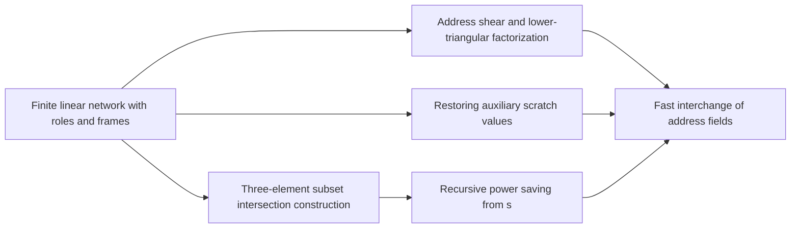

# Fast address interchange

The main construction needs to exchange two address fields on a tape at sub-linear cost per volume. This part builds that procedure from a linear network with roles, scratch restoration, and a shear factorization. It also shows that subset-intersection gathering yields a recursive power saving, which the later butterfly layers reuse.

## Pages

1. [Finite linear network with roles and frames](../linear-network-roles.md "Fixed linear network exchanging two banks of values with prescribed signs and restoring auxiliary values; wires have roles, rows are distributed cyclically among roles, and invertible frame operators cancel along routes leaving an endpoint operator.") — Fixed linear network exchanging two banks of values with prescribed signs and restoring auxiliary values; wires have roles, rows are distributed cyclically among roles, and invertible frame operators cancel along routes leaving an endpoint operator.
2. [Restoring auxiliary scratch values](../scratch-restoration.md "Subtract initial register value, compute, add result, reverse, so the permutation is exact for arbitrary initial auxiliary values.") — Subtract initial register value, compute, add result, reverse, so the permutation is exact for arbitrary initial auxiliary values.
3. [Address shear and lower-triangular factorization](../address-shear-factorization.md "Endpoint operator (H,D)->(H+D,D) over a residue ring, with rank reduction via a singular-matrix Bruhat factorization into lower-triangular factors.") — Endpoint operator (H,D)->(H+D,D) over a residue ring, with rank reduction via a singular-matrix Bruhat factorization into lower-triangular factors.
4. [Three-element subset intersection construction](../subset-intersection-construction.md "Gather/scatter with auxiliary wires cancelling unwanted coefficients, using indicator-vector orthogonality to assign subspaces; gives s<Wm smaller calls.") — Gather/scatter with auxiliary wires cancelling unwanted coefficients, using indicator-vector orthogonality to assign subspaces; gives s<Wm smaller calls.
5. [Recursive power saving from s<Wm](../recursive-power-saving.md "Recursive call at parameter mf uses s calls at parameter f on streams of volume V/W; since s/W<m the volume-normalized cost grows as a power, giving a fixed power saving.") — Recursive call at parameter mf uses s calls at parameter f on streams of volume V/W; since s/W<m the volume-normalized cost grows as a power, giving a fixed power saving.
6. [Fast interchange of address fields](../fast-address-interchange.md "Interchange two disjoint contiguous u-bit address fields in an array in O(V u^τ) for fixed τ<1, via XOR combinations that end as an exact permutation.") — Interchange two disjoint contiguous u-bit address fields in an array in O(V u^τ) for fixed τ<1, via XOR combinations that end as an exact permutation.

## Map

Arrows point from a page to the pages that build on it.

