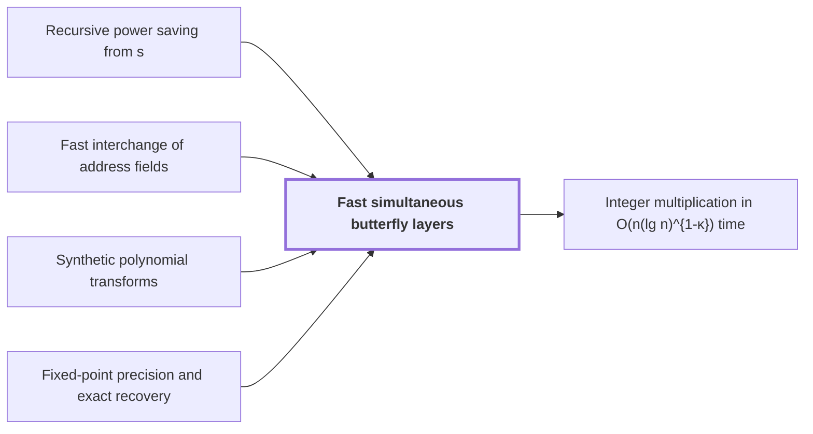

# Fast simultaneous butterfly layers

!!! info "Before this page"

    Fast simultaneous butterfly layers *gets its exponent from* [Recursive power saving from s<Wm](recursive-power-saving.md "The layer gets its exponent from Recursive power saving from s<Wm, which turns such a recursion into a power saving."), *moves whole chunks by* [Fast interchange of address fields](fast-address-interchange.md "The layer moves whole chunks by Fast interchange of address fields to realize its binary basis changes."), *performs the butterfly rounds of* [Synthetic polynomial transforms](synthetic-transforms.md "The layer performs the butterfly rounds of Synthetic polynomial transforms, which otherwise needs one whole-array pass per butterfly.") and *keeps error within the bound of* [Fixed-point precision and exact recovery](fixed-point-precision.md "This single truncation keeps error within the bound of Fixed-point precision and exact recovery, which needs error below $1/2$.").

!!! abstract "Where this fits"

    1. An $n$-bit integer product is computed by a fixed-tape machine in $O(n(\lg n)^{1-\kappa})$ time, $\kappa=2^{-182}$. — how: reduce multiplication to ring convolution and speed up its address moves and butterfly layers ([Integer multiplication in O(n(lg n)^{1-κ}) time](main-theorem.md "Deterministic fixed-tape Turing machine multiplying n-bit integers in O(n(lg n)^{1-κ}), κ=2^{-182}, by reducing to ring convolution with fast address interchanges and simultaneous butterfly layers, disproving the n log n conjecture in this model."))
    2. Two fixed-tape procedures, an address interchange and a simultaneous butterfly layer, cost $O(Vu^\tau)$ and $O(Vd^{\lambda'})$ for fixed exponents below 1, where $V$ is the stored bit volume. — how: build both procedures from one finite linear network and a recursion that saves a power
    3. **This page:** A simultaneous layer of $H_0(u,v)=((u+v)/2,(u-v)/2)$ on selected address bits of polynomial-valued arrays costs $O(Vd^{\lambda'})$ with $\lambda'<1$, with a single truncation at the end.

??? note "Symbols from earlier pages"

    - $I$ — identity operator: The identity operator, which leaves every array unchanged. (on [Finite linear network with roles and frames](linear-network-roles.md "Fixed linear network exchanging two banks of values with prescribed signs and restoring auxiliary values; wires have roles, rows are distributed cyclically among roles, and invertible frame operators cancel along routes leaving an endpoint operator."))
    - $\tau$ — cost exponent: The fixed exponent below 1 in the cost $O(Vu^\tau)$ of an address interchange of $u$-bit fields. (on [Fast interchange of address fields](fast-address-interchange.md "Interchange two disjoint contiguous u-bit address fields in an array in O(V u^τ) for fixed τ<1, via XOR combinations that end as an exact permutation."))
    - $\lambda$ — power exponent: The fixed exponent, below 1, of the power of the parameter that bounds the cost per bit. (on [Recursive power saving from s<Wm](recursive-power-saving.md "Recursive call at parameter mf uses s calls at parameter f on streams of volume V/W; since s/W<m the volume-normalized cost grows as a power, giving a fixed power saving."))

Fast simultaneous butterfly layers is a fixed-tape procedure that applies $H_0(u,v)=((u+v)/2,(u-v)/2)$ to one bit position in several address chunks at once. Here $u$ and $v$ are the paired records. The layer performs the butterfly rounds of [Synthetic polynomial transforms](synthetic-transforms.md "Nussbaumer-style transforms over the polynomial ring where root multiplications are signed shifts, leaving address rearrangements, shifts and butterflies."), which otherwise needs one whole-array pass per butterfly.

## The layer

Let $\Delta$ be the number of selected address chunks, and let $d$ be an upper bound on $\Delta$, so $\Delta\le d$. Here $d$ is the chunk bound, which means something else on the recursive-power-saving page. Each chunk consists of $\chi$ consecutive address bits, and the selected bit sits at one common offset in every chunk. Each record has complex fixed-point coefficients with $O(p)$ bits per component, where $p$ is the working precision. The layer costs $O(Vd^{\lambda'})$ for a fixed exponent $\lambda'<1$, where $V$ is the stored bit volume.

## Method

Here $i$ is the imaginary unit. Let $Y=\begin{pmatrix}0&1\\1&0\end{pmatrix}$ be the bit-flip matrix. Let $\Upsilon=\operatorname{diag}(1,i)$ be the phase matrix. Let $\Xi=\tfrac12\bigl((1+i)I+(1-i)Y\bigr)$ be the two-point kernel. Since $H_0=\tfrac{1-i}{2}\,\Upsilon\,\Xi\,\Upsilon$ and [tensor powers](glossary.md#tensor-product-of-vector-spaces "The space built from tuples of vectors whose dimension is the product of the factors' dimensions, so (Q^h)^{⊗3} has dimension h^3.") respect products,

$$H_0^{\otimes\Delta}=\left(\tfrac{1-i}{2}\right)^{\Delta}\Upsilon^{\otimes\Delta}\,\Xi^{\otimes\Delta}\,\Upsilon^{\otimes\Delta}.$$

Multiplying by $\Upsilon^{\otimes\Delta}$ only permutes and negates real and imaginary parts, so the work lies in $\Xi^{\otimes\Delta}$.

The layer computes $\Xi^{\otimes\Delta}$ recursively. Group $mf$ selected bits into $m$ slots of $f$ bits. The phase identities for $\Xi$ reduce this group to $\Psi$ child calls, each computing $\Xi^{\otimes f}$ on one slot, with $\Psi<Wm$. The data sits on $W$ roles (wires) of a [Finite linear network with roles and frames](linear-network-roles.md "Fixed linear network exchanging two banks of values with prescribed signs and restoring auxiliary values; wires have roles, rows are distributed cyclically among roles, and invertible frame operators cancel along routes leaving an endpoint operator."), and splitting the rows evenly gives each child $1/W$ of the volume. The layer moves whole chunks by [Fast interchange of address fields](fast-address-interchange.md "Interchange two disjoint contiguous u-bit address fields in an array in O(V u^τ) for fixed τ<1, via XOR combinations that end as an exact permutation.") to realize its binary basis changes. With $T(f)$ the normalized cost (time divided by volume), each child costs $(V/W)\,T(f)$, and the node's outside work is $O(V\chi^{\tau})$ for its chunk exchanges, with $\tau<1$, plus linear copying. Dividing by $V$,

$$T(mf)\le \tfrac{\Psi}{W}\,T(f)+O\bigl((mf\chi)^{\tau}+1\bigr).$$

The fixed exponent $\sigma=1-2^{-50}$ gives $\Psi/W<m^{\sigma}$, because $\Psi/W$ is $m$ times one minus a tiny fraction. Here $\sigma$ is this fixed exponent, which means something else on the recursive-power-saving page. For this network the source computes $\frac{Wm-\Psi}{Wm}=\frac{73}{19906842167500}$, which exceeds $20\cdot2^{-50}$<cite class="exegenius-ref" data-source="paper" data-locator="§3.6 Explicit rational bounds for the two recurrences" data-quote="Both exact deficits displayed above are greater than $20\cdot2^{-50}$" title="Both exact deficits displayed above are greater than $20\cdot2^{-50}$"> (see §3.6 Explicit rational bounds for the two recurrences)</cite>. Since $m<2^{20}$ gives $\log m<20$,

$$m^{1-2^{-50}}=m\exp(-2^{-50}\log m)>m(1-20\cdot2^{-50})>m\Bigl(1-\tfrac{73}{19906842167500}\Bigr)=\frac{\Psi}{W}.$$

The layer gets its exponent from [Recursive power saving from s<Wm](recursive-power-saving.md "Recursive call at parameter mf uses s calls at parameter f on streams of volume V/W; since s/W<m the volume-normalized cost grows as a power, giving a fixed power saving."), which turns such a recursion into a power saving. Unroll it over $\lceil\log_m d\rceil$ levels, stopping at groups of fewer than $\sqrt d$ bits, which apply their kernels one at a time. Internal overheads form a geometric series, summing to $O(d^{\lambda})$ with $\lambda<1$. A leaf after $j$ levels has $u=d/m^j<\sqrt d$ chunks, and its share is at most $(\Psi/W)^j u\le (d/u)^{\sigma}u=d^{\sigma}u^{1-\sigma}\le d^{\sigma+\frac12(1-\sigma)}$. The layer takes $\lambda'$ above $\sigma+\tfrac12(1-\sigma)$.

## Exactness

A Gaussian dyadic is a complex number whose real and imaginary parts have power-of-two denominators. Each entry of $\Xi$ is $\tfrac{1\pm i}{2}$, so each selected bit adds one binary digit to the denominators.<cite class="exegenius-ref" data-source="paper" data-locator="§1.1 The two tape operations" data-quote="Intermediate values are exact Gaussian dyadics" title="Intermediate values are exact Gaussian dyadics"> (see §1.1 The two tape operations)</cite>.

A unitary matrix preserves the Euclidean length of every pair of values, and here $\Xi=\sqrt2H_0\,\Upsilon\,\sqrt2H_0$ is a product of unitary matrices, so $\Xi^{\otimes\Delta}$ preserves the norm of each block of $2^\Delta$ entries. If the inputs have modulus at most 1, the block norm is at most $2^{\Delta/2}$, so intermediate moduli are at most $2^{\Delta/2}\le 2^{d/2}$. The final factor $\bigl(\tfrac{1-i}{2}\bigr)^{\Delta}$ has modulus $2^{-\Delta/2}$, so the outputs stay in the unit disk. These fit the $O(p)$ widths<cite class="exegenius-ref" data-source="paper" data-locator="§5.4 An explicit guard-width bound" data-quote="these widths are $O(p)$" title="these widths are $O(p)$"> (see §5.4 An explicit guard-width bound)</cite>.

The layer evaluates exactly and truncates once, toward zero to multiples of $2^{-p}$, with error below $\sqrt2\,2^{-p}$ in maximum norm. This single truncation keeps error within the bound of [Fixed-point precision and exact recovery](fixed-point-precision.md "Complex fixed-point coefficients; bounding error below 1/2 so rounding recovers exact integer coefficients and carry propagation yields the product."), which needs error below $1/2$.

## Connections

Used by:

- [Integer multiplication in O(n(lg n)^{1-κ}) time](main-theorem.md "It performs its butterfly layers by Fast simultaneous butterfly layers.") *performs its butterfly layers by* Fast simultaneous butterfly layers

??? quote "From the sources"

    > The second procedure applies
    >
    > — [Integer multiplication below n log n (OpenAI, 2026)](https://github.com/openai/math/tree/fd4aeeb2ee4fc729c18d98444fed42fd0529eeeb/preprints/Integer-multiplication-below-n-log-n-September-23-2026)
