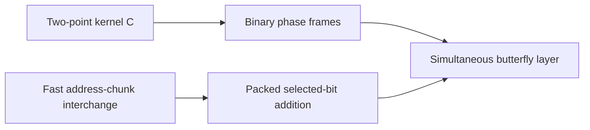

# Fast Tape Primitives

This part applies the recursion to the two tape procedures the algorithm needs. The [address-chunk interchange](../address-interchange.md "The first tape procedure: exchanging two disjoint equal-width address fields of u digits in time O(V·u^τ) for a fixed τ < 1, using XOR combinations of intermediate data.") and [packed selected-bit addition](../packed-bit-addition.md "XORing selected bits between two address chunks (with a third chunk as restored scratch) using cyclic shifts of whole chunk ranges plus a repair of explicitly bounded exceptional addresses.") move and combine address fields. The [two-point kernel](../phase-kernel.md "The matrix C = aI + bX with a = (1+i)/2, b = (1−i)/2, a square root of the bit flip, linked to the butterfly by H₀ = b·S·C·S with S = diag(1, i).") and [binary phase frames](../phase-frames.md "Frames C_U = H^{⊗m} diag(i^{wt(P_U x) mod 4}) H^{⊗m} whose edge differences are products of translation kernels aI + bX_v, one per vector of an orthonormal residual basis.") give the [simultaneous butterfly layer](../simultaneous-layer.md "The second tape procedure: applying H₀ coefficientwise on the same bit of up to d address chunks in time O(V·d^λ′) for a fixed λ′ < 1, instead of d passes.") that does several transform layers at once.

## Pages

1. [Two-point kernel C](../phase-kernel.md "The matrix C = aI + bX with a = (1+i)/2, b = (1−i)/2, a square root of the bit flip, linked to the butterfly by H₀ = b·S·C·S with S = diag(1, i).") — The matrix C = aI + bX with a = (1+i)/2, b = (1−i)/2, a square root of the bit flip, linked to the butterfly by H₀ = b·S·C·S with S = diag(1, i).
2. [Fast address-chunk interchange](../address-interchange.md "The first tape procedure: exchanging two disjoint equal-width address fields of u digits in time O(V·u^τ) for a fixed τ < 1, using XOR combinations of intermediate data.") — The first tape procedure: exchanging two disjoint equal-width address fields of u digits in time O(V·u^τ) for a fixed τ < 1, using XOR combinations of intermediate data.
3. [Binary phase frames](../phase-frames.md "Frames C_U = H^{⊗m} diag(i^{wt(P_U x) mod 4}) H^{⊗m} whose edge differences are products of translation kernels aI + bX_v, one per vector of an orthonormal residual basis.") — Frames C_U = H^{⊗m} diag(i^{wt(P_U x) mod 4}) H^{⊗m} whose edge differences are products of translation kernels aI + bX_v, one per vector of an orthonormal residual basis.
4. [Packed selected-bit addition](../packed-bit-addition.md "XORing selected bits between two address chunks (with a third chunk as restored scratch) using cyclic shifts of whole chunk ranges plus a repair of explicitly bounded exceptional addresses.") — XORing selected bits between two address chunks (with a third chunk as restored scratch) using cyclic shifts of whole chunk ranges plus a repair of explicitly bounded exceptional addresses.
5. [Simultaneous butterfly layer](../simultaneous-layer.md "The second tape procedure: applying H₀ coefficientwise on the same bit of up to d address chunks in time O(V·d^λ′) for a fixed λ′ < 1, instead of d passes.") — The second tape procedure: applying H₀ coefficientwise on the same bit of up to d address chunks in time O(V·d^λ′) for a fixed λ′ < 1, instead of d passes.

## Map

Arrows point from a page to the pages that build on it.

