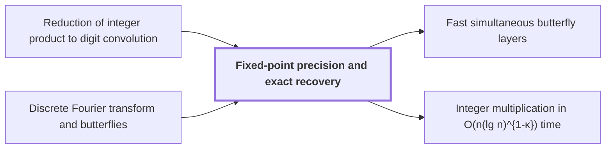

# Fixed-point precision and exact recovery

!!! info "Before this page"

    Fixed-point precision and exact recovery *recovers the integer coefficients produced by* [Reduction of integer product to digit convolution](radix-digit-reduction.md "It recovers the integer coefficients produced by the Reduction of integer product to digit convolution.") and *computes its transforms by* [Discrete Fourier transform and butterflies](dft-fft.md "It computes its transforms by the forward transform of length $S$ and its opposite, which run in finite precision."). Assumed known: Complex numbers.

!!! abstract "Where this fits"

    1. An $n$-bit integer product is computed by a fixed-tape machine in $O(n(\lg n)^{1-\kappa})$ time, $\kappa=2^{-182}$. — how: reduce multiplication to ring convolution and speed up its address moves and butterfly layers ([Integer multiplication in O(n(lg n)^{1-κ}) time](main-theorem.md "Deterministic fixed-tape Turing machine multiplying n-bit integers in O(n(lg n)^{1-κ}), κ=2^{-182}, by reducing to ring convolution with fast address interchanges and simultaneous butterfly layers, disproving the n log n conjecture in this model."))
    2. **This page:** Known rescalings and rounding recover the coefficients since the error is below $1/2$, and carry propagation gives the exact product.

??? note "Symbols from earlier pages"

    - $n$ — integer length: The number of bits in each of the two integers being multiplied. (on [The n log n optimality conjecture](nlogn-conjecture.md "Schönhage–Strassen's proposal that n log n is the optimal order of cost for multiplying n-bit integers."))
    - $x_j$ — digit of x: The jth radix digit of x, with value at least 0 and below 2^b. (on [Reduction of integer product to digit convolution](radix-digit-reduction.md "Splitting the inputs into radix digits turns the integer product into a convolution of short integer coefficients, followed by carry propagation."))
    - $y_j$ — digit of y: The jth radix digit of y, with value at least 0 and below 2^b. (on [Reduction of integer product to digit convolution](radix-digit-reduction.md "Splitting the inputs into radix digits turns the integer product into a convolution of short integer coefficients, followed by carry propagation."))
    - $x$ — first integer: One of the two integers being multiplied. (on [Reduction of integer product to digit convolution](radix-digit-reduction.md "Splitting the inputs into radix digits turns the integer product into a convolution of short integer coefficients, followed by carry propagation."))
    - $y$ — second integer: The other of the two integers being multiplied, an integer and not the indeterminate of the convolution page. (on [Reduction of integer product to digit convolution](radix-digit-reduction.md "Splitting the inputs into radix digits turns the integer product into a convolution of short integer coefficients, followed by carry propagation."))
    - $m$ — frequency index: The index of an entry of the transform, with $0\le m<n$; it means something else on the earlier address-fields page. (on [Discrete Fourier transform and butterflies](dft-fft.md "Evaluation of a coefficient list at roots of unity, computed in log-many levels of two-point butterfly operations; turns convolution into pointwise product."))
    - $k$ — input index: The index of an input entry $a_k$, ranging over $0$ to $n-1$; on the convolution page $k$ indexes the output list instead. (on [Bluestein's chirp identity](bluestein-chirp.md "Rewrites a discrete Fourier transform as a cyclic convolution via chirp phases."))
    - $i$ — index i: An index into the entries of the input list $a$. (on [Convolution](convolution.md "Product of polynomials / combination of coefficient lists where entries sum by index (cyclic if indices wrap)."))
    - $j$ — index j: An index into the entries of the input list $b$. (on [Convolution](convolution.md "Product of polynomials / combination of coefficient lists where entries sum by index (cyclic if indices wrap)."))

Fixed-point precision and exact recovery turns approximate transform output into exact integers, and then into the digits of the product. It recovers the integer coefficients produced by the [Reduction of integer product to digit convolution](radix-digit-reduction.md "Splitting the inputs into radix digits turns the integer product into a convolution of short integer coefficients, followed by carry propagation.").

Each complex coefficient is stored as a pair of integer numerators $X$ over $2^p$, where $p$ is the working precision in bits; a numerator $X$ represents $X/2^p$. Scalings by known integers and powers of two are exact on numerators, so the only inexact steps are transforms, pointwise products and truncations. The source sets $p=6b$<cite class="exegenius-ref" data-source="paper" data-locator="§9.2.1 The padded box and working precision" data-quote="p=6b" title="p=6b"> (see §9.2.1 The padded box and working precision)</cite>, where $b=\lceil\log_2 n\rceil$<cite class="exegenius-ref" data-source="paper" data-locator="§9.2.1 The padded box and working precision" data-quote="b=\lceil\log_2n\rceil" title="b=\lceil\log_2n\rceil"> (see §9.2.1 The padded box and working precision)</cite>, so $n\le 2^b$.

Let $T$ be the power of two in $[4n/b,8n/b)$, and $S$ the cyclic convolution length, with $T/2<S<T$. Since $T<8n/b<2^b$ for $b>8$, we have $S<2^b$. Let $L=\log_2 T$ (this letter changes meaning from the Gaussian resampling page), so $L<b$. The digit lists have degree below $T/2<S$, so cyclic convolution has no wraparound. It computes its transforms by the [forward transform of length $S$](dft-fft.md "Evaluation of a coefficient list at roots of unity, computed in log-many levels of two-point butterfly operations; turns convolution into pointwise product.") and its opposite, which run in finite precision.

Let $\xi_j=x_j/2^{b+2}$ and $\psi_j=y_j/2^{b+2}$; each entry lies in $[0,1/4)$. Let $\Phi$ be the forward transform of length $S$, with $(\Phi\xi)_m=\frac1S\sum_k\xi_k\omega^{mk}$, where $\omega$ is a primitive $S$-th root of unity, and let $\Phi^{+}$ be its opposite, with $\omega^{-mk}$ in its place. Two identities hold: $\Phi(\xi*\psi)=S\,\Phi\xi\cdot\Phi\psi$, since powers of $\omega$ multiply by adding exponents mod $S$; and $\Phi^{+}\Phi=I/S$, since $\sum_m\omega^{m(k-k')}$ is $S$ for $k=k'$ and $0$ otherwise. Hence
$$\Phi^{+}(\Phi\xi\cdot\Phi\psi)=\frac1S\,\Phi^{+}\Phi(\xi*\psi)=\frac{\xi*\psi}{S^2}.$$
The source's transforms also carry a coordinate permutation, which cancels from this product<cite class="exegenius-ref" data-source="paper" data-locator="§8.3 The middle transform and the final permutation" data-quote="retained source permutation $R$ cancels when computing a convolution" title="retained source permutation $R$ cancels when computing a convolution"> (see §8.3 The middle transform and the final permutation)</cite>, so the identity holds for the transforms written here.

Each computed transform, after the source scale $2^\gamma$, has error below $E_s2^{-p}$ with $E_s=9\cdot 2^\gamma TL$<cite class="exegenius-ref" data-source="paper" data-locator="§9.7.1 Scales and disk margins" data-quote="E_s=9\,2^\gamma TL" title="E_s=9\,2^\gamma TL"> (see §9.7.1 Scales and disk margins)</cite>; here $\gamma$ is the exponent of that scale (this letter changes meaning from the scratch-restoration page). Each factor of the pointwise product contributes $E_s2^{-p}$ and truncation adds $2\cdot2^{-p}$, and the opposite transform adds $E_s2^{-p}$ more, so the computed $\Phi^{+}$ result is within $(3E_s+2)2^{-p}$ of $(\xi*\psi)/S^2$. Multiplying by $S$ multiplies this error by $S$: it is below $S(3E_s+2)2^{-p}<28\cdot2^\gamma T^2L\cdot2^{-p}$, since $3E_s+2=27\cdot2^\gamma TL+2<28\cdot2^\gamma TL$. The second scaling by $2^{2b+4}S$ and $2^{-p}=2^{-6b}$ give a coefficient error below
$$2^{2b+4}S\cdot 28\cdot2^\gamma T^2L\cdot2^{-6b}<448\,b\,2^{-b+\gamma}\le 448\,b\,2^{-3b/4},$$
using $S<T<2^b$, $L<b$, and $\gamma\le b/4$ for large $b$<cite class="exegenius-ref" data-source="paper" data-locator="§9.2.1 The padded box and working precision" data-quote="For example $b\ge2^{24}$ implies $\gamma\le b/4$." title="For example $b\ge2^{24}$ implies $\gamma\le b/4$."> (see §9.2.1 The padded box and working precision)</cite>. For large $b$ this is below $\tfrac12$<cite class="exegenius-ref" data-source="paper" data-locator="§9.7.2 The final integer coefficients" data-quote="448b\,2^{-3b/4}&lt;\frac12" title="448b\,2^{-3b/4}&lt;\frac12"> (see §9.7.2 The final integer coefficients)</cite>. The coefficient $c_j=2^{2b+4}(\xi*\psi)_j$ is an integer, so rounding each computed value returns $c_j$ exactly.

Carry propagation then gives the digits. Let $h_0=0$ and, for $0\le j<S$,
$$d_j=(c_j+h_j)\bmod 2^b,\qquad h_{j+1}=\left\lfloor\frac{c_j+h_j}{2^b}\right\rfloor.$$
Since $c_j+h_j=d_j+2^bh_{j+1}$, induction gives $\sum_{i<j}c_i2^{bi}=\sum_{i<j}d_i2^{bi}+h_j2^{bj}$. With $j=S$, $xy=\sum_{i<S}c_i2^{bi}<2^{2n}\le 2^{bS}$, because $S>T/2\ge2n/b$. The digit sum also lies below $2^{bS}$, so $h_S=0$, and $d_0,\dots,d_{S-1}$ are the radix-$2^b$ digits of $xy$.

Example, radix $10$ for $2^b$ and $c=(12,15,3)$: $d_0=2$, $h_1=1$; $d_1=6$, $h_2=1$; $d_2=4$, $h_3=0$. The digits $4,6,2$ give $462=12+15\cdot10+3\cdot100$.

## Connections

Used by:

- [Fast simultaneous butterfly layers](fast-butterfly-layers.md "This single truncation keeps error within the bound of Fixed-point precision and exact recovery, which needs error below $1/2$.") *keeps error within the bound of* Fixed-point precision and exact recovery
- [Integer multiplication in O(n(lg n)^{1-κ}) time](main-theorem.md "The machine recovers its coefficients by Fixed-point precision and exact recovery.") *recovers its coefficients by* Fixed-point precision and exact recovery

??? quote "From the sources"

    > proves that the recovered
    >
    > — [Integer multiplication below n log n (OpenAI, 2026)](https://github.com/openai/math/tree/fd4aeeb2ee4fc729c18d98444fed42fd0529eeeb/preprints/Integer-multiplication-below-n-log-n-September-23-2026)
